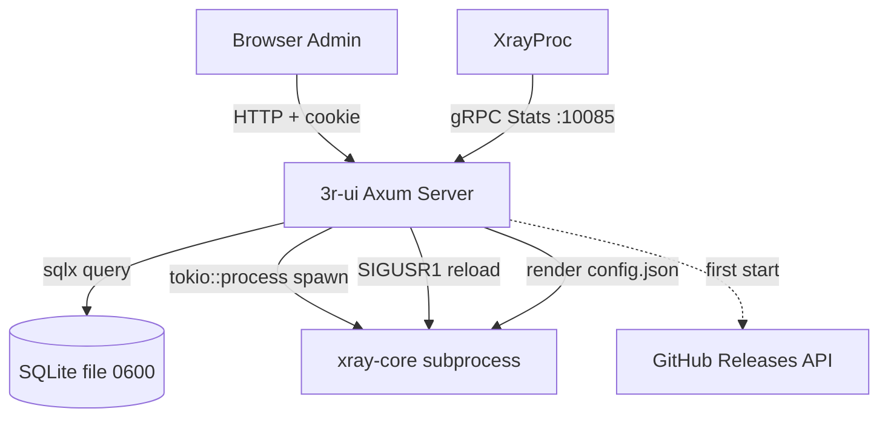
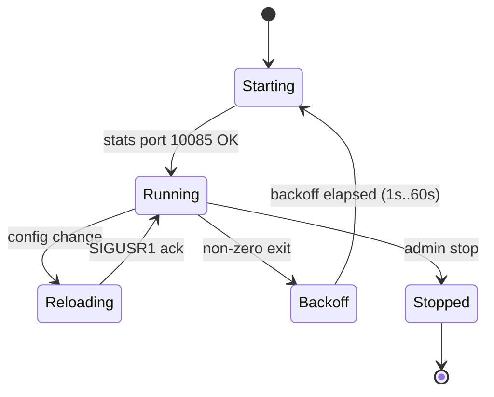
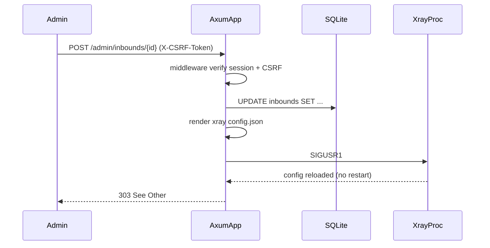

## Goal Capsule

- **Objective**: 为自用场景交付一个 Rust 实现的 xray-core Web 管理面板，专注单一 VLESS+REALITY+XHTTP 入站；面板单二进制运行，自动下载并管理 xray-core 子进程；管理员通过本地 Web 界面完成入站配置、用户管理与流量监控。
- **Means**: Rust 重写管理面板（Axum + Askama + htmx + SQLite）；xray-core 作为 sidecar 子进程，面板负责生命周期与配置热重载；面板自动从 GitHub release 获取 xray-core 二进制。
- **Product authority**: 本计划覆盖"自用 MVP"范围。3x-ui 既有的多协议、多节点、Telegram/PWA/REST API 等能力明确不在 MVP 范围内；未来若扩到小团队或服务商用场景，需另起 plan。
- **Open blockers**: 无。
- **Product Contract preserved**: unchanged (in-place enrichment from requirements-only unified plan; all 18 R-IDs, 5 F-IDs, 5 AE-IDs carried forward).

---

## Product Contract

### Summary

3R-UI 是一个用 Rust 编写的 xray-core Web 管理面板。目标是把 3x-ui 中"自用单节点"所必需的功能剥离出来，以单二进制形式交付：自动下载 xray-core、生成与热重载配置、按用户统计流量、提供分享链接与二维码。所有超出"自用单节点"的能力（多协议、多节点、订阅、机器人、PWA、多语言等）不在本 MVP 范围。

### Problem Frame

3x-ui 是 Go 实现的 Xray 管理面板，功能覆盖面广（10+ 协议入站、多节点管理、Telegram/Discord 机器人、订阅服务器、PWA 等）。对自用单一节点的用户而言：
- 大部分功能带来不必要的复杂度与攻击面；
- Go 二进制反编译相对容易，面板凭据等敏感信息保护较弱；
- 部署需要拉取整个 Go 生态依赖，对极简服务器不友好。

Rust 重写可以用更小体积、更强类型安全获得单文件部署体验；同时通过严格的范围限定（仅 VLESS+REALITY+XHTTP 一个入站）控制 MVP 复杂度。

### Actors

- A1. 面板管理员（自用，单管理员账户，bcrypt 密码）
- A2. xray-core 进程（sidecar，由面板管理）
- A3. 代理客户端（用户的手机 / 电脑，连接 xray 入站）

### Key Decisions

- **KD1.** 仅支持 VLESS+REALITY+XHTTP 一个入站模板；不抽象多协议入站。VLESS+REALITY+XHTTP 是当下反审查最优解，REALITY 无需自签证书，XHTTP 比 WebSocket 难识别。Governs R8, R9, R10, R11, R13.
- **KD2.** xray-core 作为 tokio 管理的子进程运行；面板负责启动、停止、崩溃检测与指数退避重启。3x-ui 采用相同 sidecar 模式，复用其可靠性。Governs R5.
- **KD3.** 面板首次启动自动从 GitHub release 下载 xray-core 到数据目录；后续启动复用已下载版本。减少用户安装步骤。Governs R4.
- **KD4.** 面板默认纯 HTTP 监听 127.0.0.1:2053；TLS 由用户自配的反向代理（Caddy / Nginx）终结。自用场景无需面板自带 HTTPS。Governs R3.
- **KD5.** 数据库使用 SQLite（sqlx）；单文件持久化用户配置、配额、过期时间。与 3x-ui 默认存储对齐。Governs R15.
- **KD6.** UI 使用 Axum + Askama + htmx + Alpine.js；服务端渲染为主，htmx 处理局部刷新，Alpine.js 处理轻交互。避免前后端分离的双产物部署。Governs R1, R2, R12, R13.
- **KD7.** 不实现订阅服务器、Telegram/Discord 机器人、REST API、PWA、多语言 / 深色主题、Fail2ban、多节点、跨协议入站、出站路由、WARP / 代理链、负载均衡。这些是 3x-ui 的核心但非自用 MVP 必需。

### Requirements

#### 面板核心

- R1. 面板提供登录页与单管理员账户；密码以 bcrypt 哈希存储。
- R2. 登录后仪表盘展示 xray 进程状态、当前入站摘要、用户数与流量汇总。
- R3. 面板以单二进制形式分发；启动后监听本地 HTTP（默认 127.0.0.1:2053，可通过环境变量或配置文件覆盖）。

#### xray 生命周期

- R4. 首次启动检测 xray-core 二进制是否存在；不存在则从 GitHub release 下载最新稳定版到数据目录。
- R5. 面板管理 xray 子进程（启动 / 停止 / 重启）；进程崩溃后以指数退避策略自动重启，记录最近一次崩溃原因到日志。
- R6. 面板生成 xray JSON 配置并通过 SIGUSR1 触发热重载，不中断现有连接。
- R7. 面板通过 xray Stats API（gRPC，端口 10085）拉取流量数据；定时刷新间隔默认 30 秒，可配置。

#### 入站配置

- R8. 面板支持创建 / 编辑 / 删除一个 VLESS+REALITY+XHTTP 入站；同一时刻只允许存在一个 active 入站。
- R9. 入站配置项包含监听端口、REALITY dest、SNI、shortId、X25519 密钥对；密钥对在创建时由面板自动生成并持久化，公钥在 UI 展示用于客户端配置。
- R10. 入站任意字段变更后立即生成新 xray 配置并触发热重载。

#### 用户管理

- R11. 面板支持在入站下添加 / 编辑 / 删除用户；每个用户有 UUID（自动生成）、流量配额（GB）、过期时间。
- R12. UI 展示每个用户的累计上行 / 下行流量（已用 / 配额）与过期倒计时；过期或超额用户高亮显示禁用状态。
- R13. 面板为每个用户生成 VLESS URI 分享链接与 PNG 二维码，链接包含入站地址、端口、UUID、公钥、SNI、shortId 等完整参数。
- R14. 用户被禁用或过期后，xray 热重载生效后立即拒绝其连接。

#### 流量与持久化

- R15. SQLite 存储入站配置、用户配置、配额、过期时间、REALITY 密钥对；通过 sqlx 访问。
- R16. 流量数据来源于 xray Stats API，按 user inbound uplink / downlink 累加；面板在内存中维护当前累计值，进程重启后从 xray 实时拉取恢复。
- R17. 流量达到配额后自动将该用户标记为 disabled，更新 xray clients 配置并触发热重载。

#### 安装

- R18. 提供 install.sh 一键安装脚本（Linux），完成下载二进制、创建数据目录、注册 systemd 服务（x86_64 / arm64）。

### Key Flows

- F1. 首次启动与 xray-core 获取
  - **Trigger**: 面板进程首次启动，数据目录中无 xray-core 二进制。
  - **Actors**: A1, A2
  - **Steps**: 面板启动时默认监听 `127.0.0.1:2053`（来自 R3）→ 检测 xray-core 不存在 → 从 `${XRAY_DOWNLOAD_BASE:-https://github.com}/XTLS/Xray-core/releases/latest` 下载匹配架构的稳定版 → 解压到数据目录 → 启动 xray 子进程（开启 stats 端口 127.0.0.1:10085）→ 等待 stats 端口可访问。
  - **Outcome**: 仪表盘显示 xray 运行中；stats API 可拉取数据。
  - **Covers**: R3, R4, R5.

- F2. 创建入站
  - **Trigger**: 管理员在入站页面点击"创建入站"。
  - **Actors**: A1, A2
  - **Steps**: 选定 VLESS+REALITY+XHTTP 模板 → 填写监听端口、REALITY dest、SNI、shortId → 生成 X25519 密钥对 → 写入 SQLite → 生成 xray config JSON → 触发 SIGUSR1 热重载。
  - **Outcome**: 新入站生效；外部客户端可按公钥 / SNI / shortId 配置连接。
  - **Covers**: R8, R9, R10.

- F3. 添加用户并分享
  - **Trigger**: 管理员在用户页面点击"添加用户"。
  - **Actors**: A1, A3
  - **Steps**: 生成 UUID → 输入流量配额与过期时间 → 写入 SQLite → 更新 xray clients 段 → 触发热重载 → UI 展示 VLESS URI 与 PNG 二维码 → 用户扫码连接。
  - **Outcome**: 用户连接成功，流量被 xray 统计并出现在仪表盘。
  - **Covers**: R11, R12, R13, R14.

- F4. 流量超额自动禁用
  - **Trigger**: 30 秒轮询周期触发 stats 拉取；某用户累计流量 ≥ 配额。
  - **Actors**: A1, A2
  - **Steps**: 轮询任务读取 stats → 比对每个用户当前用量与配额 → 标记超额用户 disabled → 更新 SQLite 与 xray clients → 触发热重载。
  - **Outcome**: 该用户下一次连接被 xray 拒绝；UI 显示已禁用。
  - **Covers**: R7, R16, R17.

- F5. xray 崩溃自动恢复
  - **Trigger**: xray 子进程异常退出。
  - **Actors**: A2
  - **Steps**: tokio 进程句柄检测到非零退出 → 记录退出码与最近 stderr 到日志 → 指数退避（1s / 2s / 4s / 8s 上限 60s）→ 重新启动 xray。
  - **Outcome**: xray 恢复运行；现有 SQLite 配置自动重载。
  - **Covers**: R5, R6, R15.

### Acceptance Examples

- AE1. **首次启动自动获取 xray-core**: 管理员在干净的 Ubuntu 22.04 x86_64 服务器运行 `3r-ui` → 面板启动时默认绑定 `127.0.0.1:2053` 并监听（curl `http://127.0.0.1:2053/` 可访问登录页）→ 检测 `/var/lib/3r-ui/xray` 不存在 → 从 GitHub release 下载 `Xray-linux-64.zip` → 解压到数据目录 → 启动 xray 子进程 → 仪表盘显示"xray: running, version 1.8.x"。Covers R3, R4, R5.
- AE2. **创建入站生成 REALITY 密钥**: 管理员创建入站监听 443，dest=www.microsoft.com，SNI=www.microsoft.com，shortId=abcd → 面板生成 X25519 密钥对 → SQLite 存入私钥 → UI 展示公钥（48 字节 Base64）→ 渲染 xray config.json（chmod 0600）→ SIGUSR1 热重载后 → 已存在的客户端连接不中断（inbound 端口不变时），新建连接立即接受 REALITY 握手并验证公钥成功 → 客户端用公钥成功握手。Covers R8, R9, R10.
- AE3. **用户配额触发自动禁用**: 用户 abc 配额 100 GB；30 秒轮询通过 xray QueryStats RPC（pattern=`user>>>`）检测到该 email=`abc-uuid` 的用户累计 102 GB → 用户状态在 SQLite 中变为 disabled → 面板重新渲染 config.json 移除该 client → 触发 SIGUSR1 热重载 → 客户端重连失败 → UI 高亮显示 disabled 标签。Covers R16, R17.
- AE4. **二维码分享可用**: 管理员在用户详情页点击"复制链接"获得 `vless://uuid@host:port?...#name`；点击"下载二维码"获得 PNG；手机扫码后直接导入到客户端。Covers R13.
- AE5. **xray 崩溃自恢复**: `kill -9` xray 子进程 → 面板 2 秒内检测到退出 → 记录 stderr 到 `/var/log/3r-ui/xray.log` → 指数退避 1 秒后重启 → 现有入站配置自动从 SQLite 重新生成并通过 SIGUSR1 触发 xray 热重载 → 客户端恢复可用。Covers R5, R6, R15.

### Scope Boundaries

#### Outside this product's identity (永久排除)

- 多协议入站（VMess / Trojan / Shadowsocks / WireGuard / Hysteria2 / TUIC / MTProto 等）
- 单端口多协议 fallback（443 同时承载 VLESS+Trojan）
- 多节点管理与跨节点入站克隆
- Telegram / Discord 机器人
- 内置订阅服务器（raw / Clash / JSON 输出）
- REST API（仅自用 Web GUI）
- PWA、深色主题、13 种 UI 语言
- Fail2ban 集成
- 出站路由规则、WARP / NordVPN / PIA 集成
- 出站代理链、负载均衡
- 客户端 HWID 限制、IP 数限制（含可信地址豁免）
- MTProto ad-tags、FakeTLS

#### Deferred for later (未来可能)

- xray 进程异常退出时的邮件 / Telegram 通知
- SQLite 数据库自动备份与恢复
- 面板自身升级（检测 GitHub release、下载替换、热重启）
- macOS / Windows 安装包
- 入站 / 出站流量历史图表（自用列表展示已够用）

### Dependencies / Assumptions

#### Dependencies

- xray-core ≥ 1.8.x（XHTTP 传输层支持）
- Rust ≥ 1.75（edition 2021 + tokio 1.x）
- SQLite ≥ 3.x（sqlx 后端）
- Linux x86_64 / arm64（systemd 部署）

#### Assumptions

- 目标部署平台是单一 Linux 服务器；面板与 xray-core 部署在同一节点（不分离面板与节点）
- 管理员具备基础 Linux 服务器运维能力（systemd、反向代理、端口开放）
- 服务器能访问 GitHub release 或配置的镜像（`XRAY_DOWNLOAD_BASE`）下载 xray-core 二进制
- HTTPS 由管理员自配的反向代理终结，面板只处理本地 HTTP
- 单管理员账户足够；不实现 RBAC

### Sources / Research

- 3x-ui GitHub 仓库调研：https://github.com/MHSanaei/3x-ui — 协议与功能全景、xray sidecar 架构、SQLite 默认存储、单二进制 + systemd 部署形态
- xray-core 文档（VLESS+REALITY+XHTTP 配置模板）：https://xtls.github.io — 入站 JSON 配置字段、REALITY 密钥生成、Stats API 端口约定（10085）、VLESS client `email` 字段作为 stat name 中间标识符
- xray-core `app/stats/command/command.proto`（vendored）：`https://github.com/XTLS/Xray-core/blob/main/app/stats/command/command.proto` — 确认 RPC 名称为 `GetStats`（单 name 查询）和 `QueryStats`（pattern 模糊匹配，返回 repeated Stat）
- xray-core 配置 API：https://xtls.github.io/config/api.html — HandlerService / RoutingService / LoggerService / StatsService 的 gRPC 服务定义；用于 SIGUSR1 不可用时的配置热重载 fallback

---

## Planning Contract

### Key Technical Decisions

- KTD1. **单 Cargo crate（bin + lib）结构**. 整个面板编译为一个二进制；`lib.rs` 暴露可测试模块，`main.rs` 仅做启动装配。不引入 workspace 多 crate，避免自用 MVP 不必要的构建/部署复杂度。Governs U1, U2.
- KTD2. **Tokio + Axum 0.7 作为 HTTP 框架**（session-settled: user-directed — chosen over actix-web: 与 tokio runtime 与 sqlx 异步栈一致，避免双 runtime 混用）. Governs U1, U4.
- KTD3. **Askama 模板 + htmx 局部刷新 + Alpine.js 轻交互**. 服务端渲染为主，htmx 提供无构建工具链的局部刷新能力；Alpine.js 仅用于登录页等需要的轻客户端状态。Governs U4, U5, U6, U8.
- KTD4. **sqlx 0.7 + SQLite，编译期 SQL 验证**. `sqlx::query!` 宏在编译期对照 `DATABASE_URL` 校验 SQL，提供类型安全的访问。`sqlx migrate` 在启动时自动执行 pending migrations。Governs U1, U5, U6, U7.
- KTD5. **xray 子进程由 tokio::process 直管**（session-settled: user-directed — chosen over systemd 拆分 / 外部 supervisor）. `XraySupervisor` 持有 `Child` 句柄；崩溃检测通过 `Child::wait()` 返回的非零退出码触发；指数退避 1s / 2s / 4s / 8s / 16s / 32s / 60s 上限，重置语义：xray 成功运行 ≥ 300 秒后下次崩溃从 1s 重新开始（见 U3 实现细节）。Governs U3, U5, U6, U7.
- KTD6. **xray 配置生成：模板 + SQLite 查询 → JSON，写入 `${data_dir}/xray/config.json`**. 单一事实源在 SQLite；xray JSON 在配置变更时由模板渲染重新生成；写入后 `std::fs::set_permissions(0o600)` 设置仅 owner 可读写（REALITY 私钥含于其中）；通过 SIGUSR1 触发 xray 热重载。Governs U3, U5, U6.
- KTD7. **REALITY 密钥由 `x25519-dalek` 在创建入站时内存生成**. 私钥存 SQLite `inbounds.private_key`，公钥在 UI 展示。不依赖 OpenSSL 或外部密钥生成工具。Governs U5.
- KTD8. **stats 拉取：`tonic` (gRPC) `QueryStats` 客户端 + 30 秒轮询**. xray-core 的 `app/stats/command/command.proto` 在 build.rs 通过 `tonic-build` 生成 Rust 客户端；轮询用 `QueryStatsRequest { pattern: "user>>>", reset: false }` 一次取回所有 user 统计。VLESS client 的 `email` 字段（即 UUID）作为 stat name 中间段，与轮询读取的 `name = "user>>><email>>>traffic>>>uplink"` 对齐。轮询任务比对上次快照差值累加到 `traffic_snapshots`。Governs U7.
- KTD9. **认证：`bcrypt`（cost 12） + `axum-extra::cookie` session + tower 中间件 CSRF**. 登录后写 `HttpOnly; SameSite=Strict` cookie；非 GET 请求需带 `X-CSRF-Token` header，其值等于 session cookie 中的 token。Governs U4.
- KTD10. **二维码：`qrcode` crate 生成 + `image` crate 编码 PNG**. 端点 `GET /admin/clients/{id}/qr.png` 直接流式返回 `image/png`。不持久化。Governs U8.
- KTD11. **xray-core 自动下载：`reqwest`（rustls）+ `zip` 解压**. 首次启动从 `XRAY_DOWNLOAD_BASE`（默认 `https://github.com`，可覆盖为 `https://gh-proxy.com/https://github.com` 等镜像）下的 `/XTLS/Xray-core/releases/latest` 获取最新 stable tag，下载 `Xray-linux-{arch}.zip`（或 macOS/Windows 等价），解压到 `${data_dir}/xray-{version}/`，创建 symlink `${data_dir}/xray`。Governs U2.
- KTD12. **systemd 集成仅在 install.sh 中**. 面板本身不调用 `systemctl`；`install.sh` 生成 `/etc/systemd/system/3r-ui.service` 与 `/etc/3r-ui/3r-ui.env` 模板。面板崩溃时由 systemd 负责重启（`Restart=on-failure`）。Governs U9.
- KTD13. **数据迁移：sqlx migrate 启动时自动 apply**. `migrations/` 目录在 crate 根；启动时 `sqlx::migrate!()` 宏运行 pending migrations。新增表/列通过新建 `migrations/00NN_*.sql` 引入，不修改历史迁移。Governs U1.
- KTD14. **错误处理：库代码用 `thiserror`，应用代码用 `anyhow`**. 库模块导出强类型错误；handler 用 `?` + `anyhow::Result` 统一记录到 tracing 后转 HTTP 状态码。Governs all units.

### High-Level Technical Design

#### 组件拓扑



#### xray 生命周期状态机



#### 配置热重载时序



#### 目录结构（单 crate bin + lib）

```
3r-ui/
├── Cargo.toml
├── Cargo.lock
├── build.rs                  # tonic-build for xray proto
├── migrations/
│   └── 0001_initial.sql
├── install.sh
├── packaging/
│   ├── 3r-ui.service         # systemd unit template
│   └── 3r-ui.env             # env file template
├── protos/
│   └── xray.proto            # vendored from XTLS/Xray-core
├── src/
│   ├── main.rs               # entrypoint: parse config, init tracing, run app
│   ├── lib.rs                # public modules
│   ├── config.rs             # AppConfig, DataDir, env parsing
│   ├── error.rs              # thiserror types
│   ├── db/
│   │   ├── mod.rs
│   │   └── models.rs         # Admin, Inbound, Client, TrafficSnapshot
│   ├── xray/
│   │   ├── mod.rs
│   │   ├── installer.rs      # GitHub release download + unzip (U2)
│   │   ├── process.rs        # XraySupervisor (U3)
│   │   ├── config.rs         # xray JSON 模板 (U5)
│   │   └── stats.rs          # tonic client + 轮询 (U7)
│   ├── quota.rs              # 配额检查 (U7)
│   ├── crypto/
│   │   ├── mod.rs
│   │   ├── password.rs       # bcrypt hash + verify (U4)
│   │   └── reality.rs        # x25519 密钥生成 (U5)
│   ├── share/
│   │   ├── mod.rs
│   │   ├── vless.rs          # VLESS URI 构造 (U8)
│   │   └── qr.rs             # PNG 编码 (U8)
│   ├── web/
│   │   ├── mod.rs            # router + AppState
│   │   ├── auth.rs           # login / logout handlers
│   │   ├── middleware.rs     # session + CSRF
│   │   ├── dashboard.rs      # /
│   │   ├── inbounds.rs       # CRUD handlers
│   │   ├── clients.rs        # CRUD handlers
│   │   └── htmx.rs           # htmx helpers
│   └── templates/
│       ├── base.html         # 含 CSRF meta
│       ├── login.html
│       ├── dashboard.html
│       ├── inbounds/
│       │   ├── list.html
│       │   └── form.html
│       └── clients/
│           ├── list.html
│           └── form.html
├── tests/
│   ├── common/
│   │   └── mod.rs            # 测试 helper: 启动 app、登录 helper
│   ├── xray_lifecycle.rs     # 集成测试
│   ├── config_render.rs      # 集成测试
│   └── e2e.rs                # 端到端 smoke
└── docs/plans/
    └── 2026-09-30-1336-feat-3r-ui-plan.md
```

### Sequencing

依赖图（`U1 → U2 → U3 → {U4, U5} → {U6, U7} → U8 → U9 → U10`）：

1. **U1** 项目脚手架与数据库 schema — 唯一无依赖项；先建立编译与 migrate 通路。
2. **U2** xray-core 自动下载 — 必须在 U3 之前解决二进制可用性。
3. **U3** xray 子进程生命周期 — 核心运行时组件，后续单元的运行时前置。
4. **U4** 认证中间件 + **U5** 入站 CRUD 并行 — 两者解耦，可分头实现。
5. **U6** 用户 CRUD — 依赖 U5 的入站上下文。
6. **U7** stats 拉取与配额强制 — 依赖 U6（流量按 client 归属）和 U3（gRPC 客户端）。
7. **U8** 分享链接与二维码 — 依赖 U6 的 client 数据。
8. **U9** install.sh + systemd — 仅在 U1-U8 全部就绪后作为发布步骤实施。
9. **U10** 端到端 smoke — 最后一步，跨所有单元验证 AE1-AE5。

### Assumptions (Inferred, recording explicitly)

- 面板首次启动时若检测到 `${data_dir}` 为空且无管理员账户，则随机生成 16 字节密码、bcrypt 哈希入 SQLite、原文写入 `${data_dir}/initial_password` 并 `chmod 0600`；管理员通过 `cat` 该文件获取初始密码后必须修改。
- 单一活跃入站约束通过 SQLite UNIQUE 约束在 `inbounds.status='active'` 上部分索引实现（数据库层防并发）；handler 层在创建前额外检查。
- 默认监听 `127.0.0.1:2053`；可通过环境变量 `BIND_ADDR` 覆盖。若 `BIND_ADDR` 解析后的地址不在 `127.0.0.0/8` 或 `::1/128` 范围（即绑定到公网接口），启动时打印 stderr 警告并继续（不阻断，因为自用场景可能有反向代理或 VPN 入口场景）。
- 默认轮询间隔 30 秒；可通过环境变量 `STATS_INTERVAL_SECS` 覆盖。
- 面板版本号从 `Cargo.toml` `version` 字段读取，运行时通过 `env!` 编译期常量获得。

---

## Implementation Units

### U1. 项目脚手架、依赖与数据库 migrations

- **Goal**: 建立可编译可测试的 Cargo 项目骨架；定义 SQLite schema 与初始迁移；接通 sqlx migrate 自动运行通路。
- **Requirements**: R3 (单二进制 + HTTP 监听配置), R15 (SQLite 持久化).
- **Dependencies**: 无。
- **Files**:
  - `Cargo.toml`
  - `build.rs`
  - `src/main.rs`
  - `src/lib.rs`
  - `src/config.rs`
  - `src/error.rs`
  - `src/db/mod.rs`
  - `src/db/models.rs`
  - `migrations/0001_initial.sql`
  - `.gitignore`
- **Approach**:
  - `Cargo.toml`：`[package] name = "3r-ui", version = "0.1.0", edition = "2021", rust-version = "1.75"`。依赖见 KTD1-KTD14 对应 crate。`[features]` 仅 `default = []`，无任何 feature gate。
  - `[lib]` 与 `[[bin]]` 都指向 crate 根；`main.rs` 调用 `three_r_ui::run()`。
  - `src/config.rs`：解析环境变量 `BIND_ADDR`（默认 `127.0.0.1:2053`）、`DATA_DIR`（默认 `./data`）、`STATS_INTERVAL_SECS`（默认 `30`）；构造 `AppConfig`。
  - `migrations/0001_initial.sql`：
    - `admins(id INTEGER PK, username TEXT UNIQUE NOT NULL, password_hash TEXT NOT NULL, created_at INTEGER NOT NULL)`。
    - `inbounds(id INTEGER PK, listen_port INTEGER UNIQUE NOT NULL, dest TEXT NOT NULL, sni TEXT NOT NULL, server_name TEXT, private_key TEXT NOT NULL, public_key TEXT NOT NULL, short_id TEXT NOT NULL, status TEXT NOT NULL DEFAULT 'active', created_at INTEGER, updated_at INTEGER)`。
    - `clients(id INTEGER PK, inbound_id INTEGER REFERENCES inbounds(id), uuid TEXT UNIQUE NOT NULL, name TEXT, quota_bytes INTEGER NOT NULL, expiry_at INTEGER, status TEXT NOT NULL DEFAULT 'active', created_at INTEGER)`。
    - `traffic_snapshots(client_id INTEGER REFERENCES clients(id), uplink INTEGER NOT NULL DEFAULT 0, downlink INTEGER NOT NULL DEFAULT 0, recorded_at INTEGER NOT NULL)`。
    - `sessions(session_id TEXT PK, admin_id INTEGER NOT NULL REFERENCES admins(id), expires_at INTEGER NOT NULL, created_at INTEGER NOT NULL)`。
    - 部分索引：`CREATE UNIQUE INDEX one_active_inbound ON inbounds(status) WHERE status = 'active'`；`CREATE INDEX sessions_expires_idx ON sessions(expires_at)` 用于过期清理。
  - `build.rs`：`tonic_build::configure().compile_protos(&["protos/xray.proto"], &["protos/"])`。
  - 启动时 `sqlx::migrate!("./migrations").run(&pool).await`。
- **Test scenarios**:
  - Happy: 空数据目录 → 启动 → `migrations` 表创建 → 四张业务表存在 → 索引创建。
  - Happy: 二次启动 → migrate 视为 no-op，无报错。
  - Error: 同一文件被多进程打开 → sqlx 返回 busy 错误并被 `?` 传播。
- **Verification**: `cargo build --release` 通过；`cargo test` 通过；启动二进制在临时目录创建 SQLite 并迁移成功。

### U2. xray-core 自动下载

- **Goal**: 首次启动检测 xray-core 二进制缺失时，从 GitHub release 下载并解压到数据目录。
- **Requirements**: R4 (面板首次启动自动检测并下载 xray-core).
- **Dependencies**: U1.
- **Files**:
  - `src/xray/mod.rs`
  - `src/xray/installer.rs`
- **Approach**:
  - `pub fn ensure_xray(data_dir: &Path, download_base: &str) -> Result<PathBuf>`：
    - 检查 `${data_dir}/xray/xray`（或 `xray.exe`）是否可执行；是则直接返回。
    - 调用 `{download_base}/XTLS/Xray-core/releases/latest` 获取 JSON，从中取 `tag_name` 与 `assets[].browser_download_url`（若 `download_base` 是镜像，URL 由镜像返回结构决定）。
    - 通过 `std::env::consts::ARCH` 与 `OS` 选择资产：`Xray-linux-64.zip` / `Xray-darwin-arm64.zip` 等；映射表在 `installer.rs` 顶部。
    - 下载到 `${data_dir}/downloads/xray.zip`（reqwest + rustls + 进度日志）。
    - 解压到 `${data_dir}/xray-${version}/`；将可执行文件移动或符号链接到 `${data_dir}/xray/`。
    - `chmod 0755` 解压后的可执行文件。
    - 失败时清理 `downloads/` 与解压目录，错误上抛。
  - 启动时在 `main.rs` 中首先调用 `ensure_xray(&data_dir, env::var("XRAY_DOWNLOAD_BASE").unwrap_or_else(|_| "https://github.com".to_string()).as_str())?`。
- **Test scenarios**:
  - Happy: 数据目录无 xray → 模拟 GitHub API 返回 → 下载 → 解压 → `xray` 可执行。
  - Edge: 已存在 xray 且版本匹配 → 跳过下载（0 HTTP 请求）。
  - Edge: 网络失败 → 错误携带"无法下载 xray-core，请检查服务器到 github.com 的连通性"。
  - Error: GitHub rate-limited → 错误可读，提示用户稍后重试或手动放置。
- **Verification**: 集成测试使用 `wiremock` mock GitHub API；手动在干净 Ubuntu 22.04 x86_64 服务器验证自动下载 v1.8.x。

### U3. xray 子进程生命周期管理

- **Goal**: 面板启动、停止、重启 xray 子进程；崩溃指数退避自动恢复；配置变更触发热重载。
- **Requirements**: R5 (启动 / 停止 / 重启 / 崩溃自恢复), R6 (生成 xray 配置并热重载).
- **Dependencies**: U2.
- **Files**:
  - `src/xray/process.rs`
  - `src/xray/config.rs` (placeholder，U5 充实)
- **Approach**:
  - `pub struct XraySupervisor { child: Option<Child>, backoff_idx: usize, stable_since: Option<Instant>, config_path: PathBuf, log_path: PathBuf, shutdown: tokio::sync::Notify }`。
  - **启动时 orphan 回收**：在 spawn 之前检查同 PID 文件（`${data_dir}/xray.pid`，由本进程写入）是否存在；若存在且其对应进程仍运行，向其发 SIGTERM 等待 5 秒后 SIGKILL；删除 PID 文件。该步骤防止面板 `kill -9` 后 xray 残留占用端口与 stats 端口。
  - `start(&mut self, args: &[String])`：用 `tokio::process::Command::new(&xray_path).args(["run", "-c", &self.config_path.display().to_string()]).stdout(Stdio::piped()).stderr(Stdio::piped()).kill_on_drop(true).spawn()`；写入 PID 文件；派生任务读取 stderr 写入 `log_path` 与 `tracing`。
  - `wait_loop(&mut self)`: 主循环 `child.wait().await`；非零退出码 → `backoff_idx = (backoff_idx + 1).min(BACKOFF.len() - 1)`；记录 `crashed_at = Instant::now()`；`tokio::time::sleep(BACKOFF[backoff_idx]).await` → 重启。成功退出（admin stop）→ 退出循环。
  - **Backoff 重置**：每次 `Running` 状态开始时记录 `stable_since = Some(Instant::now())`；每次崩溃前若 `stable_since.unwrap().elapsed() >= Duration::from_secs(300)`，重置 `backoff_idx = 0`。300 秒无崩溃后下次从 1s 开始。
  - `BACKOFF: [Duration::from_secs(1), 2, 4, 8, 16, 32, 60]`（秒）。
  - `reload(&self)`: 通过 `nix::sys::signal::kill(Pid::from_raw(pid as i32), Signal::SIGUSR1)` 发送 SIGUSR1；xray 社区广泛使用该信号触发配置重载（xray-core 官方文档未公开承诺此行为；详见 KTD6 与 xray upstream issue 跟踪）。如果 1 秒内无 stats 端口响应保持活跃，则记录警告并 fallback 至 xray 的 gRPC ConfigService API（Windows 路径与此相同，Unix 路径作 fallback）。Windows 默认走 gRPC API 路径。
  - `stop(&mut self)`: SIGTERM，等待 5s，未退出则 SIGKILL；删除 PID 文件。
  - 主任务 spawn `XraySupervisor` 到 `tokio::spawn`；通过 `mpsc` channel 接收控制命令（start / reload / stop）。
- **Test scenarios**:
  - Covers AE1.
  - Happy: 启动空配置 → xray 子进程运行 → `kill -0` 检测存在。
  - Edge: `kill -9` xray PID → supervisor 1s 后重启成功。
  - Edge: 连续崩溃 3 次 → 退避到 4s。
  - Edge: SIGUSR1 发送后 xray 重新读取配置（通过前后 stats counter 不归零判断）。
- **Verification**: 集成测试使用真实 xray 二进制（CI 容器中下载）。

### U4. 认证与中间件

- **Goal**: 单管理员登录、cookie session、CSRF 防护；首次启动生成初始密码。
- **Requirements**: R1 (登录页与单管理员账户).
- **Dependencies**: U1.
- **Files**:
  - `src/web/mod.rs`
  - `src/web/auth.rs`
  - `src/web/middleware.rs`
  - `src/web/handlers/login.rs`
  - `src/web/handlers/logout.rs`
  - `src/crypto/password.rs`
  - `src/templates/login.html`
  - `src/templates/base.html`
- **Approach**:
  - `crypto::password::hash(pw) -> String`：bcrypt cost = 12。
  - `crypto::password::verify(pw, hash) -> bool`：bcrypt verify。
  - `sessions` 表：`session_id TEXT PK, admin_id INTEGER, expires_at INTEGER`。
  - 登录流程：POST `/login` → `verify(password, hash)` → 生成 32 字节 `session_id`（base64url）→ 写 `sessions` 表 → 设置 cookie `Set-Cookie: session=<id>; HttpOnly; SameSite=Strict; Path=/`。
  - Middleware 链：`request → trace → session_lookup → csrf_guard (仅非 GET)`。
  - `session_lookup`：读取 cookie，查询 `sessions` 表，未过期则注入 `Extension<Admin>`。
  - `csrf_guard`：从 cookie 读取 token，校验请求头 `X-CSRF-Token`（仅对 `/admin/*` 下非 GET 方法）。
  - 首次启动：若 `admins` 表为空 → 生成密码、哈希入库、原文写入 `${data_dir}/initial_password`（chmod 0600），打印到 stderr。
  - **session 过期清理任务**：`tokio::spawn` 一个 `tokio::time::interval(Duration::from_secs(3600))` 周期任务，每小时执行 `DELETE FROM sessions WHERE expires_at < unixepoch()`，避免 sessions 表累积。
  - **单实例锁**：启动时通过 `fs2` 或 `nix` 在 `${data_dir}/3r-ui.lock` 上获取 `flock` 排他锁；若失败，立即报错退出（防止多实例并发写 SQLite）。
- **Test scenarios**:
  - Happy: 正确密码 → 302 → cookie 写入 → 访问 `/admin` 仪表盘。
  - Edge: 错误密码 → 401 + 错误信息。
  - Edge: 缺 session cookie → 重定向 `/login`。
  - Edge: POST 无 CSRF token → 403。
  - Edge: 首次启动 → 生成密码并写入 `initial_password`。
- **Verification**: 集成测试用 `axum-test` 或 `tower::ServiceExt::oneshot` 验证完整登录/CSRF 链。

### U5. 入站 CRUD + xray 配置生成

- **Goal**: 仪表盘；入站的创建 / 编辑 / 删除；自动生成 X25519 密钥对；写入 xray config.json 并触发热重载。
- **Requirements**: R2 (仪表盘), R8 (单一 VLESS+REALITY+XHTTP 入站), R9 (入站字段 + 密钥生成), R10 (变更触发热重载).
- **Dependencies**: U3, U4.
- **Files**:
  - `src/web/handlers/dashboard.rs`
  - `src/web/handlers/inbounds.rs`
  - `src/templates/dashboard.html`
  - `src/templates/inbounds/list.html`
  - `src/templates/inbounds/form.html`
  - `src/xray/config.rs` (充实)
  - `src/xray/process.rs` (来自 U3，handler 通过 supervisor channel 触发 Reload)
  - `src/crypto/reality.rs`
- **Approach**:
  - `crypto::reality::generate_keypair() -> (PrivateKey, PublicKey)`：用 `x25519-dalek::{StaticSecret, PublicKey}` + `rand::rngs::OsRng`。
  - `xray::config::render(pool: &SqlitePool, config_path: &Path) -> Result<()>`：
    - 从 SQLite 查询当前所有 `status='active'` 的入站及其下 `status='active'` 的 clients。
    - 渲染 xray JSON 模板并写入 `${data_dir}/xray/config.json`，写入后 `std::fs::set_permissions(path, std::fs::Permissions::from_mode(0o600))`。
    - 模板包含：`log`（loglevel warning）、`stats`（空对象，gRPC 仅监听 127.0.0.1:10085，由 xray 的 inbound `listen` 字段控制）、`inbounds`、`outbounds`（freedom + blackhole）、`routing`（默认全走 freedom）。
    - **VLESS client 对象必须包含 `email` 字段**：每个 client 的 `email` 字段值等于其 `uuid`（VLESS 配置文档：email 是 stat name 中间标识符；缺 email 则该用户不开统计）。生成的 client 段格式：`{"id": "<uuid>", "email": "<uuid>", "level": 0, "flow": "xtls-rprx-vision"}`（XHTTP 传输不需要 flow，可省略）。
  - `inbounds.rs`：CRUD handlers；`POST /admin/inbounds` 校验端口范围 1-65535、dest 与 SNI 非空、调用 `generate_keypair()`、写入 SQLite、调用 `render()`、通过 supervisor channel 发送 `Reload`。
  - 单一入站约束：创建前 `SELECT COUNT(*) FROM inbounds WHERE status='active'`；若 > 0 → 渲染 409 + 友好提示。
  - 编辑：可改 `listen_port` / `dest` / `sni` / `short_id`；改后必须再次 `render()` + `Reload`。
  - 删除：`UPDATE inbounds SET status='deleted'`（软删除，便于审计）；`render()` 不包含已删除入站。
- **Test scenarios**:
  - Covers AE1, AE2.
  - Happy: 创建入站 → DB 行写入 → config.json 生成 → SIGUSR1 → xray 接受新端口连接。
  - Edge: 编辑端口 → render diff 正确 → xray 端口切换（通过 ss / netstat 验证）。
  - Edge: 删除入站 → render 不含该入站 → SIGUSR1 → xray 关闭该端口。
  - Error: 端口冲突 → 409。
  - Error: 重复创建（已有 active 入站）→ 409 + 提示先删除。
- **Verification**: 集成测试用真实 xray 二进制 + `tokio::net::TcpStream::connect` 验证端口。

### U6. 用户 CRUD + 配额

- **Goal**: 入站下添加 / 编辑 / 删除用户；UUID 生成；配额与过期时间；过期自动禁用。
- **Requirements**: R11 (UUID + 配额 + 过期), R12 (UI 展示实时流量与过期), R14 (禁用 / 过期后拒绝连接).
- **Dependencies**: U5.
- **Files**:
  - `src/web/handlers/clients.rs`
  - `src/templates/clients/list.html`
  - `src/templates/clients/form.html`
- **Approach**:
  - 添加：`POST /admin/clients` → 生成 UUID v4 → 写入 `clients` 表 → 调用 `xray::config::render()` → `Reload`。
  - 编辑：可改 `name` / `quota_bytes` / `expiry_at`；UUID 不可改。
  - 删除：`UPDATE clients SET status='deleted'`；render 不包含。
  - 过期判定：每次 render 前 `UPDATE clients SET status='disabled' WHERE expiry_at < unixepoch() AND status='active'`。
  - quota 状态展示：当前流量与配比的 HTML 进度条；过期倒计时；状态徽章（active / disabled / expired / quota_exceeded）。
  - 配额超额禁用由 U7 触发；本单元只保证 `status='disabled'` 的 client 不出现在 xray config 中。
- **Test scenarios**:
  - Happy: 添加用户 → UUID 生成 → xray config clients 段包含 → 客户端可连接。
  - Edge: 修改配额 → DB 更新。
  - Edge: 删除 → render 不含 → 客户端重连被拒。
  - Edge: 过期 → 下次 render 检测 → status='disabled' → render 不含。
  - Error: quota_bytes < 0 → 422。
- **Verification**: 集成测试覆盖 CRUD + 过期触发。

### U7. xray stats 拉取与配额强制

- **Goal**: 30 秒轮询 xray gRPC Stats API，累加用户流量，达到配额自动禁用。
- **Requirements**: R7 (stats API 拉取), R16 (按 user 累加), R17 (达到配额自动禁用).
- **Dependencies**: U1, U3, U6.
- **Files**:
  - `src/xray/stats.rs`
  - `src/quota.rs`
  - `src/db/models.rs` (来自 U1，引用 Client / TrafficSnapshot 类型)
  - `protos/xray.proto` (vendored)
- **Approach**:
  - `protos/xray.proto`：从 `https://github.com/XTLS/Xray-core/blob/main/app/stats/command/command.proto` 拷贝（vendored 版本固定）。
  - `xray::stats::StatsClient`：tonic 生成的 `StatsServiceClient<Channel>`，连 `http://127.0.0.1:10085`。
  - `xray::stats::poll_once(pool: &SqlitePool, snapshot: &mut HashMap<String, (u64, u64)>) -> Result<()>`：
    - 构造 `QueryStatsRequest { pattern: "user>>>", reset: false }`，调用 `QueryStats` RPC（**注意：xray-core 的 StatsService 中实际是 `QueryStats` 提供 pattern 匹配；`GetStats` 仅支持单条 name 查询**）。
    - 解析返回的 `stat.value` 列表；过滤出 `name` 以 `user>>>` 开头且以 `>>>traffic>>>uplink` / `>>>traffic>>>downlink` 结尾的项；中间段即为该用户 client 的 `email`（与 U5 写入的 `uuid` 对齐）。
    - 内存中维护 `HashMap<String, (u64 uplink, u64 downlink)>` 的 last snapshot。
    - 与 `traffic_snapshots` 表中该 client 累计值差值比对：差值即为新一轮产生的流量，累加并新写入 `traffic_snapshots`。
    - **面板启动时初始化 snapshot**：从 `traffic_snapshots` 表中取每 client 最新一行（`MAX(recorded_at)`）作为 `last_seen_uplink / last_seen_downlink`；xray 端计数器从 0 开始时差值为 0，不产生 phantom spike。xray 重启后同样 xray 端从 0 开始，与 DB 中既有的累计值无关，diff 为 0。**关键不变量：snapshot 的 "xray 端计数值" 在面板重启后从 0 重建；DB 中 `traffic_snapshots` 累加值是绝对累计，不依赖 xray 端的瞬时值**。
  - `quota::check_and_disable(pool, supervisor_tx)`：每轮 poll 后调用，比对 `clients.quota_bytes` 与 `traffic_snapshots` 该 client 累加总和；超额 → `UPDATE status='disabled'` + render + Reload。
  - 轮询任务 spawn：`tokio::spawn(async move { loop { interval.tick().await; poll_once(&pool, &mut snapshot).await; quota::check_and_disable(...).await; } })`。
- **Test scenarios**:
  - Covers AE3, AE5.
  - Happy: 用户产生流量 → 30s 内 stats 拉取 → 累加正确。
  - Edge: xray 不可达 → 重试，不崩溃面板。
  - Edge: 流量达到配额 → 自动禁用 → render 不含 → 客户端连接被拒。
  - Error: proto 解析失败 → 记录日志，不阻塞轮询循环。
- **Verification**: 集成测试用一个简化的 xray 客户端发送数据，验证 stats 拉取与配额触发。

### U8. 分享链接与二维码

- **Goal**: 为每个用户生成 VLESS URI 和 PNG 二维码，端点直接返回图片。
- **Requirements**: R13 (VLESS URI + PNG 二维码).
- **Dependencies**: U6.
- **Files**:
  - `src/share/mod.rs`
  - `src/share/vless.rs`
  - `src/share/qr.rs`
- **Approach**:
  - `share::vless::build_uri(client, inbound, host) -> String`：组装 `vless://<uuid>@<host>:<port>?type=xhttp&security=reality&pbk=<public_key>&sni=<sni>&sid=<short_id>&fp=chrome#<urlencoded_name>`。`host` 取 `PUBLIC_HOST` 环境变量或 `INBOUND_HOST`（在 U5 配置中暴露）。
  - `share::qr::render_png(uri: &str) -> Vec<u8>`：`qrcode::QrCode::new(uri.as_bytes())` → `image::ImageBuffer<Luma<u8>, _>` → `image::png::PngEncoder::write_image`。
  - 端点：`GET /admin/clients/{id}/qr.png` → Content-Type: image/png → 返回字节流。
  - 详情页模板含"复制链接"按钮（Alpine.js 写 clipboard）+ ``。
- **Test scenarios**:
  - Covers AE4.
  - Happy: 详情页 → 复制链接 → clipboard 含完整 vless URI。
  - Edge: `/qr.png` 响应 magic bytes 为 PNG (`\x89PNG\r\n`).
  - Edge: 修改入站 SNI → 重新生成链接反映新 SNI。
- **Verification**: 单元测试断言 URI 格式；端点集成测试断言 content-type 与 magic bytes。

### U9. install.sh 与 systemd 集成

- **Goal**: 一键安装脚本（Linux x86_64 / arm64），注册 systemd 服务，初始化数据目录。
- **Requirements**: R3 (env 配置 BIND_ADDR), R18 (install.sh + systemd).
- **Dependencies**: U1-U8 全部就绪（发布前最后一步）。
- **Files**:
  - `install.sh`
  - `packaging/3r-ui.service`
  - `packaging/3r-ui.env`
- **Approach**:
  - `install.sh`：
    - 检测 `uname -m` 映射到 release asset 名（`x86_64` → `3r-ui-linux-x86_64`）。
    - 从 GitHub release 下载对应 tarball（或 cargo build 后用本地 artifact）。
    - 解压到 `/usr/local/bin/3r-ui`，`chmod 0755`。
    - 创建 `/var/lib/3r-ui/`（root:root, 0700，使用 `install -d -m 0700 -o root -g root /var/lib/3r-ui/`）、`/var/log/3r-ui/`（root:root, 0755）。
    - 写入 `/etc/systemd/system/3r-ui.service` 与 `/etc/3r-ui/3r-ui.env`。
    - `systemctl daemon-reload && systemctl enable --now 3r-ui`。
    - 等待服务启动，从 `journalctl -u 3r-ui` 提取初始密码并提示用户。
  - `3r-ui.service`：`User=root`、`Restart=on-failure`、`EnvironmentFile=/etc/3r-ui/3r-ui.env`。
  - `3r-ui.env`：`DATA_DIR=/var/lib/3r-ui`、`BIND_ADDR=127.0.0.1:2053`、`RUST_LOG=info`。
- **Test scenarios**:
  - Happy: Ubuntu 22.04 x86_64 容器 → install.sh 执行 → systemd 启动 → 端口 2053 监听。
  - Edge: 重复执行 → 检测已有版本 → 升级流程（先 stop，再覆盖二进制）。
  - Edge: arch 不在映射表 → 友好错误并退出码非零。
- **Verification**: CI 中用 `ubuntu:22.04` + `systemd` PID 1 容器跑完整 install.sh + 服务状态检查。

### U10. 端到端 smoke 测试

- **Goal**: 自动化验证完整用户旅程，覆盖 AE1-AE5。
- **Requirements**: 全部 R / F / AE。
- **Dependencies**: U1-U9。
- **Files**:
  - `tests/e2e.rs`
  - `tests/e2e.sh`
- **Approach**:
  - `tests/e2e.sh`：CI 容器中（ubuntu:22.04 + x86_64 + systemd），启动预构建的 `3r-ui` 二进制。
  - 用 curl 走完：登录 → 创建入站 → 添加用户 → 触发 stats（通过客户端 stub 或直接修改 stats counter）→ 验证超额禁用 → kill -9 xray → 验证自动恢复。
  - 通过断言 / 退出码报告通过 / 失败。
- **Test scenarios**:
  - Covers AE1, AE2, AE3, AE4, AE5.
- **Verification**: 在 main 分支 push 时 CI 跑一次。

---

## Verification Contract

### 仓库命令

- `cargo build --release` — 主构建命令。
- `cargo test` — 单元 + 集成测试（含 xray_lifecycle、config_render、quota、crypto、auth、share）。
- `cargo clippy --all-targets -- -D warnings` — 静态检查。
- `cargo fmt --check` — 格式检查。
- `cargo tarpaulin --out Stdout` — 覆盖率报告（CI 中验证 ≥ 70%）。
- `./install.sh --dry-run`（实现如未支持则跳过） — 安装脚本静态检查。
- `bash tests/e2e.sh` — 端到端 smoke（需要 systemd 容器，仅 main 分支 CI）。

### 质量门

- `cargo build --release` 必须 0 错误 0 警告。
- `cargo test` 必须 0 失败；U1-U10 的每个 test scenario 必须有对应自动化覆盖。
- `cargo clippy --all-targets -- -D warnings` 必须通过。
- `cargo fmt --check` 必须通过。
- 单元测试覆盖率 ≥ 70%（`cargo-tarpaulin`）。
- e2e smoke 通过 AE1-AE5 全部断言。
- 启动时无 panic，无 `unwrap()` / `expect()` 在生产路径。

### 何时执行

- 每个 U 完成后跑 `cargo test` 与 `cargo clippy`。
- PR 提交时跑完整 `cargo test` + `cargo clippy` + `cargo fmt --check`。
- main 分支 push 跑 e2e smoke。**CI 要求**：e2e 需要 systemd 作为 PID 1 的 Linux runner（ubuntu:22.04 + systemd）。GitHub Actions ubuntu-latest 不满足此条件，需要使用 `docker run --privileged -v /sys/fs/cgroup:/sys/fs/cgroup:ro geerlingguy/docker-ubuntu2204-ansible:latest` 或等效的 systemd-in-docker 镜像，或自托管 runner。`tests/e2e.rs` 提供不进 systemd 的进程级 e2e（直接 spawn 3r-ui + xray，curl HTTP API 断言），可在标准 CI runner 上跑次级 smoke。

---

## Definition of Done

### 全局

- 18 条 R 全部有对应的 unit / integration / e2e 测试通过。
- 5 个 Acceptance Examples（AE1-AE5）全部通过 e2e smoke。
- `cargo build --release` 产物为单二进制 ≤ 30 MB（含模板与 proto stub）。
- `install.sh` 在 ubuntu:22.04 / debian:12 / fedora:39 上完整执行成功并注册 systemd 服务。
- README 包含：安装步骤、初始密码获取方式、反向代理示例、卸载步骤、升级步骤。
- 无遗留 `#[allow(dead_code)]` / `todo!()` / `unimplemented!()`。
- 无 SECURITY / data-loss 风险残留（REALITY 私钥文件权限 0600；`config.json` 权限 0600；cookie HttpOnly + SameSite=Strict；xray stats API 仅监听 127.0.0.1）。

### Per-unit

- `cargo build --release` 通过。
- 对应 test scenarios 全部通过。
- 对应 R 被 `Governs` / `Covers` 引用并可追溯。
- 无 trailing log / dead code / 调试用 println!。
- 错误路径覆盖：每个 handler 至少一个 4xx/5xx 测试场景。

