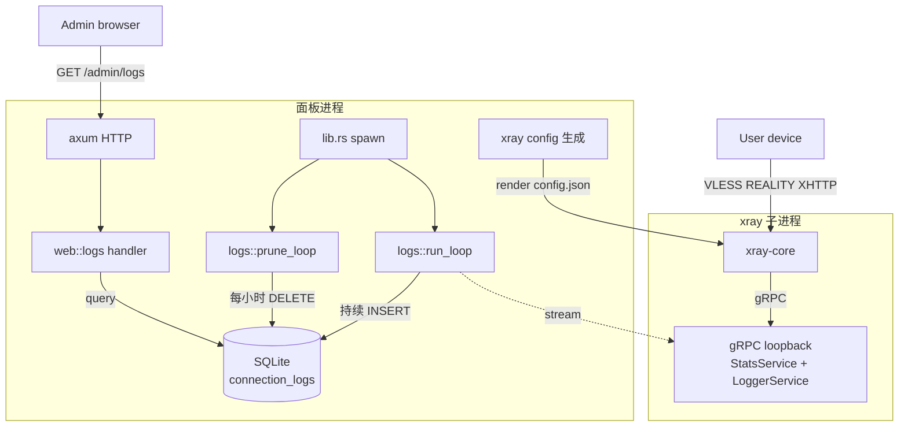
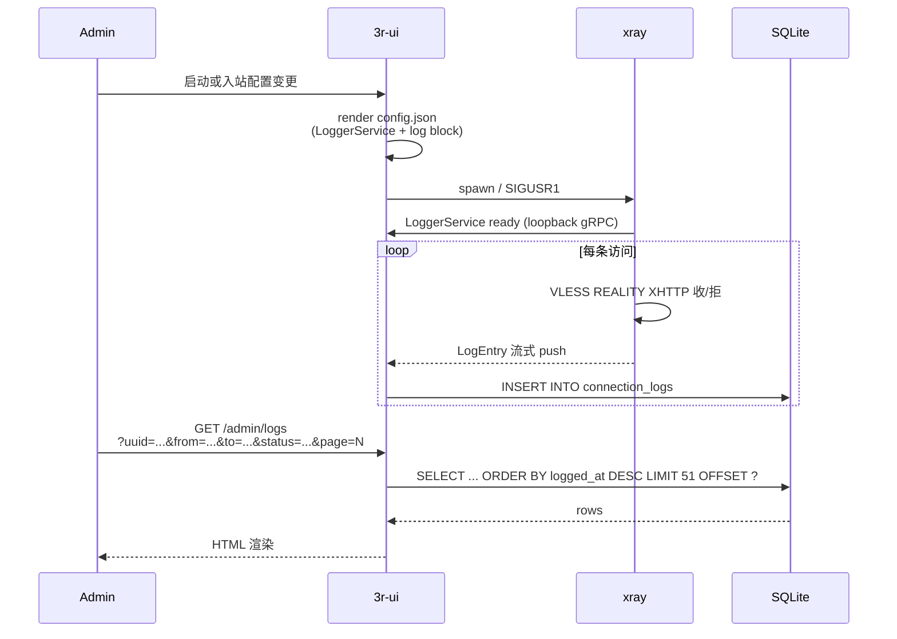
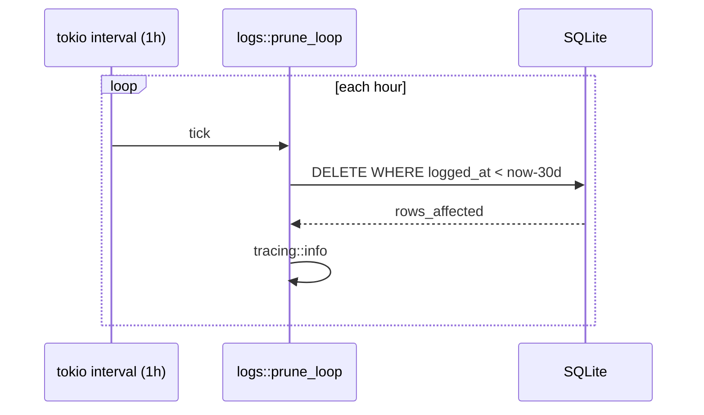

## Goal Capsule

- **Objective**: 管理员可在面板 admin 页面查看每条 xray 入站的访问日志，包含时间、客户端 UUID、来源地址、目标 dest、接受/拒绝结果，并按 UUID、时间范围、接收结果筛选与分页。
- **Means**: xray 通过其日志输出 API（loopback gRPC 上的 `LoggerService`，与现有 `StatsService` 同一端口段）把每条访问日志推送给面板，面板解析并写入新 SQLite 表 `connection_logs`，新 admin 页面 `/admin/logs` 按筛选条件展示；后台任务按固定时间窗口清理过期记录。 (KTD1-KTD5)
- **Product authority**: 在既有 "自用 MVP" 范围上扩展可观测性；不引入订阅 / Telegram / 远程 syslog 等额外能力。
- **Open blockers**: 无。
- **Product Contract preserved**: 新建 plan（bootstrap 来源），不修改既有 `docs/plans/2026-09-30-1336-feat-3r-ui-plan.md`；本计划与既有 U1-U10 并行。

---

## Product Contract

### Summary

为面板新增"连接日志"功能。xray-core 的入站访问日志通过其对外的日志输出接口推送给面板，面板逐条写入 SQLite 新表 `connection_logs`，新 admin 页面按 VLESS UUID（=xray client email）、时间范围、接受/拒绝结果筛选展示；后台任务按固定时间窗口滚动清理。鉴权、CSRF 防护、侧边栏导航、测试 harness 均沿用既有约定；`process.rs` 中 xray stderr 兜底通路的隐性 bug 在同一处修复。

### Problem Frame

目前面板只能反映累计流量与配额状态，无法看到某一次连接是被接受还是被拒绝。当用户的客户端连不上时，管理员只能在"REALITY 配置错 / 客户端被禁用 / 流量超额 / 网络被 GFW 干扰"之间猜测——日志是定位这件事的唯一手段。同时 `src/xray/process.rs:188` 的 `let _ = file;` 让 `${data_dir}/xray.log` 永远写不入数据，缺失一行可读的兜底通路。

### Actors

- A1. 面板管理员（单管理员账户）。
- A2. xray-core 子进程。
- A3. 代理客户端（用户设备）。

### Requirements

#### 日志接入

- R1. 面板管理 xray 时启用访问日志输出，并接入到 loopback 的日志接收端点；面板持续接收并落库。
- R2. 面板从每条日志至少解析出：时间戳、VLESS UUID（=client email）、来源 IP:port、目标 dest、接受/拒绝结果、可能的拒绝原因；解析失败的条目仍以 `raw_message` 原文持久化。
- R3. xray 配置中 `api.services` 包含 `LoggerService`（与现有 `StatsService` 并列）；`log` 块 `access: "none"`、`error: "none"`、`loglevel: "warning"`；统计 / 日志共用 127.0.0.1 loopback 监听。

#### 持久化与展示

- R4. 面板将每条访问日志持久化到新表 `connection_logs`，字段覆盖 R2 中的解析结果与 `raw_message`、`received_at`。
- R5. 面板提供 `/admin/logs` admin 页面，默认按 `logged_at DESC` 分页展示最近 50 条；支持按 UUID、时间范围（from/to，YYYY-MM-DD）、接受/拒绝结果筛选。
- R6. 分页参数 `?page=N`（N 从 1 起，默认 1）；最多每页 50 条，多余时页面显示"下一页"链接。

#### 保留与清理

- R7. 后台任务定期清理 `logged_at` 早于保留窗口的条目（默认 30 天）。
- R8. 清理任务与现有 session 清理任务一样在 `lib.rs::start_services` 中 `tokio::spawn` 派生，与面板同生命周期。

#### 旁路修复

- R9. 修复 `src/xray/process.rs:188` 的 `let _ = file;` 导致 xray stderr 永远不写入 `${data_dir}/xray.log` 的隐性 bug，使该兜底通路首次可工作。

### Key Flows

- F1. 启动并接入日志输出
  - **Trigger**: 面板启动或入站配置变更触发 xray 热重载。
  - **Actors**: A1, A2
  - **Steps**: 面板渲染 xray config（含 `api.services: ["StatsService","LoggerService"]` 与 `log: { access:"none", error:"none", loglevel:"warning" }`）→ SIGUSR1 或首次 spawn → xray 在 loopback 注册 StatsService + LoggerService。
  - **Outcome**: 面板后台任务持续接收 xray 写入的访问日志，逐条落库 `connection_logs`。
  - **Covers**: R1, R3.

- F2. 查看连接日志
  - **Trigger**: 管理员在侧边栏点击"连接日志"或访问 `/admin/logs`。
  - **Actors**: A1
  - **Steps**: session / CSRF 中间件通过 → handler 解析查询字符串（uuid / from / to / status / page）→ 构造参数化 SQL（`ORDER BY logged_at DESC LIMIT 51 OFFSET ?`）→ 渲染模板。
  - **Outcome**: 管理员看到分页列表，每行含时间 / UUID / 来源 / 目标 / 状态徽章 / 详细。
  - **Covers**: R5, R6.

- F3. 筛选连接日志
  - **Trigger**: 管理员提交筛选表单（UUID / from / to / status）。
  - **Actors**: A1
  - **Steps**: handler 构造带条件的 SQL（参数化拼接条件占位，无字符串拼接）→ 执行 → 渲染。
  - **Outcome**: 列表只展示匹配条件的记录，分页与计数随筛选而变。
  - **Covers**: R5.

- F4. 后台清理过期日志
  - **Trigger**: 每小时 ticker。
  - **Actors**: A1（间接）。
  - **Steps**: 任务计算阈值 `now_unix() - 30 * 24 * 3600` → `DELETE FROM connection_logs WHERE logged_at < ?` → 记录删除行数到 tracing。
  - **Outcome**: 表大小收敛在保留窗口内的总和。
  - **Covers**: R7, R8.

### Acceptance Examples

- AE1. **页面展示日志**: 登录后的管理员访问 `/admin/logs` 看到表格列：时间 / UUID / 来源 / 目标 / 结果 / 详情；空表状态显示"暂无日志"。
- AE2. **筛选 UUID (精确匹配)**: 在 UUID 框输入 `abc-uuid` 提交，列表只剩 uuid 字段字面等于 `abc-uuid` 的条目；其他条目消失。截断或带前后缀的 UUID（如只输入 `abc-uid`）不命中（精确匹配是 MVP 期的最小行为）。
- AE3. **筛选时间**: 设置 from / to 提交，列表只展示落在区间内的条目。
- AE4. **状态徽章**: 一个被接受的连接渲染为绿色"已接受"；被拒绝的渲染为红色"已拒绝"加原因（如"已禁用用户"）。
- AE5. **持久化**: 重启面板后 `connection_logs` 仍保留之前的条目；查询可返回历史。
- AE6. **保留清理**: 手工插入一条 `logged_at = now - 31 天` 的条目等待下一次清理任务；之后该条目从表中消失。

### Scope Boundaries

#### Inside this plan

- xray loopback 日志输出接入 + 新 SQLite 表 + admin 页面 + 后台清理 + 兜底通路修复。

#### Outside this product's identity (永久排除)

- 面板侧审计（管理员登录 / 退出 / 入站配置变更 / 用户增删等入口操作记录）：不属于"用户连接日志"。
- 把日志转发到外部系统（远程 syslog、Loki 等）。
- xray 内部日志（`log.loglevel: "debug"` 时的诊断输出）的解析与展示。
- 日志条目的运行时编辑 / 删除（除清理任务外）。

#### Deferred for later

- 把日志按天归档为 gzip 减小磁盘占用。
- 在客户详情页加"最近一次连接时间"。
- 实时尾巴（live tail、SSE、WebSocket 推送）：MVP 期内不实现；初始化列表 + 筛选 + 分页是当前交互上限。如未来加 htmx 短轮询或 SSE，应同步暴露 `autoRefreshSecs` 查询参数与 `data-controller="auto-refresh"` 组件开关，确保默认关闭。
- 用户维度的最近 N 次全部为拒绝时提示"可能被 GFW 干扰"。

### Sources / Research

- `docs/plans/2026-09-30-1336-feat-3r-ui-plan.md`：既有 U1-U10 计划，本计划与之并行；本计划不修改其中的 R-IDs / F-IDs / AE-IDs。
- `src/xray/stats.rs`：gRPC client 模式样板；`src/xray/mod.rs`、`src/xray/config.rs`、`src/xray/process.rs`：xray config 生成 / 子进程管理样板。
- `src/web/clients.rs`、`src/web/mod.rs`、`src/web/middleware.rs`：handler / 路由 / session+CSRF 样板。
- `src/db/models.rs`、`migrations/0001_initial.sql`、`migrations/0002_traffic_xray_counters.sql`：model 与 migration 命名 + 风格样板。
- `tests/clients.rs`：集成测试 harness 样板。
- xray-core `app/log/command/command.proto`（vendored, pin 提交号）：`LoggerService` 服务 + `LogEntry` 消息来源。
- xray-core `app/stats/command/command.proto`（vendored, 已有）：作为 proto 引入方式的参照。
- xray-core docs https://xtls.github.io/config/api.html 与 https://xtls.github.io/config/log.html：`api.services` 与 `log` 块的字段语义，以及 StatsService / LoggerService 在 loopback 共用监听端口的约定。

---

## Planning Contract

### Key Technical Decisions

- KTD1. **新 vendored proto 文件 `protos/xray-log.proto`**。从 xray-core 的 `app/log/command/command.proto` 拷贝最小子集：`LoggerService` 服务与 `LogEntry` 消息（含 timestamp / level / source / message 字段）。xray 的标准 `LogEntry` 不携带 VLESS 特定字段（uuid/src/dest/status/reason），这些必须从 `raw_message` 文本解析；`entry_to_row` 必须能在结构化字段全空时仅靠 message 文本给出可用字段，不可依赖结构化字段抽取。RPC 方法名（`LoopLog` / `SubscribeLogs` 等具体命名以 vendored proto 为准）、日志流方向（xray → panel，server-streaming，共享 STATS_ADDR :10085）以及 `LogEntry.message` 实际格式都需在 vendoring 后立刻对照 vendored proto 与一次 smoke 跑通确认。`build.rs` 加入新文件即可。

- KTD2. **xray 配置启用 LoggerService**。`src/xray/config.rs::render` 输出 JSON 中 `api.services` 从 `["StatsService"]` 改为 `["StatsService", "LoggerService"]`；`log` 块扩展为 `{ "loglevel": "warning", "access": "none", "error": "none" }`（全部走 gRPC LoggerService，不另开文件）。`STATS_ADDR` 不变，两服务共用 127.0.0.1 loopback。

- KTD3. **`connection_logs` schema**（`migrations/0003_connection_logs.sql`）：`id INTEGER PRIMARY KEY, logged_at INTEGER NOT NULL, uuid TEXT NOT NULL, src_addr TEXT, dest TEXT, status TEXT NOT NULL, reason TEXT, raw_message TEXT NOT NULL, received_at INTEGER NOT NULL`。索引：`(logged_at)`、`(uuid, logged_at)`、`(status, logged_at)` 覆盖典型筛选路径。

- KTD4. **后台双任务**。`xray::logs::run_loop`（持续读取 LoggerService stream，逐条 `INSERT INTO connection_logs`；流断开时 `tracing::warn` + 5 秒后重连，不退出循环）+ `xray::logs::prune_loop`（每小时 `DELETE WHERE logged_at < now - 30 天`，与 session cleanup 节奏一致）。两者都在 `lib.rs::start_services` 中 `tokio::spawn` 派生，句柄进 `Services`，shutdown 时 `.abort()`。

- KTD5. **`process.rs` 兜底修复**。`src/xray/process.rs:188` 的 `let _ = file;` 把循环里持有的文件句柄每次迭代立即 drop，导致 `${data_dir}/xray.log` 永远写不入数据。修复就是删除这一行：`OpenOptions::open(...)` 已经在 `tokio::spawn` 闭包内部，`file` 随闭包自然持有直到 read-line 循环结束；这是与本次日志功能同 supervisor task 内的顺手修复，单独 PR 价值低，留作与日志功能一同落地。

### High-Level Technical Design

#### 组件拓扑

#### 日志接入与展示

#### 清理任务

### Assumptions

- xray LoggerService 的 RPC 方法名与响应消息字段以 xray-core vendored proto 为准；本计划标注的最小字段集（`LogEntry` 含 timestamp / level / source / message）为权威基线，落地时通过读取 vendored proto 校对字段映射。
- 保留窗口默认值 30 天为 hardcoded；未来扩展成 `LOG_RETENTION_DAYS` 环境变量。
- 分页采用 `LIMIT 51 OFFSET ?`（多取 1 行判断 has_next）而非游标分页，MVP 期内足够。
- 每条 `LogEntry` 的 VLESS UUID / src / dest / status 优先从结构化字段读取；退而求其次从 `raw_message` 解析；解析失败仅写 `raw_message`，字段为 NULL。
- 面板不做语义翻译或高亮；`raw_message` 备查。

---

## Implementation Units

### U1. 持久化 schema 与 model

- **Goal**: 新表 `connection_logs` 与对应 Rust struct，让 `ConnectionLog` 能被 `sqlx::query_as` 直接消费；为下游 worker 与 handler 提供持久化层底座。
- **Requirements**: R4.
- **Dependencies**: 无。
- **Files**:
  - `migrations/0003_connection_logs.sql`
  - `src/db/models.rs`
- **Approach**:
  1. `migrations/0003_connection_logs.sql`：`CREATE TABLE connection_logs (id INTEGER PRIMARY KEY, logged_at INTEGER NOT NULL, uuid TEXT NOT NULL, src_addr TEXT, dest TEXT, status TEXT NOT NULL, reason TEXT, raw_message TEXT NOT NULL, received_at INTEGER NOT NULL)`；索引 `connection_logs_logged_at(logged_at)`、`connection_logs_uuid_at(uuid, logged_at)`、`connection_logs_status_at(status, logged_at)`。
  2. `src/db/models.rs` 新增 `#[derive(Debug, Clone, FromRow)] pub struct ConnectionLog { id: i64, logged_at: i64, uuid: String, src_addr: Option<String>, dest: Option<String>, status: String, reason: Option<String>, raw_message: String, received_at: i64 }`。
  3. 在 `db/models.rs` 顶部加注释，说明该 model 由本次新增。
- **Patterns to follow**:
  - `migrations/0002_traffic_xray_counters.sql` 的命名与风格。
  - `src/db/models.rs:26-36` 的 `Client` 字段顺序、可空处理。
- **Test scenarios**:
  - **Happy**: harness 启动后 `SELECT name FROM sqlite_master WHERE type='table' AND name='connection_logs'` 返回一行；三个索引存在。
  - **Round-trip**: 直接 `INSERT` 一条 → 通过 `sqlx::query_as::<_, ConnectionLog>` 反向读出，字段一一对应。
  - **Migration idempotent**: 第二次启动 migrate 不报错。
- **Verification**: 该 U 完成后 `cargo test` 中相应测试通过；既有 `tests/clients.rs` 全部仍绿。

### U2. xray 配置启用 LoggerService 与 process.rs 兜底修复

- **Goal**: 修改 `xray::config::render` 输出 JSON 让 xray 启用 LoggerService；顺手把 `process.rs:188` 的兜底文件句柄 bug 一并修好。
- **Requirements**: R1（配置侧）, R3, R9.
- **Dependencies**: 无（与 U1 并行）。
- **Files**:
  - `src/xray/config.rs`
  - `src/xray/process.rs`
- **Approach**:
  1. `src/xray/config.rs`：在 `render` 的 JSON 模板中，将 `api.services` 从 `["StatsService"]` 改为 `["StatsService", "LoggerService"]`；将 `log` 块从 `{"loglevel": "warning"}` 扩展为 `{"loglevel": "warning", "access": "none", "error": "none"}`。`STATS_ADDR` 常量不变。
  2. `src/xray/process.rs` 的 `spawn` 函数：删除 `let _ = file;`（line 188）——`OpenOptions::open(...)` 已在 `tokio::spawn` 闭包内，`file` 随闭包自然持有直至 read-line 循环结束；不要重构闭包变量作用域。tracing 输出保持。
- **Patterns to follow**:
  - `src/xray/config.rs:36-64` 的 JSON 模板结构。
  - `src/xray/process.rs:147-197` 既有 spawn 模式。
- **Test scenarios**:
  - **Happy (config)**: harness 启动 + 写一条 inbound → 读 `${data_dir}/xray/config.json` 包含 `"LoggerService"` 子串，`log.access == "none"`。
  - **Permission regression**: 配置改后 `config.json` 仍 0600（已有 `tests/clients.rs::config_json_remains_owner_only_after_client_changes` 断言）。
  - **Happy (process fix)**: 启动 supervisor 后等待 2 秒，`${data_dir}/xray.log` 至少 1 行（xray 启动 banner）。本测试需要真实 xray 二进制。
- **Execution note**: 进程级 smoke 需要 `xray-core` 已下载到 `${data_dir}/xray/`；CI 容器中跑 `installer.ensure_xray` 准备。
- **Verification**: `cargo test` 全绿；smoke 阶段在 dev 环境跑一次确认 `${data_dir}/xray.log` 含 xray 启动输出。

### U3. 日志接收与持久化后台 worker

- **Goal**: 用 tonic 流式 client 接收 xray LoggerService 的日志条目，逐条写入 `connection_logs`；流断开时自动重连，不退出循环。
- **Requirements**: R1, R2, R4.
- **Dependencies**: U1（schema）, U2（LoggerService enabled）。
- **Files**:
  - `protos/xray-log.proto`（vendored）
  - `build.rs`（加入新 proto 文件）
  - `src/xray/logs.rs`（新）
  - `src/xray/mod.rs`（新增 `pub mod logs;`）
- **Approach**:
  1. **Pre-U3 vendoring 与字段校对**。先拷贝 xray-core `app/log/command/command.proto` 到 `protos/xray-log.proto`，在 `build.rs` 编译进 crate；同时按下表校对 vendored 后的实际字段：RPC 方法名 / 流方向（默认假设 `LoggerService.LoopLog` 为 xray → panel server-streaming）/ `LogEntry` 字段（确认 `timestamp` 是 `int64` Unix 秒而 `message` 是单条日志原文）。校对结论作为本文件外的内部笔记传递给 U3 step 3 的实现者；若 vendored proto 显示 `LoggerService` 实为 panel-as-server（xray dial 推送到面板的 gRPC server）或 RPC 名不一致，相应调整 `connect()` / `run_loop` 的方向与函数签名。
  2. `build.rs`：在已有 `tonic_build::configure().compile_protos(&[...], &[...])` 的文件列表中加入 `protos/xray-log.proto`，include 路径仍为 `protos/`。`tonic_build` 默认会对每个 `.proto` 生成独立 Rust 模块（按 `package` 命名空间），但因两个 proto 可能被引用为同名 Rust module，需在生成产物中通过 wrapper 模块区分。
  3. `src/xray/logs.rs`：
     - `pub mod logs_proto { tonic::include_proto!("xray.app.log.command"); }`（与 `src/xray/stats.rs::proto` 区分名，避免 crate 内同名 `pub mod` 冲突）。
     - `pub async fn connect() -> AppResult<LoggerServiceClient<Channel>>`：与 `src/xray/stats.rs:222-226` 同形态，使用 `connect_lazy()`；端点重用 `STATS_ADDR` (127.0.0.1:10085)——前提是 U3 step 1 的校对确认两服务共用该端口，否则改用独立 `LOG_ADDR` 常量。
     - `fn entry_to_row(entry: &logs_proto::LogEntry) -> ConnectionLogRow`：纯函数；按 U3 step 1 校对结果优先尝试结构化字段，失败或字段为空时回退到 `raw_message` 文本解析（按日志行模板分字段，例如正则匹配 `from <addr>` / `email <uuid>` / `accepted|rejected` / `destination: <dest>`）；结构化字段全空时也允许 `raw_message` 单独落库，UUID / src / dest / status / reason 字段填 NULL。
     - `pub async fn persist_one(pool: &SqlitePool, row: &ConnectionLogRow) -> AppResult<()>`：参数化 INSERT。
     - `pub async fn run_loop(pool: SqlitePool)`：connect → 调 stream RPC（按校对确认的方法名）→ `while let Some(entry) = stream.next().await` → entry_to_row → persist_one；任意 step 错误 `tracing::warn!` → `tokio::time::sleep(Duration::from_secs(5)).await` → 重连外层。重连循环无 cap（与既有 stats loop 形态不一致，但 MVP 期内可接受 — 见 FYI）。
  4. `src/xray/mod.rs`：在文件顶部加 `pub mod logs;`。
- **Patterns to follow**:
  - `src/xray/stats.rs:36-37` 的 `include_proto!`。
  - `src/xray/stats.rs:222-226` 的 `connect()` 与 `connect_lazy()`。
  - `src/xray/stats.rs::run_loop` 的循环 + reconnect 模式（按出错 → warn → sleep 5s → 重连设计）。
- **Execution note**: 流式响应解析需要 `futures_util::StreamExt`（crate 已带 `futures-util = "0.3"`）；落地时按 vendored proto 校对字段名。
- **Test scenarios**:
  - **Unit**: `entry_to_row` 对 sample `LogEntry`（结构化字段全填）映射正确；对字段全空的 `LogEntry` 全部落到 `NULL` + `raw_message` 占位；解析路径对 dest 字段缺失时返回 `NULL`。
  - **Integration (mock gRPC)**: 启动一个内嵌的 mock tonic gRPC server 实现 `LoggerService` 并回放一组 sample `LogEntry`；`run_loop` 在接到 stream 之前需要先 connect——因此测试通过把 mock server 绑到 `127.0.0.1:0`、取端口后再起 `run_loop`；断言 SQLite 中 `connection_logs` 有 N 行且字段映射正确。
  - **Error path**: mock server 在收到首批 entry 后主动断开 stream → worker 5 秒内重新 connect → 推送第二批 entries 后正常入库（不退出循环、不丢失 logger 句柄）。

### U4. admin 页面：handler、模板、侧边栏入口

- **Goal**: 提供 `/admin/logs` admin 页面，渲染最近 50 条连接日志，支持筛选与分页。
- **Requirements**: R5, R6.
- **Dependencies**: U1（schema）.
- **Files**:
  - `src/web/logs.rs`（新）
  - `src/web/mod.rs`（新增 `pub mod logs;` 与 `.route("/admin/logs", get(logs::list))`）
  - `templates/logs_list.html`（新）
  - `templates/sidebar_nav.html`（新增"连接日志"链接）
- **Approach**:
  1. `src/web/logs.rs`：定义 `LogsFilters { uuid, from, to, status, page }`、`LogRowView { logged_at_iso, uuid, src_addr, dest, status_label, reason, detail_preview }`、`#[derive(Template)] #[template(path = "logs_list.html", escape = "html")] struct LogsListTemplate { csrf, nav_active, entries, page, has_next, has_prev, filters, total_known }`。Handler `pub async fn list(State(state): State<AppState>, Extension(_admin): Extension<CurrentAdmin>, jar: CookieJar, Query(params): Query<HashMap<String, String>>) -> Response`：解析参数（按 Execution note 的 whitelist 与回退规则）→ 构造动态 SQL 使用 `sqlx::QueryBuilder::new()` + `.push("WHERE 1=1")` → 条件可选 `.push(" AND uuid = ").push_bind(uuid)`，**禁止字符串拼接**；所有用户输入走 `.push_bind(...)` 走参数绑定。→ 执行查询（`LIMIT 51 OFFSET ((page-1)*50)`，多取 1 行判断 `has_next`）→ 渲染 → `page(jar, StatusCode::OK, html)`。
  2. `src/web/mod.rs`：在 `auth.rs` 之后追加 `pub mod logs;`；在 admin router 上注册 `.route("/admin/logs", get(logs::list))`，自然落在 `require_session` 路由层之下。
  3. `templates/logs_list.html`：复用既有 dashboard 的样式与布局，**在 `<style>` 块末尾包含 ``**（与 `templates/dashboard.html:64` 一致，是侧边栏 grid 布局与移动端断点的承载文件，缺它 logs 页面将塌成单列）。新增 CSS：`.status-accepted { background: #e3f5e9; color: #1a7f42; }` 与 `.status-rejected { background: #fdecec; color: #a4262c; }`（与现有 `.status-active` / `.status-disabled` 用于 client 状态区分；这是连接级别的接受/拒绝）。页面顶部 `<form method="get">` 筛选区（UUID input、`from`/`to` date input、status `<select>` 三个选项空 / `accepted` / `rejected`、submit button），下方 `<table>` 列：时间 / UUID / 来源 / 目标 / 状态（带 `.status-accepted` 或 `.status-rejected` 类）/ 详细（`raw_message` 截断到 60 字 + `<abbr title="<完整 raw_message>">…</abbr>` 形式悬停展开）；分页与筛选链接 `?page=N&uuid=...&from=...&to=...&status=...` 必须同时携带所有当前筛选参数，保证翻页不丢筛选。空表状态显示"暂无日志"占位。MVP 不暴露 loading 状态——HTTP 请求到渲染中间用浏览器原生进度条接受白屏。
  4. `templates/sidebar_nav.html`：在 `nav-label = "管理"` 的 `<nav>` 末尾追加 `<a class="nav-link active" aria-current="pagefalse" href="/admin/logs">连接日志</a>`。
  5. ISO 时间显示：handler 把 `logged_at` 用 `time::macros::format_description!` 渲染为 `YYYY-MM-DD HH:MM:SS`（UTC+8 写死为面板默认展示）。
- **Patterns to follow**:
  - `src/web/clients.rs:107-156` 的 `list` handler 与 view-model 模式。
  - `src/web/clients.rs:601-630` 的 `page()` / `decorate()`。
  - `templates/clients_list.html` 的样式与侧边栏 include 模式（**注意：sidebar_style.html 是样式 include，而非 header/sidebar block**）。
  - `templates/sidebar_nav.html` 的 `nav_active` 高亮逻辑。
- **Execution note**: URL 参数 sanitize 规则——`uuid` 取值最大 64 字符（按字面量 `=` 精确匹配；非规范格式不算输入错误，按无匹配处理）；`status` 取值仅 `accepted` / `rejected` / 空三者（其他值视为无筛选，不报错也不返回 400）；`from` / `to` 必须是 `YYYY-MM-DD` 或空；`page` 解析为 `>= 1` 的整数（失败 fallback 到 1）。`status` 与其他筛选独立组合（可同时 `?uuid=x&status=accepted`）。handler 不做 SQL 字符串拼接；全部走 `QueryBuilder.push_bind`。
- **Test scenarios**:
  - **Auth**: 未登录访问 `/admin/logs` 重定向到 `/`。
  - **Empty**: harness + 空表 GET → 200 OK，HTML 含"暂无日志"。
  - **Happy - 默认列表**: 写入 30 条样例 → GET → 表格渲染按 `logged_at DESC`，列与 `class="status-accepted"` / `class="status-rejected"` 状态徽章正确。
  - **Happy - 筛选 UUID (精确匹配)**: `?uuid=abc-uuid` → 仅 uuid 字面等于 `abc-uuid` 的条目；不匹配的部分前缀 UUID 不命中。
  - **Happy - 筛选 status**: `?status=accepted` / `?status=rejected` → 仅对应条目。
  - **Happy - status 非法值**: `?status=garbage` → 与无筛选一致（不报错，不返回 400）。
  - **Happy - 筛选时间**: `?from=2026-10-01&to=2026-10-15` → 仅落在区间内的条目。
  - **Happy - 分页**: 60 条 → `?page=1` 显示 50 条 + 下一页链接；`?page=2` 显示 10 条。
  - **Happy - 分页保留筛选**: 60 条 → `?uuid=abc-uuid&page=1` 含分页链接 `?uuid=abc-uuid&page=2`；两条链接筛选范围一致。
  - **Happy - 侧边栏导航**: HTML 含 `href="/admin/logs"` 与 `class="sidebar"`，并且访问 `/admin/logs` 时该链接含 `active` 类。
  - **Template - sidebar_style include**: HTML 含 `templates/sidebar_style.html` 编译产物的特征（如断点相关 class `sidebar` 或 `content`）。
  - **Security - HTML escape**: 让 raw_message 含 `<script>...`，渲染后 HTML 里看到 `&lt;script&gt;` 而非裸 `<`（模板 `escape = "html"`）。
  - **Security - SQL 参数化**: 给 `?uuid=abc' OR 1=1--`，仍按字面匹配处理（0 结果或不报错）。
  - **Status badge AE**: `?status=accepted` 与 `?status=rejected` 的行各自携带正确的徽章 class（绿 / 红），与 AE4 对应。
  - **详情列**: raw_message 长度 ≤ 60 字整段展示；> 60 字截断为前 60 字 + `<abbr title="完整内容">…</abbr>` 形式（鼠标悬停或触屏长按展示完整原文）。

### U5. 后台清理任务

- **Goal**: 启动一项小时级 ticker，定期删除 `logged_at < now - 30 天` 的行。
- **Requirements**: R7, R8.
- **Dependencies**: U1（schema）, U3（worker established）。
- **Files**:
  - `src/xray/logs.rs`（新增 `prune_loop` 与 `prune_older_than`）
  - `src/lib.rs`（新增 spawn + 句柄；shutdown 时 `.abort()`）
- **Approach**:
  1. `src/xray/logs.rs::prune_older_than(pool: &SqlitePool, threshold_unix: i64) -> AppResult<u64>`：`DELETE FROM connection_logs WHERE logged_at < ?` 参数化执行，返回 `rows_affected()`。
  2. `pub async fn prune_loop(pool: SqlitePool)`：`interval(Duration::from_secs(3600))`；每 tick → `prune_older_than(&pool, now_unix() - 30 * 24 * 3600)` → `tracing::info!(deleted = rows)`。
  3. `src/lib.rs::start_services`：在 stats loop spawn 之后增加 `let logs_recv_handle = tokio::spawn(xray::logs::run_loop(pool.clone()));` 与 `let prune_handle = tokio::spawn(xray::logs::prune_loop(pool.clone()));`；把这两个句柄加进 `Services`。
  4. `Services::shutdown` 增加 `.abort()` 两个新句柄。
- **Patterns to follow**:
  - `src/lib.rs:86-102` 的 session cleanup 内联 spawn + interval。
  - `src/xray/stats.rs::run_loop` 的 `tokio::time::interval` + `MissedTickBehavior::Delay` 风格。
- **Test scenarios**:
  - **Unit**: 直接 `INSERT` 4 条带 `logged_at` 分别为 `-1d` / `-29d` / `-31d` / `-60d` 的样例；调用 `prune_older_than(pool, now_unix() - 30 * 86400)` → 断言删除行数为 2，剩余 2 行分别为 `-1d` / `-29d`。
  - **Integration (logs.rs boot)**: harness 启动后立即 `prune_older_than` 一次（不依赖 1 小时 ticker），验证 wiring 路径。

### U6. wiring 与回归测试

- **Goal**: 把 U3 / U5 真正接到 `start_services`/`Services`；新增 `tests/logs.rs` 集成测试；既有 `tests/clients.rs` 全部仍绿。
- **Requirements**: 全 R；既有 R1-R18 全部仍满足。
- **Dependencies**: U1-U5.
- **Files**:
  - `src/lib.rs`
  - `tests/logs.rs`（新）
- **Approach**:
  1. `src/lib.rs::start_services`：完成 U5 步骤 3。
  2. `src/lib.rs::Services::shutdown`：完成 U5 步骤 4。
  3. `tests/logs.rs`：参照 `tests/clients.rs::boot()` 的 harness（tempdir + `three_r_ui::init_storage` + 注入 admin + drain supervisor 通道）；覆盖 U4 的所有列表 / 筛选 / 分页 / auth / security 集成测试 + U5 的 prune_older_than 单元 / 集成。
- **Patterns to follow**:
  - `src/lib.rs:104-119` 的 stats_handle spawn + shutdown abort。
  - `tests/clients.rs:24-128` 的 harness、login、body_text、rendered_config helper。
- **Test scenarios**:
  - **Wiring**: `cargo build --release` 0 错误 0 警告。
  - **Logs 集成测试**: U4 + U5 列出的所有场景。
  - **回归**: `cargo test` 全部 `tests/*.rs` 0 失败。
  - **侧边栏回归**: 既有断言 `tests/clients.rs::admin_pages_shows_left_navigation` 把 `/admin/logs` 加入循环（U4 完成后该断言可放宽到三处：`/admin`、`/admin/inbound`、`/admin/clients/new`，但 `/admin/logs` 也是 admin 页面之一）。

---

## Verification Contract

### 仓库命令

- `cargo build --release` — 主构建；必须 0 错误 0 警告。
- `cargo test` — 既有 + 新增。
- `cargo clippy --all-targets -- -D warnings` — 静态分析，无新增警告。
- `cargo fmt --check` — 格式。

### 质量门

- `tests/logs.rs` 中所有 U 列举的测试场景在 CI 中通过。
- 既有 `tests/clients.rs` / `tests/inbounds.rs`（若有）全部 0 失败。
- `/admin/logs` 路由在未登录时被 `require_session` 拦截，返回重定向到 `/`。
- `cargo build --release` 产物保持单二进制；`config.json` 模式仍 0600；xray 进程仍受 supervisor 控制。

### 何时执行

- 每个 U 完成后跑 `cargo build` + `cargo test`，避免 U 边界破坏既有测试。
- PR 阶段跑完整 `cargo test` + `cargo clippy` + `cargo fmt --check`。
- Smoke（带真实 xray 二进制）：启动面板后某客户端发送一次连接 → `/admin/logs` 至少一行新条目；`${data_dir}/xray.log` 至少一行 xray 启动 banner。

---

## Definition of Done

### 全局

- 9 条 R（R1-R9）均通过对应 unit / integration 测试覆盖。
- 既有 `docs/plans/2026-09-30-1336-feat-3r-ui-plan.md` 的 R1-R18 / F1-F5 / AE1-AE5 仍全部通过 `cargo test`（无回归）。
- `cargo build --release` 0 错误 0 警告；二进制保持单文件，REALITY 私钥文件权限 0600。
- 新增运行时路径无 panic、无 `unwrap()`/`expect()`。
- 没有 trailing debug code；无 SECURITY / data-loss 风险残留。

### Per-unit

- 对应 test scenarios 全部通过。
- 对应 R 被 `Requirements` 或 `Approach` 引用并可追溯。
- 错误路径在 `tracing` 中有 warn / error 日志。
- 新代码路径不引入 `#[allow(dead_code)]` / `todo!()` / `unimplemented!()`。
