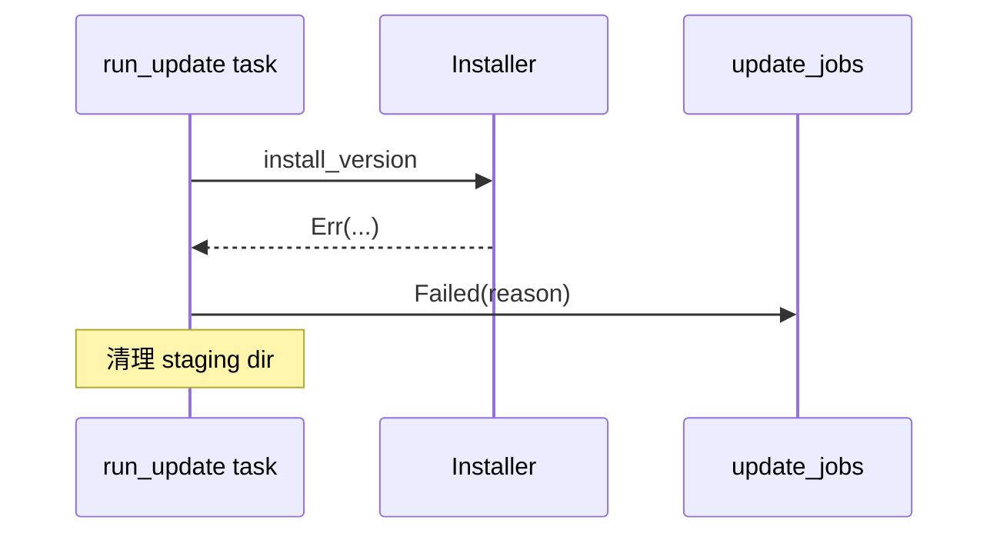

## Goal Capsule

- **Objective**: 管理员在面板内打开新的"系统设置"页，只读查看 xray-core 的版本、二进制路径与下载源 URL，并能通过一个表单触发把当前 xray 升级到 GitHub latest（或可选的具体 tag）；升级过程中 xray 进程被 supervisor 自动替换为新二进制重启，面板进程本身不重启。
- **Means**: 在 `installer.rs` 暴露 `install_version(Option<&str>)` 公共路径，复用现有 HTTP/解压逻辑；扩展 `SupervisorCommand` 枚举新增 `RestartNow` 变体，使 supervisor 杀掉 xray 子进程但不退出自身 run 循环；新增 `src/web/settings.rs` 与 `templates/settings.html`、侧边栏导航项 `系统设置`，提交后用 `tokio::spawn` 启动后台下载/替换/重启任务，状态以 `Arc<Mutex<HashMap<JobId, JobStatus>>>` 共享，UI 通过新增的 JSON 状态端点轮询 (KTD1-KTD5)。
- **Product authority**: 与既有 `2026-09-30-1336-feat-3r-ui-plan.md`、`2026-10-10-1459-feat-connection-log-viewer-plan.md` 并行；不修改其 R-IDs / AE-IDs。
- **Open blockers**: 无。
- **Product Contract preserved**: bootstrap 来源，无既有合同可破坏。

---

## Product Contract

### Summary

为面板新增 `/admin/settings` 页面与侧边栏"系统设置"菜单。设置页只读展示当前 xray 二进制路径、`XRAY_DOWNLOAD_BASE`、`data_dir` 与通过 `xray --version` 取得的版本号；主交互是一个"立即更新"表单（可选指定版本号），提交后启动一次后台异步下载任务，UI 通过 JSON 状态端点轮询（Queued → Downloading → Downloaded → Restarting → Succeeded/Failed）。新二进制替换到 canonical 路径后，supervisor 收到新增的 `RestartNow` 命令停止当前 xray 并在下一轮 loop 用新二进制 respawn；面板进程保持运行。

### Problem Frame

`src/xray/installer.rs::ensure_xray` 是启动期一次性 bootstrap：首次启动下载一次，后续即便 GitHub 上新版本发布，面板永远停留在最初的二进制。要换版本要么 SSH 登服务器手工 `cp` 替换再重启面板 systemd 单元，要么面板自身重启 — 两者都打断面板对外提供的 admin 通道。真实部署中 xray-core 几乎每月发版、漏洞修复与新协议特性都强烈建议及时升级；本计划把"启动期一次性下载"扩展为"运行时由管理员命令式下载+原子替换+supervisor respawn"的完整闭环。

### Actors

- A1. 面板管理员（单管理员账户）。
- A2. 面板进程（HTTP server + supervisor 任务 + 后台更新任务）。
- A3. xray-core 子进程（受 supervisor 监管）。

### Requirements

#### 设置导航与页面

- R1. 侧边栏在"连接日志"链接之后新增"系统设置"菜单项，链接 `/admin/settings`，导航高亮判定值为 `settings`。
- R2. `/admin/settings` 页面（GET, requires session, 不需 CSRF）只读展示：当前 xray 二进制绝对路径、`XRAY_DOWNLOAD_BASE` 当前值、`xray.log` 路径、`data_dir` 路径、`xray --version` 解析得到的版本号（失败时显示"未安装"）。
- R3. 设置页主交互是一个 `<form method="post" action="/admin/settings/xray/update">`，含 CSRF 隐藏字段、可选 `version` 文本输入（默认空 = latest）、提交按钮"立即更新"。提交成功后浏览器跳回 `/admin/settings`（PRG 模式），避免刷新重复触发。

#### 异步更新任务

- R4. `POST /admin/settings/xray/update` 立即生成 `JobId`（16-hex 随机字符串），把 `{ status: Queued, message, started_at }` 写入 `AppState` 上的 `update_jobs: Arc<Mutex<HashMap<String, JobStatus>>>`，`tokio::spawn` 启动后台任务 `run_update(state, job_id, version_opt)`，然后 handler `Redirect::to("/admin/settings")` 立即返回；handler 自身不阻塞会话。
- R5. 后台任务按状态机推进：Queued → Downloading → Downloaded(Restarting) → Succeeded 或 Failed。每个过渡写一次 `JobStatus`（覆盖式更新 `message`）。
- R6. `GET /admin/settings/xray/status?job=<id>`（requires session, no CSRF）返回 `{ id, status, message, started_at, finished_at?, installed_tag? }` JSON；不存在的 JobId 返回 `200` + `JobStatus { stage: Failed, message: "任务不存在或已清理" }`（避免 404 触发 JobId 枚举探测；状态端点的语义是"任务是否被记录",而非 HTTP 资源语义）。JSON schema 与模板渲染一一对应。
- R7. 同时段仅允许一个 active job；`active` 定义为 `JobStage` 中处于 Queued / Downloading / Downloaded / Restarting 中任一非终态。新提交若检测到任一 active 任务存在则新任务直接进入 `Failed("已有更新任务进行中")`，不排队；`Succeeded` 和 `Failed` 视为非 active，可发起新一轮更新。
- R8. `update_jobs` 保留最近 N 条（N=10）历史记录，超出滚动淘汰；淘汰发生在每次新任务入队时，不在请求处理热路径上。

#### Installer 与 Supervisor 协同

- R9. `Installer` 新增 `pub async fn install_version(data_dir: &Path, version: Option<&str>) -> AppResult<(PathBuf, String)>` 返回 `(staging_dir, tag)`；与既有 `ensure_xray` 互补：`ensure_xray` 仍是启动期 bootstrap，`install_version` 永远下载并返回 staging 路径，不短路、不替换 canonical。
- R10. 后台任务在 `Downloaded` 阶段调用 `std::fs::rename(staging_xray, ${data_dir}/xray/xray)` 完成后推进到 `Restarting`；发送 `SupervisorCommand::RestartNow` 到 supervisor 通道。
- R11. `SupervisorCommand` 枚举新增 `RestartNow` 变体。`run` 的 `tokio::select!` 分支匹配：`stop_child(&mut child).await` 杀 xray 子进程后 `continue` 外层 loop（**不** `return Ok`），下一轮 spawn 时 `Command::new(xray_bin)` 自然读到新二进制。
- R12. `Stop` 既有语义不变（面板 shutdown 用，`return Ok(())`），`RestartNow` 与 `Stop` 不合并。
- R13. `AppState` 新增 `pub shutdown_initiated: Arc<std::sync::atomic::AtomicBool>` 字段；`Services::shutdown` 在发送 `Stop` 之前 `store(true)`；后台任务在状态机每个推进点(`Downloading` 之前、`Downloaded` 之前、`Succeeded` 之前)循环检查,若为 true 则立即 `Failed("panel shutdown")` 终态,不再消费 supervisor 通道或 rename 文件。`supervisor_tx.send` 返回 `Err`(通道关闭)同样推 `Failed("supervisor gone")`。
- R14. 新二进制启动失败的转归：supervisor 已有的退避重启逻辑承担；面板侧不感知，让更新任务继续以 `Succeeded(swapped)` 终态报告（"已下载并替换，xray 自监督重启中"）。

#### 版本展示

- R15. `xray --version` 通过 `tokio::process::Command` 调用 `${data_dir}/xray/xray`；读取首行 stdout；进程退出码非 0 或二进制不存在时显示字符串"未安装"。
- R16. 模板上端只读区暴露的 `installed_tag` 字段是上一次 Succeeded 任务的 `installed_tag`；若没历史任务或面板重启清空则显示空字符串。

#### 鉴权与安全

- R17. 全部 `/admin/settings` 路由沿用既有 `require_session` 中间件；POST 触发更新需 CSRF（沿用现有 form CSRF 校验）。
- R18. 状态 GET 不需要 CSRF（同 GET `/admin`）；但仍要求 session cookie。
- R19. 后台任务在状态进入终态 (`Succeeded` / `Failed`) 后，通过 `tokio::task::spawn_blocking` 一起清理 staging 目录 `${data_dir}/xray-<tag>-staging-<rand>` 与对应的下载产物 `${data_dir}/downloads/Xray-<suffix>.zip`（best-effort，失败仅 warn）；staging 目录以 `0o700` 创建（对齐 `data_dir` 的权限，避免 umask 把未完成二进制暴露给其他本地用户；Windows 上 no-op）。

### Key Flows

- F1. **进入系统设置页**
  - **Trigger**: 管理员点击侧边栏"系统设置"或直接访问 `/admin/settings`。
  - **Actors**: A1, A2.
  - **Steps**: `require_session` 通过 → handler 取 `AppState.config.xray_download_base`、`config.data_dir`、拼出 `${data_dir}/xray/xray` 与 `${data_dir}/xray.log` 的绝对路径 → 异步调用 `xray --version` 取首行（spawn_blocking）→ 拼装 `JobView` 列表 → 渲染模板。
  - **Outcome**: 页面展示只读区与最新 10 条任务历史。
  - **Covers**: R1, R2, R15, R16.

- F2. **触发一次后台更新**
  - **Trigger**: 管理员在设置页提交"立即更新"表单（可填版本号）。
  - **Actors**: A1, A2.
  - **Steps**: session + CSRF 通过 → handler 取表单 `version`（Optional 字符串，trim 后空串视为 None）→ 调 `app_state.spawn_update(version_opt)`（helper）→ `tokio::spawn` 启动后台任务 → `Redirect::to("/admin/settings")`。
  - **Outcome**: 浏览器跳回 `/admin/settings`，新任务条目在历史顶部，状态 `Queued`，`message` 为"排队中"。
  - **Covers**: R3, R4, R7.

- F3. **后台下载新版本**
  - **Trigger**: 后台任务启动瞬间由 `Queued` 推进。
  - **Actors**: A2.
  - **Steps**: status.push(`Downloading`, "从 GitHub 拉取 release 元数据") → 调用 `Installer::install_version(data_dir, version_opt)` → 完成后 staging 路径存在，tag 被记录 → status.push(`Downloaded`)。
  - **Outcome**: 后台拿到 `(staging_xray, tag)`。
  - **Covers**: R5, R9.

- F4. **替换并触发 supervisor 重启**
  - **Trigger**: 后台任务完成 staging 后的下一步。
  - **Actors**: A2, A3.
  - **Steps**: status.push(`Restarting`, "正在替换二进制并重启 xray") → `std::fs::rename(staging, canonical)` → 发送 `SupervisorCommand::RestartNow` 到 supervisor_tx → 短暂 sleep 100ms（让 supervisor 真的进入 spawn 前夕）→ status.push(`Succeeded(tag)`, "已替换并已重启")。
  - **Outcome**: supervisor 在下一次 spawn 用新二进制，pid_file 中的 PID 改变；面板进程未重启；UI 历史任务显示绿色 Succeeded。
  - **Covers**: R5, R10, R11, R12, R14.

- F5. **UI 轮询状态**
  - **Trigger**: 设置页加载后，前端 inline `<script>` 每 2 秒 `fetch('/admin/settings/xray/status?job=<id>')`。
  - **Actors**: A1 (浏览器), A2.
  - **Steps**: 取响应 JSON → 找对应 DOM 节点的 `.status-badge` 与 `.status-message` 更新文本与样式类 → 若 status 是终态则停止轮询。
  - **Outcome**: 管理员看到状态实时刷新，无需刷新整页。
  - **Covers**: R6.

### Acceptance Examples

- AE1. **设置页可访问**: 登录后点击侧边栏"系统设置"进入 `/admin/settings`，页面包含"立即更新"按钮和展示 xray 路径的只读区；未登录访问被重定向到 `/`。
- AE2. **默认下载 latest**: 不填版本号直接点"立即更新"，submit 后页面显示任务 ID 状态在 `Downloading`；查看 `XRAY_DOWNLOAD_BASE` 与 `data_dir` 拼接出的 `${data_dir}/downloads/Xray-linux-64.zip` 应存在并被处理（需真实联网）。
- AE3. **指定 tag**: 在版本号框输入 `v1.8.10` 提交，最终安装到 `${data_dir}/xray/xray` 的二进制运行 `xray version` 输出包含 `1.8.10`（mock 测试断言 tag 字符串在响应 JSON 中）。
- AE4. **失败显示**: mock installer 抛错（如 HTTP 429）时，状态最终为 `Failed`，`message` 含错误描述。
- AE5. **并发抑制**: 已经有一个 active job 时再次提交，后一个直接终态 `Failed("已有更新任务进行中")`，前一个不受影响。
- AE6. **自动重启**: supervisor 收到 `RestartNow` 后 ${data_dir}/xray.pid 内容变更（断言 pid 字符串与之前不同），xray.log 里出现第二次启动 banner（需要真实 xray 二进制）。
- AE7. **CSRF**: 未带 CSRF token 的 POST `/admin/settings/xray/update` 返回 `403 missing or invalid CSRF token`，同既有 web 模块约定。

### Scope Boundaries

#### Outside this product's identity (永久排除)

- 把 `XRAY_DOWNLOAD_BASE` 或版本 pin 写回配置文件并提供面板内编辑入口（运维侧敏感 — 编辑需重启面板；不在本期）。
- 面板自动定期检查 xray 新版本并主动提示更新。
- 多管理员账户 / RLS / 审计日志（与本计划无关联）。
- 把更新进度通过 SSE / WebSocket 推送（前端复杂度高，超出"自用 MVP"）。
- 升级面板自身（cargo 二进制）的入口。

#### Deferred for later

- 更新任务历史持久化（`JobStatus` 当前仅内存；面板重启即清空）。
- 调度任务、版本回滚（已下载但未启用的版本号列表 → "回滚到上一版"按钮）。
- 已下载 staging zip 自动压缩 / 清理 `data_dir/downloads/` 目录。
- Succeeded 任务附带 diff（提示"从 vX.Y.Z → vA.B.C"）。

#### Deferred to follow-up work

- 用户管理区（如果后续引入多管理员角色，相关的 audit 表与角色路由在单独 plan 内做）。
- 真实业务设置项（面板端口 / TLS / log level 等）；本计划不预留 placeholder 块，仅做最低占位的只读区。

### Sources / Research

- `src/xray/installer.rs::ensure_xray`：`download → extract → rename → chmod` 完整管线；本计划把 `fetch_latest_release` 通用化为支持 `tags/<tag>` 的入口，把网络+解压部分抽为可复用私有函数，返回 `(staging_dir, tag)`。
- `src/xray/process.rs::SupervisorCommand`、`run()`：当前只有 `Stop`（`return Ok`）与 `Reload`（SIGUSR1，热重载配置但不变二进制路径）；`Reload` 与本计划的"替换二进制"语义正交，"替换二进制"必须走 stop+respawn，所以新增变体 `RestartNow`。
- `src/web/auth.rs::dashboard`、`src/web/inbound.rs::show`：handler + Askama 模板 + `page(jar, status, html)` 包装模式参照。
- `src/web/mod.rs::router`：路由注册位置、`require_session` 中间件应用方式。
- `templates/sidebar_nav.html`：侧边栏链接 + `active` 模板；新增条目沿用同结构。
- `templates/dashboard.html`：Askama 头部 + `<style>` 内嵌 + `` + sidebar_nav.html include 的标准页面骨架。
- `tests/clients.rs::Harness`：web 测试 boot 模板；新 `tests/settings.rs` 沿用同样形态。
- `src/web/middleware.rs::require_session`：session + CSRF 双重门，已被所有 `/admin/*` 路由继承；本计划无需新写中间件。
- `src/lib.rs::start_services`：`AppState` 在 `lib.rs` 中构造；新增字段需在 `lib.rs:78` 附近同步构造。
- xray-core GitHub releases API：既有 fetch 直接调用 `/releases/latest`，新增分支调用 `/releases/tags/<tag>`；HTTP 401/429 既有错误语义沿用。

---

## Planning Contract

### Key Technical Decisions

- KTD1. **`install_version` 与 `ensure_xray` 正交**。`Installer::install_version(data_dir, Option<&str>)` 返回 `(staging_xray, tag)`，总是下载，不动 canonical；与现有 `ensure_xray`（启动期 bootstrap，幂等）并存。`ensure_xray` 内部实现抽取共享私有 `fetch_and_extract(version)` 函数，避免重复 HTTP/解包代码。`install_version` 是后台 handler 的唯一入口。

- KTD2. **替换采用"先 stop 后 rename"协同**。`run_update` 推进到 `Downloaded` 后，先 `rename(staging_xray, canonical)`，再发送 `RestartNow`。这里并没有严格依赖"rename 完成 → supervisor 才能读到新二进制"，因为 supervisor 在 `spawn()` 时一次性 `Command::new(&self.xray_bin)` 走文件系统路径解析；rename 完成后 supervisor 的下一次 `spawn` 自然吃到新文件。先 rename 是为了把 IO 与 supervisor 唤醒解耦（rename 是同步的不阻塞），把 supervisor 重启划入其自身的 backoff 调度。

- KTD3. **状态在内存中共享**。`AppState` 新增字段 `update_jobs: Arc<Mutex<HashMap<String, JobStatus>>>`。状态不持久化（SQLite 无表），面板重启即清空 — 符合"运行期升级 xray"的短期属性。每条新任务插入时若 `len > 10` 则 pop oldest（FIFO 淘汰）。

- KTD4. **`SupervisorCommand::RestartNow` 与 `Stop` 语义分裂**。`Stop`（现状）杀掉 xray + `return Ok(())` — 由 `services.shutdown()` 触发；`RestartNow`（新增）杀掉 xray + `continue` 外层 loop — 由设置页后台任务触发。两者不合并，原 `Stop` 行为零回归。

- KTD5. **`JobStatus` 状态机**：enum `JobStage { Queued, Downloading, Downloaded, Restarting, Succeeded, Failed }` + 可选载荷字段（`installed_tag: Option<String>`、`error_message: Option<String>`）。模板与 JSON 都按此 enum 渲染；状态机终态只能是 `Succeeded` 或 `Failed`。

- KTD6. **模板轮询用 inline `<script>`**：`templates/settings.html` 末尾 20 行内嵌 `fetch` 轮询，与既有 dashboard / logs 模板的"自包含 HTML"约定保持一致，不引入前端构建步骤或额外 JS 文件。脚本在 DOMContentLoaded 后启动，每条 active 任务开一个 2 秒间隔 timer；任务到终态后 `clearInterval`。

- KTD7. **JobId 用 16-hex 随机字符串**。`uuid` crate 不在依赖中；改用 `rand::Rng::gen::<u64>()` 输出 `format!("{:016x}", r)`，对撞概率可忽略。

### High-Level Technical Design

#### 组件拓扑

```mermaid
flowchart TB
    subgraph "面板进程"
      H[axum HTTP]
      SP[web::settings page]
      SU[web::settings trigger_update]
      ST[web::settings status (JSON)]
      RU[后台 task<br/>run_update]
      IJ[update_jobs<br/>Arc Mutex HashMap]
      I[Installer::install_version]
      SU_Tx[supervisor_tx]
      SPV[XraySupervisor]
      XD[xray 子进程]
      FS[filesystem<br/>data_dir/xray/, downloads/]
    end
    Browser[Admin browser] -->|GET /admin/settings| H
    H --> SP
    Browser -->|POST /admin/settings/xray/update| H
    H --> SU
    SU -->|spawn| RU
    RU -->|push| IJ
    RU -->|call| I
    I -->|download/extract| FS
    SU -->|send| SU_Tx
    RU -->|send RestartNow| SU_Tx
    SU_Tx --> SPV
    SPV -->|spawn/stop/respawn| XD
    XD -.replace.-> FS
    Browser -->|GET /admin/settings/xray/status?job=...| H
    H --> ST
    ST -->|read| IJ
```

#### 异步更新时序

```mermaid
sequenceDiagram
    participant A as Admin
    participant P as 3r-ui HTTP
    participant BG as run_update task
    participant I as Installer
    participant FS as filesystem
    participant S as XraySupervisor

    A->>P: POST /admin/settings/xray/update (CSRF, version?)
    P->>BG: spawn(jobId, version?)
    P-->>A: 303 -> /admin/settings
    Note over BG: status = Queued
    BG->>IJ: Downloading
    BG->>I: install_version(data_dir, version?)
    I->>FS: GET releases/latest 或 tags/&lt;tag&gt;
    FS-->>I: release JSON
    I->>FS: download zip + extract
    I-->>BG: (staging_xray, tag)
    BG->>IJ: Downloaded (tag)
    BG->>FS: rename(staging -> canonical)
    BG->>IJ: Restarting
    BG->>S: supervisor_tx.send(RestartNow)
    S->>S: stop_child (SIGTERM)
    Note over S: continue loop
    S->>FS: spawn xray (新二进制)
    BG->>IJ: Succeeded(tag, message)
    loop 每 2s
      A->>P: GET /admin/settings/xray/status?job=...
      P->>IJ: read
      IJ-->>P: JobStatus
      P-->>A: JSON
    end
```

#### 失败路径



### Assumptions

- 当前网络环境能访问 GitHub releases（CI 与生产环境均由 `XRAY_DOWNLOAD_BASE` env 配置；默认 `https://github.com`）。如未来切换到镜像也通过环境变量即可，不需要 UI 入口。
- 单管理员账户、session 已足够提供权限隔离；不会有人同时刷新同一 JobId 触发竞争 — JobId 的 Mutation 是后台任务独占的，UI 只读。
- `xray --version` 在新版 xray 上的输出格式为单行首部；已有 xray 安装大部分是单行；后续如二进制失败模板 fallback 到"未安装"。
- supervisor 在执行 `RestartNow` 时不会有其他并发重启指令 — `supervisor_tx` 是 mpsc(16) 单生产者多消费者没问题，但本计划只有更新任务向其发 `RestartNow`，无竞争。
- 状态只在内存中，超出近期任务的 history 即丢弃 — 与连接日志 30 天保留语义不同（不持久化符合"短生命周期状态"）。

---

## Implementation Units

### U1. `Installer::install_version` 与 manifest tag 字段返回

- **Goal**: 在 `Installer` 上暴露"显式版本下载"公共方法，返回 `(staging_dir, tag)`；既有 `ensure_xray` 行为零回归；为下游后台任务提供下载入口。
- **Requirements**: R9.
- **Dependencies**: 无。
- **Files**:
  - `src/xray/installer.rs`
  - `tests/installer.rs`（追加测试）
- **Approach**:
  1. 把现有 `ensure_xray` 内的 `fetch_latest_release` + `download_to` + `extract_zip` 抽到一个共享私有方法 `async fn fetch_and_extract(&self, data_dir, version: Option<&str>) -> AppResult<(PathBuf, String)>`：根据 `version` 决定 fetch `/releases/latest` 还是 `/releases/tags/<tag>`；统一 staging 目录为 `${data_dir}/xray-<tag>-staging-<rand16hex}`。在该函数顶部新增 `use rand::Rng;`（installer.rs 当前未引入 `rand`），`rand16hex` 通过 `rand::thread_rng().gen::<u64>()` 得到；创建 staging 后立即 `std::fs::set_permissions(&staging_dir, std::fs::Permissions::from_mode(0o700))`（unix only）。统一返回 `(staging/xray, tag)`。`tag` 字段来自 manifest 的 `tag_name`。
  2. `ensure_xray` 改为：先看 `${data_dir}/xray/xray` 是否存在；存在直接返回；否则 `fetch_and_extract(None)` → rename staging 到 canonical → chmod → 返回。
  3. 新增 `pub async fn install_version(data_dir, version: Option<&str>) -> AppResult<(PathBuf, String)>`：直接 `fetch_and_extract(version)`，不短路、不 rename。
  4. `fetch_latest_release` 重命名为 `fetch_release(version: Option<&str>)`：`version.is_some()` 走 `/releases/tags/<version>`（urlencode tag，避免 `/` 等特殊字符）；否则保留现状 `/releases/latest`。
  5. `Installer` 的 HTTP 客户端不变（`reqwest::Client` 已 120s timeout）。
- **Patterns to follow**: `src/xray/installer.rs:71-140` 既有管线；`src/xray/stats.rs:222-226` 重试 + 错误传播。
- **Test scenarios**:
  - **Happy**: `wiremock` mock `/releases/latest` 返回样本 manifest → `install_version(None)` 后 `${data_dir}/xray-v1.8.10-staging-XXXX` 目录存在且包含 `xray` 文件。
  - **Explicit tag**: mock `/releases/tags/v1.8.10` → `install_version(Some("v1.8.10"))` 同样产出 staging，**不**请求 `/releases/latest` 路由（断言 mock 仅被 hit 一次）。
  - **HTTP 429**: mock 返回 429 → 抛出 `AppError::Xray`，staging 目录不存在（best-effort cleanup）。
  - **Asset miss**: mock manifest 但 assets 列表缺本平台 zip → 抛 `AppError::Xray`。
- **Verification**: `cargo test --test installer` 全绿；既有 `tests/clients.rs` 中 `tests::inbound::...` 不应回归。

### U2. `SupervisorCommand::RestartNow` 不退出 loop

- **Goal**: 让 supervisor 接收 `RestartNow` 时停止当前 xray 子进程但保留自身循环，下一轮 spawn 用新二进制拉起。
- **Requirements**: R11, R12.
- **Dependencies**: 无（独立于 U1）。
- **Files**:
  - `src/xray/process.rs`
  - `tests/supervisor.rs`（追加测试）
- **Approach**:
  1. 在 `src/xray/process.rs` 顶部 `SupervisorCommand` enum 加 `RestartNow` 变体。
  2. `run` 的 `tokio::select!` cmd 分支加一行匹配：`Some(SupervisorCommand::RestartNow) => { stop_child(&mut child).await; continue; }`。`Stop | None` 处理逻辑原样保留。
  3. 在该 enum 上方补注释：`Stop` 是面板 shutdown 用，`RestartNow` 是 xray 二进制替换用；语义不同。
  4. `services.shutdown()`（`src/lib.rs:31` 附近）维持发送 `Stop` — 无回归。
- **Patterns to follow**: `src/xray/process.rs:319-358` 现有 select 结构。
- **Test scenarios**:
  - **Round-trip**: 启动 supervisor 任务（mock xray = `scripts/fake-xray.sh` 持续打印行）；发 `RestartNow` → supervisor 杀进程 + 立刻 spawn 新进程（fake-xray.sh 新 PID）。
  - **Run continues**: 发 `RestartNow` 后再发 `Stop` → supervisor 干净退出，不阻塞。
  - **Empty channel**: 通道发完 RestartNow 不再发任何命令，supervisor 一直循环；但本测试需要 mock xray 一直存活，验证 supervisor 不死循环 backoff。
- **Verification**: `cargo test --test supervisor` 跑通；smoke 用真实 xray 二进制跑一遍（dev 环境）。

### U3. Settings web 模块 + 共享 JobStatus 状态

- **Goal**: 新增 `src/web/settings.rs`，包含 `GET /admin/settings`、`POST /admin/settings/xray/update`、`GET /admin/settings/xray/status`，共享 `AppState` 上的 `update_jobs` 字段，后台任务 `run_update` 按状态机推进。
- **Requirements**: R4-R8, R10, R13, R17-R19.
- **Dependencies**: U1（download API）, U2（RestartNow 变体）。
- **Files**:
  - `src/web/settings.rs`（new）
  - `src/web/mod.rs`（`pub mod settings;` + 路由挂接）
  - `src/lib.rs`（`AppState` 加 `update_jobs` 字段；`xray::Installer` 实例化沿用 `config.xray_download_base`）
  - `tests/settings.rs`（new）
- **Approach**:
  1. 在 `src/web/mod.rs` 的 `AppState` 结构上新增 `pub update_jobs: Arc<Mutex<HashMap<String, JobStatus>>>` 与 `pub installer: Arc<Installer>`（后者从 `config.xray_download_base` 构造一次）与 `pub shutdown_initiated: Arc<std::sync::atomic::AtomicBool>`。`lib.rs::start_services` 同步构造这三个字段并注入；`Services::shutdown` 在发送 `Stop` 之前 `shutdown_initiated.store(true, Ordering::SeqCst)`。
  2. 在 `src/web/settings.rs`:
     - 公共类型: `pub struct JobStatus { pub id: String, pub stage: JobStage, pub message: String, pub started_at: i64, pub finished_at: Option<i64>, pub installed_tag: Option<String>, pub error_message: Option<String> }`；`pub enum JobStage { Queued, Downloading, Downloaded, Restarting, Succeeded, Failed }`；`#[derive(Serialize)]` 让 status 端点能直接 `Json(&job)` 序列化。
     - `pub async fn settings_page(State(state), Extension(_admin), jar) -> Response`：取 `xray_bin_path = data_dir.join("xray").join(if windows "xray.exe" else "xray")`、`download_base = state.config.xray_download_base`、当前 xray 版本（`spawn_blocking` 调用 `${xray_bin_path} --version` 或失败 → `"未安装"`）。从 `state.update_jobs.lock().await` 拿 Vec 快照（按 `started_at` DESC 排序），render `templates/settings.html`。
     - `pub async fn trigger_update(State(state), Extension(_admin), jar, Form(form)) -> Response`：CSRF 沿用 `csrf_from_cookies(&jar)` + form `csrf` 字段比对（套路同 `auth::change_password`）。读 `version: String`，trim 后空视为 `None`。检查已有 active job（`stage` 不是 `Succeeded`/`Failed`）：若是，新建 job 立即 `Failed("已有更新任务进行中")` 推入 hashmap 后 redirect；不是则 `state.spawn_update(...)` 启动后台任务，redirect。
     - `pub async fn update_status(State(state), Extension(_admin), Query(params): Query<HashMap<String, String>>) -> Response`：取 `params["job"]`，若无 → 落 `AppState` 上找；若找不到,合成一个 `JobStatus { id: "<unknown>", stage: Failed, message: "任务不存在或已清理", started_at: now_unix(), finished_at: Some(now_unix()), installed_tag: None, error_message: None }`，`axum::Json(&synth).into_response()` 返回 200（与 R6 一致）；命中 → `axum::Json(&status).into_response()` 同样 200。
     - `pub fn spawn_update(state: AppState, job_id: String, version: Option<String>)`：当前实现是 `tokio::spawn(async move { run_update(state, job_id, version).await })`。`run_update` 是异步函数：依次按状态机推进：lock map，写入 Queued/started_at；`Installer::install_version` → Downloading → Downloaded(installed_tag)；push 后 lock → rename → write Restarting → supervisor_tx.send → sleep 100ms → write Succeeded。任意 step `Err` → push Failed(Display)。Succeeded/Failed 时 `spawn_blocking` 清理 staging 目录（best-effort，错误仅 warn）。
  3. 在 `src/web/mod.rs` 注册路由（顺序：`/admin/settings`、`/admin/settings/xray/update` POST、`/admin/settings/xray/status` GET）；全部走既有 `require_session` 路由层。
- **Patterns to follow**:
  - `src/web/auth.rs::change_password` 的 CSRF + form 处理模式。
  - `src/web/logs.rs::list` 的 `Query<HashMap<String, String>>` 解析模式。
  - `src/xray/stats.rs::run_loop` 的 background task `tokio::spawn` 模式。
- **Test scenarios**:
  - **Happy**: mock installer + supervisor_tx（drains），触发更新，等 sleep/tick，断言 status Succeeded。
  - **Failure inject**: mock installer 返回 Err(status) → 状态 Failed。
  - **Concurrent guard**: 已有 active 时再触发 → 后者直接 Failed。
  - **404 status**: GET `/admin/settings/xray/status?job=missing` 返回 404。
  - **Auth**: 未登录请求 settings 页 → `Redirect::to("/")`。
  - **CSRF**: POST 无 csrf 字段 → 403。
- **Verification**: `cargo test --test settings` 全绿。

### U4. 设置页模板与侧边栏入口

- **Goal**: `templates/settings.html` 渲染只读区 + 表单 + 任务历史 + 客户端轮询脚本；侧边栏加"系统设置"项。
- **Requirements**: R1, R2, R3, R15, R16.
- **Dependencies**: U3（handler 与 Json 形态存在）。
- **Files**:
  - `templates/settings.html`（new）
  - `templates/sidebar_nav.html`（新增菜单项）
  - `tests/settings.rs`（追加模板渲染断言）
- **Approach**:
  1. `settings.html`：复用 `templates/dashboard.html:7-65` 的样式（`:root color-scheme`、`body`、`header`、`main`、`.card`、`.btn`、`.btn-primary`、`.btn-secondary`、暗色模式覆盖），追加 6 个 `.status-badge-{queued,downloading,downloaded,restarting,succeeded,failed}` 状态色块类，颜色沿用 `templates/logs_list.html` 既有语义：`.status-badge-queued/downloading/downloaded/restarting` 用中性灰底深色字（`background: #eceef1; color: #4a5260`），`.status-badge-succeeded` 用绿底（`background: #e3f5e9; color: #1a7f42`，对齐 `.status-active`），`.status-badge-failed` 用红底（`background: #fdecec; color: #a4262c`，对齐 `.status-rejected`）。模板结构：
     - `<head>` 同样包含 ``（grid 布局承载）；
     - body 顺序：`<aside class="sidebar">`、`<div class="content">`、`<header>`（含 username + csrf + logout）、`<main>`。
     - 只读 `<section class="card">`：xray 路径 / 下载源 / xray.log / data_dir / xray 版本（每条 `<dt>/<dd>` 对）。
     - 表单 `<section class="card">`：method post action `/admin/settings/xray/update`；csrf hidden input；`version` text input `placeholder="v1.8.10 或留空跟随 latest"`、`pattern="^v?[0-9]+(\.[0-9]+){1,2}(-[\w.-]+)?$"`（HTML5 客户端预校验,服务端用 installer 错误兜底）；submit `立即更新`。
     - 任务历史 `<section class="card">`：`<div class="table-scroll"><table>` 列出 id / 状态徽章 / detail / 时间。`.table-scroll { overflow-x: auto; }` 沿用 `templates/logs_list.html:79` 以支持移动端窄屏横滚。每行带 `data-job-id` 属性给 inline script 用。
     - inline `<script>`：DOMContentLoaded 后对 `[data-job-id][data-stage-active]` 的每一行启动 setInterval(2000) → fetch `/admin/settings/xray/status?job=<id>` → 更新 `.status-badge` 文本与 `.status-message` textContent + `.status-badge-failed/succeeded` 类。任务进入 `Succeeded` / `Failed` 后 `clearInterval`，加 `data-stage-active=false` 标志。
  2. `sidebar_nav.html`：在"连接日志"链接之后、`</nav>` 之前插入新 `<a class="nav-link ...nav_active == "settings"...>系统设置</a>`。语义与其他链接完全平行。
  3. 顶部 ISO 时间显示：handler 用 `now_unix` + `time` 已有 API 格式化（同 `logs_list.html` 既有处理）。
- **Patterns to follow**: `templates/dashboard.html` 与 `templates/logs_list.html` 既有结构；`templates/sidebar_nav.html` 现有链接结构。
- **Test scenarios**:
  - **GET 渲染**：带 session 访问 → 响应 200，body 含"立即更新" 与 "系统设置"；不带 session → 重定向到 `/`。
  - **Sidebar active**：渲染后的 HTML 包含 `aria-current="page"` 且类包含 `active`（与 `nav_active == "settings"` 对应）。
  - **CSRF 表单字段**：body 含 `<input type="hidden" name="csrf"`。
- **Verification**: `cargo test --test settings` 既有断言通过；新增的渲染断言通过。

### U5. smoke 测试与全量回归

- **Goal**: 在已有 dev 工具链下端到端验证 happy path + 失败 path，避免集成测试覆盖不到的细节（如真实 xray 二进制、真实 GitHub 响应）。
- **Requirements**: R5, R10, R11, R14 全链路贯通。
- **Dependencies**: U1-U4 全部完成。
- **Files**: 不增加新文件；通过现有 `scripts/dev.sh` + 手工 curl 验证。
- **Approach**: 文档化步骤而非新写代码：
  1. `make build` 编译 release。
  2. `make dev` 启动面板（默认 `DATA_DIR=.run/dev`）。
  3. 浏览器登录 → 进入设置页 → 看到路径 / 当前版本。
  4. 修改 `XRAY_DOWNLOAD_BASE` 为本地 mock HTTP server（用 `scripts/dev.sh` 增加一个 env）或保留默认 → 触发一次更新。
  5. 在另一终端用 `tail -f .run/dev/xray.log` 观察：旧 xray 收到 SIGTERM/SIGUSR1 后退出，新 xray 启动 banner 出现。
  6. `cat .run/dev/xray.pid`：PID 改变。
  7. 触发失败 path：临时禁用网络（`XRAY_DOWNLOAD_BASE=http://127.0.0.1:1`）→ 任务 30 秒内进入 Failed，UI 历史任务显示红色。
- **Test scenarios**: 上述步骤人工验证；脚本化版本用 `tests/e2e.rs` 既有 `e2e.sh` 模式追加（如本计划选择自动化，本段升级为新 e2e test；如选择人工，则本 U 仅保留人工脚本与 README）。
- **Execution note**: 真实联网请求在 CI 容器中不可控；smoke 由项目维护者本地 `make dev` 验证；仓库 CI 不要求通过联网下载。
- **Verification**: 现有 `cargo test` 全绿；既有 e2e 脚本绿（如有，假设无新增 e2e）。

---

## Verification Contract

- `cargo build --release` 全绿。
- `cargo test`（含新增 `tests/settings.rs`）全绿；既有所有测试无回归。
- `cargo test --test installer` 含 `install_version` 与 `fetch_release(Option<&str>)` 双向 mock 单元测试。
- `cargo test --test supervisor` 含 `RestartNow` 路径；既有 `tests/supervisor.rs` 测试无回归。
- `cargo test --test settings` 含 happy / failure / 并发抑制 / 404 / auth / CSRF 六类断言。
- `cargo clippy --all-targets -- -D warnings` 干净。
- `cargo fmt --check` 干净。
- 不引入新 crate 依赖（`Cargo.toml` 增量 0 行 — `rand` 与 `reqwest` + `tokio` + `serde_json` 已覆盖本计划所需）。
- 手工 `make dev` smoke（详情见 U5）：happy 路径下 `${data_dir}/xray.pid` 改变、xray.log 出现第二条启动 banner；失败路径下 UI 历史任务显示 `Failed`。

---

## Definition of Done

- U1-U5 五个 implementation unit 全部完成，单次 PR 内落地。
- `${data_dir}/xray-<tag>-staging-*` 临时目录与对应 `${data_dir}/downloads/Xray-*.zip` 在 Succeeded/Failed 后被一起清理（0o700 创建，对齐 R19）；`${data_dir}/downloads/` 仅保留最新一次下载。
- 侧边栏"系统设置"在控制台 / 入站配置 / 用户列表 / 连接日志之后可见（新增为第五项）。
- `/admin/settings` GET 在 session 下 200，无 session 302 → `/`。
- POST 触发更新：CSRF 缺失 → 403；并发 → 后者直接 Failed；正常 → 任务队列 + 后台推进 + supervisor 自动重启 + 状态 Succeeded。
- 既有 4 个 plan 的 R-IDs / AE-IDs / 文件不被修改；可在不破坏既有特性的前提下合并本计划。
- `cargo test` + `clippy --all-targets -- -D warnings` + `fmt --check` 三关全绿；不引入新 crate 依赖。
