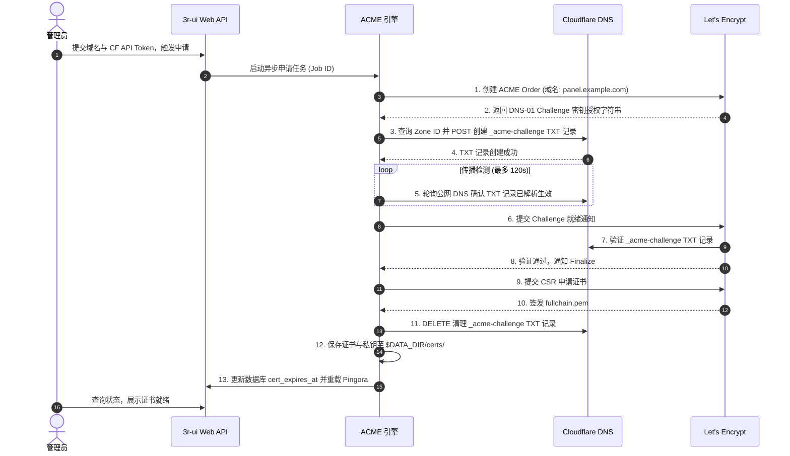

## Goal Capsule

- **Objective**: 用户能够直接通过绑定域名和 HTTPS 安全访问 3r-ui Web 管理界面，无需在宿主机额外配置或维护外部 Nginx/Caddy 反向代理，并通过 Cloudflare DNS-01 自动化完成 SSL 证书申请与续期。
- **Means**: 在 3r-ui 单二进制中内嵌 Cloudflare Pingora 反向代理引擎终结 TLS 并转发内部 Axum HTTP 服务，搭配内置 ACME 客户端与 Cloudflare DNS API 实现 DNS-01 自动质询与零暴露 80 端口证书签发 (KTD1, KTD2)。
- **Product authority**: 专职服务 3r-ui 面板自身的安全域名接入与证书管理，严格限定于自用场景；不扩展为通用多站点反代服务，不介入 Xray REALITY 入站流量嗅探分流。
- **Open blockers**: 无。
- **Product Contract preservation**: 新建计划（product_contract_source: ce-plan-bootstrap），范围由本次交互确认锁定。

---

## Product Contract

### Summary

3r-ui 当前默认仅提供本地明文 HTTP 服务（127.0.0.1:2053），若要通过公网域名安全访问后台，管理员必须自行在服务器上安装配置 Caddy 或 Nginx 反向代理。此外，多数云服务器和家庭宽带环境封禁 80 端口，导致标准的 HTTP-01 证书申请受阻。

本计划为 3r-ui 增加内置的 Cloudflare Pingora 反向代理服务与 ACME 证书管理模块：
1. 管理员可在 Web 界面（或首次启动环境变量）配置域名、HTTPS 监听端口与 TLS 证书模式。
2. 支持配置 Cloudflare API Token，通过 Cloudflare DNS-01 质询自动向 Let's Encrypt / ZeroSSL 申请与定期续期 SSL 证书（无需开放 80 端口）。
3. 同时支持指定服务器本地已有证书和私钥文件路径，满足已有证书或使用自定义 CA / Cloudflare Origin 证书的用户需求。
4. 3r-ui 主进程管理 Pingora 服务生命周期，透明反向代理本地 Axum Web 面板。

### Problem Frame

- **运维复杂度高**：现有架构（KD4）将 TLS 终结完全推给外部反代，破坏了 3r-ui "单文件开箱即用"的极致体验，管理员需要编写额外的 Nginx/Caddy 配置、配置 systemd 依赖与定时续期脚本。
- **80 端口受限**：绝大多数国内云服务器或自建轻量节点 80 端口未备案即被拦截，导致基于 HTTP-01 的自动化证书申请工具（如 Certbot、Caddy 默认模式）频频失败。
- **内存与性能优势**：采用 Rust 编写的 Cloudflare Pingora 作为内嵌代理库，无需额外运行重量级独立代理进程，在资源极其受限的 VPS 上依然轻量高效。

### Actors

- A1. 面板管理员：在 `/admin/settings` 配置域名、反代端口、Cloudflare API Token，查看证书状态与手动触发更新。
- A2. 内嵌 Pingora 反向代理：监听指定 HTTPS 端口，终结 TLS，校验 Host，转发至 3r-ui 本地 HTTP 服务。
- A3. ACME 证书轮询服务：定时检测证书有效期，通过 Cloudflare DNS API 增删 `_acme-challenge` TXT 记录完成 DNS-01 验证并保存新证书。
- A4. Cloudflare DNS API：接收 3r-ui 发起的 DNS 记录修改请求，完成域名所有权质询。

### Key Decisions

- KD1. **内置反代专职化**：Pingora 仅负责反代 3r-ui 本地 Axum HTTP 服务，不作为通用反向代理工具暴露任意 upstream 规则配置。Governs R1, R2.
- KD2. **证书自动化以 Cloudflare DNS-01 为主**：ACME 质询首选 Cloudflare API 自动管理 DNS TXT 记录，绕开 80 端口封禁痛点；同时保留本地证书文件路径配置作为通用 fallback。Governs R3, R4, R5.
- KD3. **端口隔离与独立性**：Pingora 独立监听配置端口（默认 8443，可改为 443 或任意自定义端口），与 Xray 入站端口彼此隔离，互不干扰。Governs R2, R6.
- KD4. **敏感凭据脱敏存储与展示**：Cloudflare API Token 保存在 SQLite 中，前端管理页面只做掩码回显与增量更新，避免凭据泄漏。Governs R7.

### Requirements

#### 反向代理服务
- R1. 3r-ui 内置 Pingora 反向代理服务，支持在后台设置中启用或禁用。
- R2. 支持自定义反代 HTTPS 监听端口（默认 8443）与绑定访问域名。
- R3. Pingora 服务启动后，通过配置的 TLS 证书建立 HTTPS 监听，并将所有合法的 HTTP 请求透明转发至 3r-ui 内部 Axum 服务，保持客户端真实 IP（注入 `X-Forwarded-For`、`X-Forwarded-Proto` 等头信息）并原生支持 WebSocket。
- R4. 支持 Host 头校验：非绑定域名的请求直接拒绝连接或返回 403 Forbidden，防范恶意扫描探测。

#### 证书管理与 ACME
- R5. 支持配置 Cloudflare API Token（需包含 Zone.DNS:Edit 权限）与可选 Zone ID；未提供 Zone ID 时系统能根据域名自动递归解析匹配正确的 Cloudflare Zone。
- R6. 集成 ACME DNS-01 客户端，支持一键触发及后台定时向 Let's Encrypt / ZeroSSL 申请多域名/单域名 SSL 证书。
- R7. 系统自动在 Cloudflare 添加 `_acme-challenge.<domain>` TXT 记录，并在公网 DNS 权威节点同步后通知 ACME 服务端验证，签发完成后自动清理临时 TXT 记录。
- R8. 签发的证书与私钥持久化存储在 `$DATA_DIR/certs/` 目录下（权限 0600），并记录签发时间、过期时间与当前状态到数据库。
- R9. 证书自动续期：后台常驻检测协程，当检测到证书距离到期不足 30 天时，自动执行续期流程并通知 Pingora 热重载新证书，无需重启面板。
- R10. 支持“手动自定义证书”模式：允许用户直接指定服务器本地已有的 `cert.pem` 和 `key.pem` 绝对路径。

#### Web 界面与管理
- R11. 在 `/admin/settings` 页面新增“反向代理与域名访问”卡片，包含开关、域名、端口、证书模式（Cloudflare 自动 / 本地文件）、Cloudflare API Token（掩码展示）及自定义路径输入项。
- R12. 页面直观展示当前证书状态（颁发者、生效时间、到期倒计时、域名绑定）。
- R13. 提供“保存并应用配置”和“立即申请/更新证书”按钮，操作执行过程具有异步状态与错误反馈。

### Scope Boundaries

- **In Scope**:
  - Pingora 作为 Rust 内置模块嵌入 3r-ui。
  - Cloudflare DNS-01 ACME 自动化申请与续期。
  - 自定义本地证书文件加载。
  - 域名/SNI 校验与安全头转发。
  - Web UI 配置、凭据脱敏与证书状态展示。
- **Deferred to Follow-Up Work**:
  - 支持其他 DNS 服务商（如 AliDNS、DNSPod、AWS Route53）的 DNS-01 质询插件。
  - HTTP 80 端口自动强制跳转 HTTPS（需占用 80 端口，可后续视需求以可选开关引入）。
- **Outside this product's identity**:
  - 通用多站点反向代理规则管理（添加任意第三方 upstream）。
  - 与 Xray REALITY 在 443 端口上基于 SNI 分流复用（Xray REALITY 具备特殊的偷窥探测防御机制，混部容易破坏抗封锁效果，保持端口正交）。

### Acceptance Examples

- AE1. **正常启用 Cloudflare ACME 流程**:
  - Given: 用户在设置中输入域名 `panel.example.com`，选择 Cloudflare DNS 模式并填入具备 DNS 编辑权限的 API Token，保存并点击“立即申请证书”。
  - When: 系统调用 Cloudflare API 并在 `_acme-challenge.panel.example.com` 成功添加 TXT 记录，完成 ACME DNS-01 验证。
  - Then: 证书文件成功写入 `$DATA_DIR/certs/panel.example.com/`，Pingora 在 `8443` 端口拉起 TLS 监听，浏览器访问 `https://panel.example.com:8443` 显示有效受信任证书并进入面板登录页；Cloudflare 上的临时 TXT 记录被自动清理。
- AE2. **自定义证书模式**:
  - Given: 用户选择“本地已有证书”，填入 `/etc/ssl/cert.pem` 与 `/etc/ssl/key.pem`，监听端口 `443`。
  - When: 用户点击保存。
  - Then: 系统校验文件可读性与证书有效性，Pingora 成功在 443 端口提供 HTTPS 服务。
- AE3. **非匹配域名直接阻断**:
  - Given: 反代配置绑定域名为 `panel.example.com`。
  - When: 外部攻击者通过直接访问服务器 IP `https://1.2.3.4:8443` 或未配置域名 `https://other.com:8443`。
  - Then: Pingora 直接拒绝或返回 403 Forbidden，不将请求透传至内部 Axum 面板。

---

## Planning Contract

### Key Technical Decisions

- KTD1. **Pingora 集成架构 (session-settled: user-approved)**
  - 采用 `pingora-proxy` 与 `pingora-core` 作为 Rust 直接依赖编译进 3r-ui，无需外部二进制。
  - Pingora 服务由独立管理结构 `ProxySupervisor` 管理，并在主进程的专用后台线程中运行，通过 Tokio 通道与事件协调优雅启停。
  - 反代上游固定指向 `127.0.0.1:{BIND_ADDR_PORT}`，复用已有的本地 Axum 路由与会话中间件。
- KTD2. **ACME DNS-01 引擎选型 (session-settled: user-directed)**
  - 使用 `instant-acme` 处理 RFC 8555 ACME 协议流程（支持 Let's Encrypt / ZeroSSL，纯 Rust、零外部工具依赖）。
  - DNS-01 质询使用项目内置的 `reqwest` 客户端与 Cloudflare API v4 交互，精准创建与删除 TXT 记录，并配合对公网权威 DNS（如 `1.1.1.1:53` / `8.8.8.8:53`）的 TXT 传播轮询，防止过早通知 ACME 导致验证失败。
- KTD3. **证书加载与热更新机制**
  - 证书持久化保存在 `$DATA_DIR/certs/` 目录下。
  - Pingora 监听器启动时加载对应证书；当证书续期成功或用户更新配置时，`ProxySupervisor` 触发重新初始化 Pingora TLS 监听或平滑重启代理服务。
- KTD4. **配置持久化与脱敏规范**
  - 新增数据库表 `proxy_settings`（单行记录，ID=1），持久化存储启用状态、监听端口、域名、证书模式、Cloudflare 凭据、证书到期时间。
  - API Token 在数据库中使用明文存储（配合数据库文件 0600 权限），向前端 HTML 模板渲染时使用 `sk-****` 脱敏掩码；表单提交时若字段值为掩码或为空，则保持原 Token 不变。

### High-Level Technical Design

#### 1. 架构与流量转发拓扑

```mermaid
graph TD
    Client["客户端 (浏览器/App)"]
    CF_API["Cloudflare DNS API"]
    ACME_Server["Let's Encrypt / ZeroSSL"]

    subgraph "3r-ui 进程"
        ProxySup["ProxySupervisor (生命周期管理)"]
        Pingora["Pingora 反代服务 (:8443)"]
        Axum["Axum Web 面板 (127.0.0.1:2053)"]
        ACME_Worker["ACME 轮询与续期任务"]
        DB[("SQLite (proxy_settings)")]
        CertStore["证书存储 ($DATA_DIR/certs/)"]
    end

    Client -->|HTTPS / WSS| Pingora
    Pingora -->|HTTP 反代 (带 X-Forwarded-*)| Axum
    ProxySup -->|启动 / 停止 / 重载| Pingora
    ACME_Worker -->|读写配置| DB
    ACME_Worker -->|ACME 协议交互| ACME_Server
    ACME_Worker -->|创建 / 清理 TXT 记录| CF_API
    ACME_Worker -->|写入新证书| CertStore
    Pingora -->|读取 TLS 证书| CertStore
```

#### 2. Cloudflare DNS-01 ACME 自动化申请时序



### Assumptions

- 服务器已安装系统根证书（如 `ca-certificates`），支持对外请求 Cloudflare API 与 Let's Encrypt 目录。
- 用户提供的 Cloudflare API Token 具备对应 Zone 的 `Zone.DNS:Edit` 权限。
- 若用户选择自定义证书模式，填写的证书文件路径在运行 3r-ui 的系统用户权限下可读，且文件格式为标准 PEM 编码。

### System-Wide Impact

- **编译构建依赖**：引入 `pingora` 系列依赖，可能需要 C 编译器或 CMake（处理内部 BoringSSL/OpenSSL 绑定），Makefile 需要保持 cross 跨平台编译脚本的兼容性。
- **内存占用**：Pingora 作为极轻量的 Rust 原生代理框架，常驻内存增加预计不超过 15~25 MB，满足低配 VPS 自用需求。
- **网络与安全**：Pingora 终结 TLS 后需正确传递客户端真实来源 IP 给 Axum，日志模块中的连接 IP 需要优先提取 `X-Forwarded-For`。

### Risks & Dependencies

- **跨平台静态编译风险**：Pingora 默认构建在 musl 静态链接（如 `x86_64-unknown-linux-musl`）时对 BoringSSL/OpenSSL 编译环境有特定依赖要求。
  - *缓解措施*：明确编译要求并在构建文档中说明 musl 与 gnu 编译环境的配置，必要时提供纯 OpenSSL 或指定 backend 选项。
- **Cloudflare API 频控与 DNS 传播延迟**：某些地区 DNS 传播较慢，过早向 ACME 服务端发包会导致验证失败并触发重试频控。
  - *缓解措施*：在通知 ACME 服务端前，本地主动使用 DoH 或指定 1.1.1.1 校验 TXT 记录存在且匹配，并设置带超时的轮询等待。

---

## Implementation Units

### U1. 数据库迁移与反代配置模型
- **Goal**: 在 SQLite 中建立反向代理配置表，并在 Rust 代码中实现模型增删改查。
- **Requirements**: R1, R2, R5, R8, R10, R11.
- **Dependencies**: 无。
- **Files**:
  - `migrations/0005_proxy_settings.sql` (新建)
  - `src/db/models.rs` (修改)
  - `src/db/mod.rs` (修改)
  - `src/proxy/config.rs` (新建)
- **Approach**:
  1. 编写迁移脚本 `0005_proxy_settings.sql`，创建 `proxy_settings` 单例配置表（默认 id=1 预置记录）。
  2. 在 `src/db/models.rs` 中定义 `ProxySettings` 结构体，字段包含 `enabled`, `listen_port`, `domain`, `cert_mode`, `cf_api_token`, `cf_zone_id`, `custom_cert_path`, `custom_key_path`, `cert_expires_at`, `last_renewed_at`, `last_error`。
  3. 在 `src/proxy/config.rs` 中实现 `get_proxy_settings(pool)` 与 `update_proxy_settings(pool, ...)` 辅助函数。
- **Patterns to follow**: 参考 `migrations/0001_initial.sql` 和 `src/db/models.rs` 中的已有模式。
- **Test scenarios**:
  - 迁移测试：运行 SQLite 迁移脚本，验证 `proxy_settings` 表成功创建并包含单行默认配置。
  - 读取与更新测试：测试修改配置字段（如修改 domain、端口、更新证书到期时间），验证事务更新成功且读取数据准确。
  - 凭据脱敏函数测试：测试 `masked_cf_token()`，输入有效 token 返回 `sk-***...***`，空字符串返回空。

### U2. Cloudflare DNS API 客户端与 DNS-01 质询提供者
- **Goal**: 实现基于 Cloudflare API v4 的 DNS TXT 记录创建、检索与删除功能，支持自动 Zone ID 解析与传播等待。
- **Requirements**: R5, R7.
- **Dependencies**: U1.
- **Files**:
  - `src/proxy/cloudflare.rs` (新建)
  - `src/proxy/mod.rs` (新建)
  - `Cargo.toml` (修改)
- **Approach**:
  1. 在 `src/proxy/cloudflare.rs` 中定义 `CloudflareClient` 结构体，封装 `reqwest::Client`。
  2. 实现 `get_zone_id(domain)`：如果配置未提供 zone_id，递归按域名父级（如 `panel.sub.example.com` -> `sub.example.com` -> `example.com`）调用 `/client/v4/zones?name=...` 获取 Zone ID。
  3. 实现 `create_txt_record(zone_id, name, content)`：调用 `/client/v4/zones/{zone_id}/dns_records` 创建 `_acme-challenge` TXT 记录，记录 TTL 设为 120 秒。
  4. 实现 `delete_txt_record(zone_id, record_id)`：调用 DELETE 接口清理临时记录。
  5. 实现 `wait_dns_propagation(name, expected_content, timeout)`：使用 DoH（Cloudflare 1.1.1.1 / Google 8.8.8.8）轮询验证 TXT 记录是否已在公网解析生效。
- **Patterns to follow**: 参考 `src/xray/installer.rs` 中使用 `reqwest` 的异步请求与错误处理结构。
- **Test scenarios**:
  - Mock API 创建记录测试：模拟 Cloudflare 200 响应，验证发送的 POST JSON 格式包含正确的 name、type="TXT"、content。
  - Mock 自动寻找 Zone ID 测试：模拟逐级查找域名对应 Zone，测试正确匹配到根域的 Zone ID。
  - 错误处理测试：模拟 Token 无权限（403）或网络超时，验证返回明确的 `AppError::Proxy(...)` 错误信息。

### U3. ACME 协议流程与证书生命周期管理
- **Goal**: 集成 ACME 客户端，结合 Cloudflare 提供者完成 Let's Encrypt / ZeroSSL 证书申请、下载与本地落盘，并提供到期自动续期检测。
- **Requirements**: R6, R7, R8, R9.
- **Dependencies**: U2.
- **Files**:
  - `src/proxy/acme.rs` (新建)
  - `src/proxy/cert.rs` (新建)
  - `Cargo.toml` (修改引入 `instant-acme`, `rcgen`)
- **Approach**:
  1. 在 `src/proxy/acme.rs` 中实现 `request_certificate(pool, data_dir, cf_client, domain)` 函数。
  2. 初始化 ACME Account（若本地无 ACME 账户私钥则自动生成并持久化到 `$DATA_DIR/certs/acme_account.json`）。
  3. 创建 NewOrder，提取 DNS-01 Challenge 的 token 与计算 key_authorization SHA256 base64url 值。
  4. 调用 `CloudflareClient` 写入 `_acme-challenge.<domain>`，等待 DNS 生效后向 ACME 服务端发送 Challenge ready 确认。
  5. 轮询 Order 状态直至 `ready`，生成 CSR 并提交 Finalize，下载完整证书链 `fullchain.pem` 和对应私钥 `privkey.pem` 保存至 `$DATA_DIR/certs/<domain>/`。
  6. 调用 `CloudflareClient` 删除临时 TXT 记录。
  7. 解析证书 PEM 得到 `not_after` 过期时间戳，持久化至 `proxy_settings` 表。
  8. 在 `src/proxy/cert.rs` 中实现 `check_and_renew_certs_loop` 定时轮询任务（每 24 小时检查一次，剩余天数 < 30 天时自动执行续期）。
- **Patterns to follow**: 参考 `src/xray/stats.rs` 和 `src/xray/logs.rs` 的后台 `tokio::spawn` 轮询任务结构。
- **Test scenarios**:
  - 证书过期判断测试：给定 mock 证书有效期（剩余 10 天 / 40 天），验证检查逻辑在 < 30 天时触发续期，在 > 30 天时跳过。
  - 证书与私钥落盘测试：验证生成的 PEM 文件写入 `$DATA_DIR/certs/`，权限设置为 0600，且私钥与公钥匹配。
  - 异常清理测试：当 ACME 校验阶段抛出异常时，验证 `ensure` 或 `drop` 能够兜底调用 Cloudflare 删除已创建的临时 TXT 记录，不留垃圾数据。

### U4. Pingora 反向代理核心服务引擎
- **Goal**: 使用 Pingora 构建 HTTPS 反向代理服务，支持 TLS 证书加载、Host 头校验与安全头转发。
- **Requirements**: R1, R2, R3, R4, R10.
- **Dependencies**: U1, U3.
- **Files**:
  - `src/proxy/server.rs` (新建)
  - `src/proxy/supervisor.rs` (新建)
  - `Cargo.toml` (修改引入 `pingora-proxy`, `pingora-core`, `async-trait`)
- **Approach**:
  1. 在 `src/proxy/server.rs` 中实现 `ProxyHttp` trait：
     - `upstream_peer`: 返回指向本地 Axum 面板的 peer（`127.0.0.1:{axum_port}`，纯 HTTP）。
     - `request_filter`: 校验传入的 Host 头与 SNI 是否匹配数据库绑定的 `domain`，不匹配则返回 403 Forbidden。
     - `upstream_request_filter`: 注入 `X-Forwarded-For`、`X-Forwarded-Proto: https`、`X-Forwarded-Host`，保持客户端上下文。
     - 支持 WebSocket 连接透传升级。
  2. 在 `src/proxy/supervisor.rs` 中实现 `ProxySupervisor`：
     - 管理 Pingora 服务的启动、停止与热重载。
     - 根据数据库中配置的 `cert_mode`（Cloudflare ACME 签发路径或自定义本地证书路径）读取证书与私钥，配置 Pingora TLS 监听器。
     - 监听 mpsc 命令通道（`Reload`, `Stop`, `Start`），在后台专属线程中启动 Pingora 监听，并在配置变更时平滑重启监听器。
- **Patterns to follow**: 参考 `src/xray/process.rs` 中 `XraySupervisor` 的命令循环、生命周期管理与优雅停机模式。
- **Test scenarios**:
  - Host 过滤测试：构造匹配域名与不匹配域名的请求，验证匹配域名放行至 upstream，不匹配域名立即返回 403。
  - 上游请求头增强测试：验证发往 Axum 的请求被注入了正确的 `X-Forwarded-For` 与 `X-Forwarded-Proto: https`。
  - 证书加载测试：测试有效证书路径加载成功，当证书文件不存在或无效时，Supervisor 记录明确的 `last_error` 且不导致主进程崩溃。

### U5. 核心服务编排与应用生命周期集成
- **Goal**: 将 Pingora 反代及 ACME 续期服务注册到应用启动与退出流程中，实现面板一站式引导。
- **Requirements**: R1, R9.
- **Dependencies**: U4.
- **Files**:
  - `src/lib.rs` (修改)
  - `src/config.rs` (修改)
  - `src/web/mod.rs` (修改)
- **Approach**:
  1. 在 `AppState` 中增加 `proxy_tx: mpsc::Sender<ProxyCommand>` 与 `pool` 共享访问。
  2. 在 `src/lib.rs` 的 `start_services` 中初始化 `ProxySupervisor`，读取数据库 `proxy_settings`：
     - 若 `enabled == 1` 且证书有效，自动启动 Pingora 监听。
     - 启动后台 ACME 自动续期任务 `check_and_renew_certs_loop`。
  3. 在 `Services::shutdown` 中增加向 `proxy_tx` 发送退出命令并等待 Pingora 优雅停机。
  4. Axum 的中间件提取客户端 IP 时，若检测到反代头（来自 127.0.0.1 上游发来的 `X-Forwarded-For`），优先使用该 IP 记录审计与连接日志。
- **Patterns to follow**: 参考 `src/lib.rs` 中 `supervisor_handle`, `stats_handle`, `http_handle` 的启动和优雅退出模式。
- **Test scenarios**:
  - 启停集成测试：启动面板服务，启用 proxy，模拟 Ctrl-C 信号，验证 Pingora 监听端口与 Axum 服务均被干净释放。
  - 真实 IP 穿透测试：通过带 `X-Forwarded-For: 203.0.113.195` 访问面板，验证中间件与日志模块识别出的当前访问者 IP 为 `203.0.113.195` 而非 `127.0.0.1`。

### U6. Web 后台设置表单与证书操作交互
- **Goal**: 在设置页面增加反向代理与证书管理卡片，提供配置修改、异步申请状态跟踪与凭据脱敏回显。
- **Requirements**: R11, R12, R13.
- **Dependencies**: U1, U3, U4.
- **Files**:
  - `src/web/settings.rs` (修改)
  - `templates/settings.html` (修改)
- **Approach**:
  1. 在 `templates/settings.html` 中新增“反向代理与 HTTPS 域名访问”卡片：
     - 表单控件：启用开关、域名、监听端口、证书模式单选框（Cloudflare DNS / 本地证书文件）。
     - Cloudflare 专属区域：API Token 输入框（带有“已配置，输入新值覆盖”掩码提示）、Zone ID（选填）。
     - 本地证书专属区域：证书路径、私钥路径输入框。
     - 证书信息展示栏：颁发状态、域名、过期时间、倒计时天数。
     - 按钮：“保存配置”、“立即申请/更新证书”。
  2. 在 `src/web/settings.rs` 中增加路由处理：
     - `POST /admin/settings/proxy`: 保存配置表单；若 Token 传掩码则保持旧值；触发 ProxySupervisor 重载配置。
     - `POST /admin/settings/proxy/renew-cert`: 触发异步申请证书任务，返回进度任务 ID。
     - `GET /admin/settings/proxy/cert-status`: 返回证书最新状态 JSON/HTML 片段，支持前端 htmx 轮询操作结果。
- **Patterns to follow**: 参考 `src/web/settings.rs` 中的 xray 二进制更新任务状态机（`JobStatus`, `JobStage`）与 htmx 轮询交互模式。
- **Test scenarios**:
  - 表单保存测试：提交有效表单数据，验证数据库更新并返回 303 Redirect 或成功状态。
  - Token 掩码防覆盖测试：提交 `sk-********` 占位字符串，验证数据库中原有的真实 API Token 未被破坏修改。
  - 异步任务反馈测试：触发申请证书接口，验证返回包含 Job ID 的任务记录，并在完成后正确转为 `Succeeded` 或 `Failed`。

### U7. 运维打包、脚本适配与全链路测试
- **Goal**: 适配 `Makefile`、`install.sh` 与系统服务配置，编写完整的集成测试验证端到端反代与证书流程。
- **Requirements**: R1, R2, R3, R10.
- **Dependencies**: U5, U6.
- **Files**:
  - `Makefile` (修改)
  - `install.sh` (修改)
  - `packaging/3r-ui.env` (修改)
  - `tests/proxy_e2e_test.rs` (新建)
- **Approach**:
  1. 更新 `Makefile` 检查跨平台编译选项（验证 `cargo build` 与 Linux 构建目标）。
  2. 更新 `packaging/3r-ui.env` 与 `install.sh`，说明反代端口与域名访问相关环境变量（若有）。
  3. 编写 `tests/proxy_e2e_test.rs` 集成测试：
     - 启动临时 Axum 实例与临时 Pingora 实例（使用自签测试证书）。
     - 通过 HTTPS 客户端请求 Pingora 端口，验证正确获取到 Axum 登录页响应。
     - 测试 WebSocket 连接握手透传。
     - 测试 Host 不匹配时被正确拦截。
- **Patterns to follow**: 参考 `tests/` 下现有的集成测试用例。
- **Test scenarios**:
  - E2E 反代握手与透传：客户端发起 TLS 连接并发送 HTTP 请求，验证 Axum 收到并在响应头与正文中正确回写。
  - 端口重载验证：在测试中更改端口并触发重载，验证旧端口释放、新端口成功响应。

---

## Verification Contract

### 自动化验证命令
- **单元与数据库测试**:
  ```bash
  cargo test --lib
  ```
- **代码规范与格式检查**:
  ```bash
  make fmt-check
  make clippy
  ```
- **反代与端到端集成测试**:
  ```bash
  cargo test --test proxy_e2e_test
  ```

### 手动验收步骤 (Manual Walkthrough)
1. **本地自定义证书冒烟测试**:
   - 使用 `openssl req -x509 -newkey rsa:2048 -nodes -keyout /tmp/test.key -out /tmp/test.crt -days 365 -subj "/CN=127.0.0.1"` 生成临时测试证书。
   - 登录后台进入 `/admin/settings`，启用反向代理，模式选择“本地文件”，输入证书路径与端口 `8443`，保存。
   - 使用浏览器访问 `https://127.0.0.1:8443`，忽略自签警告后能够正常打开 3r-ui 登录页并操作仪表盘。
2. **Cloudflare ACME 申请测试**:
   - 填写有效测试域名及 Cloudflare API Token。
   - 点击“立即申请证书”，观察日志中 TXT 记录创建、等待解析、ACME 验证通过并自动删除 TXT 记录的全过程。
   - 刷新页面，证书状态显示为受信任的 Let's Encrypt / ZeroSSL 证书并显示到期时间。
3. **安全拦截测试**:
   - 使用 `curl -k -H "Host: bad-domain.com" https://127.0.0.1:8443`，验证请求直接被拒绝或返回 403。

---

## Definition of Done

- [ ] `proxy_settings` 数据库迁移脚本与数据模型实现完成，版本升级平滑。
- [ ] Cloudflare DNS-01 API 客户端实现创建、轮询传播与自动清理，单测覆盖异常分支。
- [ ] ACME 证书申请引擎正常运作，成功下载证书至数据目录并解析有效期限。
- [ ] Pingora 反向代理服务成功嵌入，支持 TLS 终结、Host 过滤、头信息透传与平滑重载。
- [ ] Web 设置后台提供完整的反代配置表单、Cloudflare Token 掩码保护、证书状态展示与异步申请反馈。
- [ ] 证书定时续期任务稳定运行，在剩余有效期 < 30 天时自动触发续期并不中断服务。
- [ ] 所有代码通过 `cargo test`, `make clippy`, `make fmt-check`。
- [ ] 无废弃死代码或未清理的临时调试文件残留在 git 工作区。
