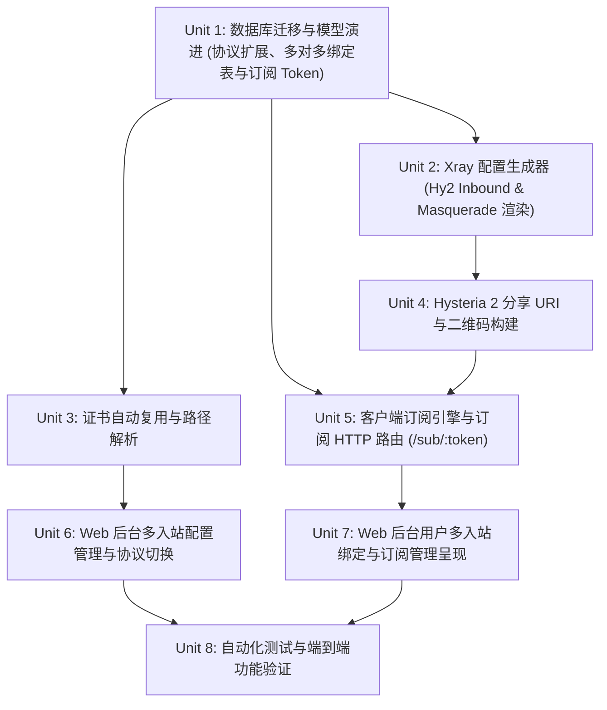

# feat: 添加 Hysteria 2 (Hy2) 入站协议、用户多入站绑定与客户端订阅模式方案

- **Date:** 2026-11-24
- **Author:** Antigravity (Google DeepMind)
- **Status:** Draft / Ready for Review
- **Plan File:** `docs/plans/2026-11-24-1808-feat-hysteria2-inbound-protocol-plan.md`

---

## 1. 目标与背景 (Problem Frame & Objective)

### 1.1 现状与需求
目前 3R-UI 仅支持单一的 **VLESS + REALITY + XHTTP** 入站协议，并且分享节点主要依赖单链接复制和二维码。
随着使用场景扩展，面临两个核心诉求：
1. **多协议共存与 Hysteria 2 支持**：在恶劣弱网、跨国丢包严重的 UDP 环境下，基于 QUIC / BBR 单边加速的 **Hysteria 2 (Hy2)** 协议能提供更流畅的网络体验。需要支持 VLESS 和 Hy2 两个独立入站并存，用户可以灵活选择绑定任意协议或全部启用。
2. **客户端订阅模式 (Subscription)**：单链接分享在节点配置更新（如端口、域名、路径调整）或多节点环境下维护成本高。用户需要每个 Client 拥有专属且安全的**订阅链接**（可通过 v2rayN、Clash Verge、Sing-box、NekoBox、Shadowrocket、Loon、Surge 等现代客户端一键订阅更新），并支持输出标准 Base64 聚合节点列表及携带标准流量信息响应头（`Subscription-Userinfo`）。

### 1.2 关键约束与架构决策 (Key Technical Decisions)
1. **Xray-core 原生 Hysteria 2 协议适配**：
   - Xray-core（≥ 1.8.x，当前环境 26.3+）原生支持 `protocol: "hysteria"`，通过 `settings.version: 2` 运行标准 Hysteria v2。
   - `streamSettings` 设置为 `network: "hysteria"`，`security: "tls"`，并开启 `alpn: ["h3"]`，默认搭配 HTTP 伪装代理（masquerade），防主动探测。
2. **多入站架构演进 (Multiple Inbounds Coexistence)**：
   - 数据库 `inbounds` 表从“单行单入站”演进为“多入站支持”：新增 `protocol`（`vless` / `hysteria2`）、`cert_mode`（`auto` / `custom`）、`custom_cert_path`、`custom_key_path` 等字段。
   - 移除单个 active inbound 的唯一性限制，支持 VLESS 监听一个端口（例如 443/TCP），Hy2 监听另一个独立端口（例如 8443/UDP）。
3. **入站与用户绑定关系 (Inbound <-> Client Binding)**：
   - 新增关联表 `client_inbounds (client_id, inbound_id)`，兼容旧表 `clients.inbound_id`（向下兼容并平滑迁移）。
   - 用户编辑界面支持勾选绑定的协议入站（例如“全部启用”、“仅 VLESS”、“仅 Hysteria 2”）。
4. **订阅令牌与订阅端点安全设计 (Subscription Endpoint Security)**：
   - 为每个用户新增不可推导的高熵随机 `sub_token`（16~32 字符），避免直接暴露 UUID 作为对外 URL 路由。
   - 订阅公开端点：`GET /sub/:token`（公开免登录访问，但需匹配活跃 token）。
   - 用户被禁用（disabled）或过期（expired）时，订阅请求返回空节点列表或 404/403，并返回清零的限额头信息。
5. **标准订阅格式与流量头 (Subscription Standards)**：
   - 响应内容：输出该用户所有已绑定且已启用的入站 URI 列表（以 `\n` 分隔并经过 Base64 编码，适配所有主流客户端）。
   - 响应头支持 `Subscription-Userinfo: upload=...; download=...; total=...; expire=...`，客户端导入后可直接在其界面上看到剩余流量和到期时间。
   - 提供 `profile-update-interval: 24` 建议更新频率头与 `content-disposition: attachment; filename="..."`。
6. **证书安全复用机制**：
   - Hy2 依赖有效的 TLS 证书。优先自动复用系统已生成的 ACME DNS 证书（`certs/<domain>/fullchain.pem` 和 `privkey.pem`），同时保留自定义本地 PEM 证书路径选项。

---

## 2. 实施单元分解 (Implementation Units)



### Unit 1: 数据库迁移与模型演进 (`migrations/0006_hy2_and_subscription.sql` & `src/db/models.rs`)
- **目标**：拓展 `inbounds` 协议字段、建立用户入站多对多映射表，并为 `clients` 增加 `sub_token` 字段。
- **任务**：
  1. 创建迁移脚本 `migrations/0006_hy2_and_subscription.sql`：
     - 为 `inbounds` 表新增字段：
       - `protocol TEXT NOT NULL DEFAULT 'vless'`（支持 `'vless'`, `'hysteria2'`）
       - `cert_mode TEXT NOT NULL DEFAULT 'auto'`（`auto`: 复用全局证书, `custom`: 自定义路径）
       - `custom_cert_path TEXT`
       - `custom_key_path TEXT`
       - `masquerade_url TEXT DEFAULT 'https://news.ycombinator.com/'`
     - 移除单个 active inbound 限制（如有），支持多入站按端口区分。
     - 为 `clients` 表新增字段：
       - `sub_token TEXT`（加唯一索引 `idx_clients_sub_token`）。
     - 创建关联表 `client_inbounds`：
       ```sql
       CREATE TABLE IF NOT EXISTS client_inbounds (
           client_id INTEGER NOT NULL REFERENCES clients(id) ON DELETE CASCADE,
           inbound_id INTEGER NOT NULL REFERENCES inbounds(id) ON DELETE CASCADE,
           PRIMARY KEY (client_id, inbound_id)
       );
       INSERT OR IGNORE INTO client_inbounds (client_id, inbound_id)
       SELECT id, inbound_id FROM clients WHERE inbound_id IS NOT NULL;
       ```
  2. 修改 `src/db/models.rs`：
     - 更新 `Inbound` 模型字段。
     - 更新 `Client` 模型字段增加 `sub_token`。
- **验证**：编写 `cargo test --lib db` 验证迁移运行与数据完整性。

---

### Unit 2: Xray 配置生成器扩展 (`src/xray/config.rs`)
- **目标**：实现 Hysteria 2 入站配置及多入站并存的 JSON 生成。
- **任务**：
  1. 在 `src/xray/config.rs` 中抽象多协议渲染：
     - 若 `inbound.protocol == "vless"`：渲染 VLESS-REALITY-XHTTP。
     - 若 `inbound.protocol == "hysteria2"`：生成 Hysteria 2 的 Xray 专属入站配置：
       ```json
       {
         "tag": "inbound-<id>",
         "listen": "0.0.0.0",
         "port": <port>,
         "protocol": "hysteria",
         "settings": {
           "version": 2,
           "users": [
             { "auth": "<client.uuid>", "email": "<client.uuid>", "level": 0 }
           ],
           "ignoreClientBandwidth": false
         },
         "streamSettings": {
           "network": "hysteria",
           "security": "tls",
           "tlsSettings": {
             "certificates": [{ "certificateFile": "<cert_path>", "keyFile": "<key_path>" }],
             "alpn": ["h3"]
           },
           "hysteriaSettings": {
             "version": 2,
             "udpIdleTimeout": 60,
             "masquerade": { "type": "proxy", "url": "<masquerade_url>" }
           }
         }
       }
       ```
  2. 客户端关联过滤：每个 inbound 仅装载在 `client_inbounds` 中关联的活跃用户。
  3. 路由规则：所有入站统一路由至 `direct` 出站。
- **验证**：单测 `cargo test --lib xray::config`，通过 `xray run -test` 验证生成配置的有效性。

---

### Unit 3: 证书安全复用与路径解析 (`src/proxy/cert.rs`)
- **目标**：为 Hysteria 2 提供健壮的 TLS 证书解析与自动 fallback 机制。
- **任务**：
  1. 提供 `resolve_inbound_cert(data_dir, inbound, proxy_settings) -> Result<(PathBuf, PathBuf)>`：
     - `auto` 模式：优先查找 `${data_dir}/certs/<domain>/fullchain.pem`（Pingora 自动化证书）。若证书尚未签发，自动生成临时的有效自签证书以供 Xray 启动，杜绝进程启动退避。
     - `custom` 模式：使用用户在入站中填写的本地 PEM 证书和私钥路径。
- **验证**：编写单元测试验证证书匹配与自签 fallback 逻辑。

---

### Unit 4: Hysteria 2 分享 URI 构建 (`src/share/hy2.rs` & `src/share/mod.rs`)
- **目标**：为 Hysteria 2 客户端生成标准协议分享链接与二维码。
- **任务**：
  1. 新建 `src/share/hy2.rs`：
     - 实现 `build_hy2_uri(client: &Client, inbound: &Inbound, host: &str) -> String`：
       `hysteria2://<uuid>@<host>:<port>/?sni=<sni>&insecure=0#<tag>`
     - 支持处理自定义别名和 SNI 参数。
  2. 统一整合至 `src/share/mod.rs`。
- **验证**：编写 `tests/share.rs` 单元测试验证 Hy2 URI 格式规范。

---

### Unit 5: 客户端订阅引擎与订阅 HTTP 路由 (`src/web/sub.rs` & `src/web/mod.rs`)
- **目标**：实现免登录但安全的客户端节点订阅接口。
- **任务**：
  1. 新建 `src/web/sub.rs` 实现 `GET /sub/:token` 处理器：
     - 校验 `token` 对应活跃客户端：若客户端不存在、处于 `disabled` 或已过期，返回 404 或空节点列表。
     - 查询该客户端绑定的所有有效入站（VLESS / Hy2）。
     - 生成每个入站对应的完整 URI，以换行符连接后进行 Base64 编码输出。
     - 注入标准订阅响应头：
       - `Subscription-Userinfo: upload=<bytes>; download=<bytes>; total=<quota>; expire=<ts>`（实时查询最新 traffic snapshot 计算）。
       - `Profile-Update-Interval: 24`
       - `Content-Disposition: attachment; filename="3r-ui.txt"`
       - `Content-Type: text/plain; charset=utf-8`
  2. 在 `src/web/mod.rs` 注册公开无 Session 路由 `.route("/sub/:token", get(sub::subscription_handler))`。
- **验证**：编写集成测试测试订阅接口的 Base64 节点解码、流量头以及失效客户端的权限拦截。

---

### Unit 6: Web 后台多入站配置管理 (`src/web/inbound.rs` & `templates/inbound_form.html`)
- **目标**：支持查看、创建与修改不同协议（VLESS / Hy2）的入站。
- **任务**：
  1. 修改入站表单：
     - 支持选择协议类型（VLESS-REALITY-XHTTP / Hysteria 2）。
     - 针对 Hysteria 2，输入端口、伪装网页 URL、证书模式（自动复用面板域名证书 / 自定义证书）。
  2. 多入站管理支持：
     - 支持配置多个入站（例如 443 跑 VLESS，8443 跑 Hy2），保存并自动触发重载。
- **验证**：测试 Hy2 入站的表单提交、更新与重载。

---

### Unit 7: Web 后台用户多入站绑定与订阅管理呈现 (`src/web/clients.rs` & `templates/clients_*.html`)
- **目标**：允许用户选择绑定入站协议，并在详情页展示各协议链接与聚合订阅链接。
- **任务**：
  1. 用户创建/编辑表单：
     - 展示「绑定入站协议」复选框组（列出当前所有已启用的入站：如 `[√] 443 - VLESS`, `[√] 8443 - Hy2`）。
     - 提交时同步更新 `client_inbounds` 关系表。若未生成 `sub_token` 则自动生成高熵 Token。
  2. 用户详情页 (`templates/clients_detail.html`)：
     - **订阅卡片 (Subscription Card)**：
       - 展示专属订阅 URL：`https://<PUBLIC_HOST或反代域名>:<port>/sub/<sub_token>`
       - 提供「复制订阅链接」按钮（带 Toast 提示）与专属订阅二维码。
       - 说明支持一键导入 Clash、Sing-box、v2rayN、NekoBox、Shadowrocket 等。
     - **单节点卡片**：
       - 根据该用户当前绑定的入站，分组循环展示 VLESS 和 Hysteria 2 单节点链接与二维码。
- **验证**：集成测试验证用户绑定多入站后，详情页能够正确渲染订阅链接和独立节点卡片。

---

### Unit 8: 自动化测试与端到端功能验证 (`tests/hy2_e2e_test.rs` & `tests/sub_test.rs`)
- **目标**：全流程集成与代码质量门禁。
- **任务**：
  1. 编写订阅端点测试：测试 Base64 内容解码还原节点 URI、测试 `Subscription-Userinfo` 头计算。
  2. 编写端到端测试：双入站同时监听，用户绑定分别测试。
  3. 执行全量代码检查：
     - `cargo test --tests`
     - `cargo clippy --all-targets -- -D warnings`
     - `cargo fmt --check`
- **验证**：全量测试 100% 通过，0 警告。

---

## 3. 风险与缓解对策 (Risks & Mitigations)

| 风险项 | 影响分析 | 缓解对策 |
| :--- | :--- | :--- |
| **订阅链接被恶意猜测或暴力枚举** | 攻击者可能尝试遍历 URL 窃取用户节点与流量 | 采用 16 字节安全随机数生成的 URL 安全 Base64 字符串作为 `sub_token`，空间大小达 $2^{128}$，无法被暴力猜测 |
| **Hy2 证书缺失导致 Xray 拒绝启动** | 新环境尚未申请域名证书时启动 Hy2 会报 `Failed to build TLS config` | `auto` 模式下若未签发证书，自动生成临时自签证书占位，保证 Xray 进程不崩溃 |
| **旧用户数据兼容性** | 升级前已创建的旧用户可能没有 `sub_token` 或多对多关联 | 迁移脚本中通过 SQL 为旧用户自动绑定原有的 `inbound_id`，并在读取或首次更新时自动填充 `sub_token` |
| **UDP 端口安全组未放行** | Hysteria 2 基于 QUIC (UDP 传输)，若防火墙未开 UDP 客户端将无法连接 | 在界面入站设置中增加显眼的黄色提示条，提醒放行服务器防火墙 UDP 对应端口 |

---

## 4. 交付与下一步

计划文档已更新并持久化保存至：
`docs/plans/2026-11-24-1808-feat-hysteria2-inbound-protocol-plan.md`
