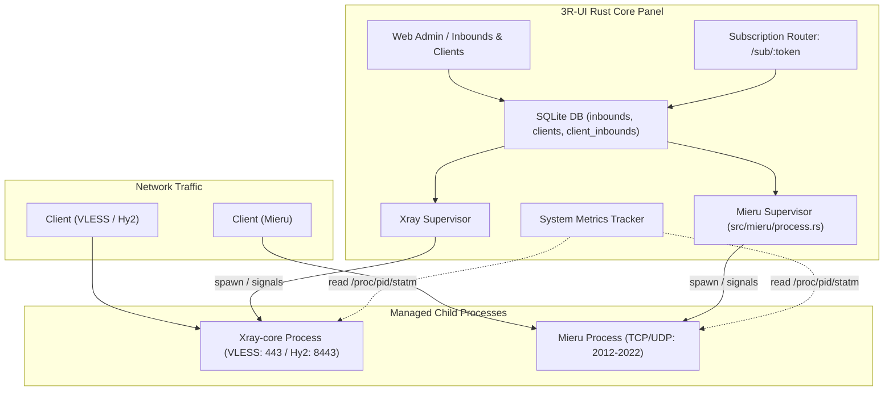
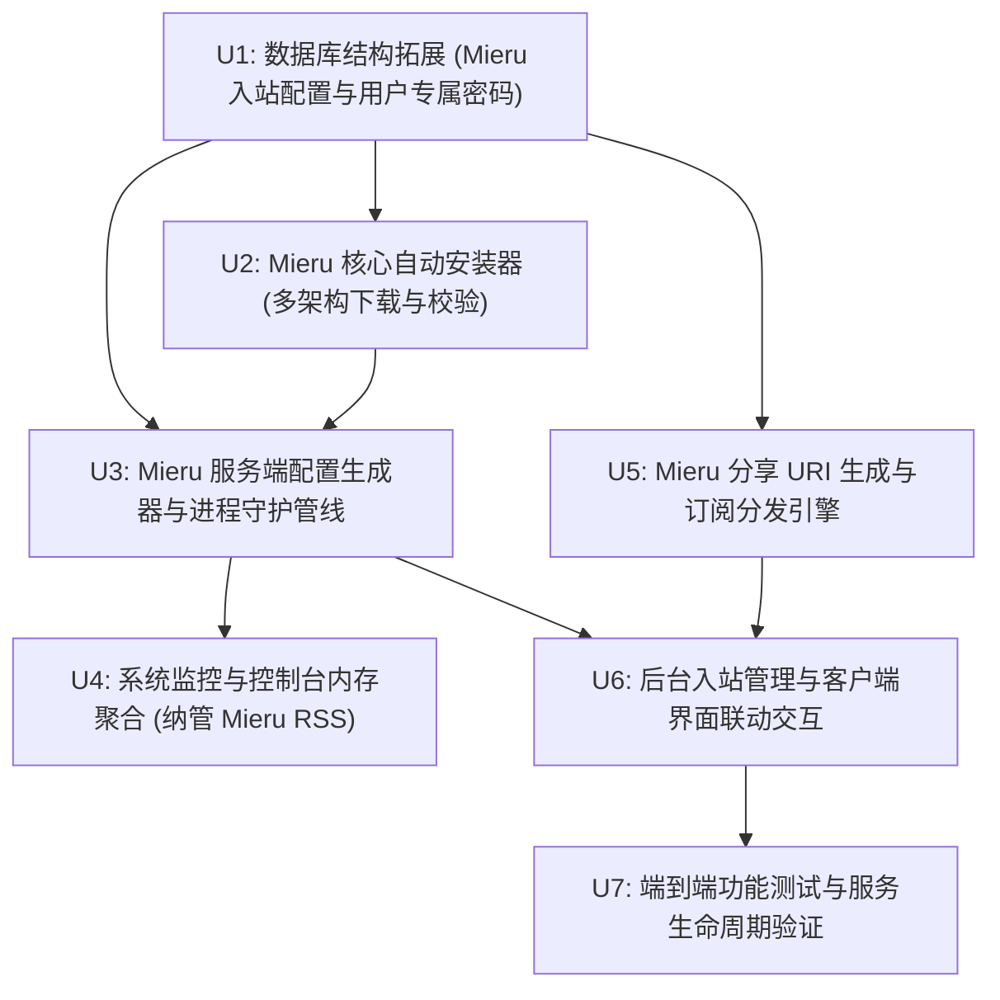

## Goal Capsule

- **Objective:** 3R-UI 面板支持 Mieru 入站协议，使用户在不需要域名与 SSL 证书的条件下，即可一键部署并使用高抗主动探测与抗 DPI 的 Mieru 代理节点，并通过客户端订阅接口与分享弹窗便捷分发。
- **Means:** 引入轻量化 Mieru 服务端守护进程（`enfein/mieru`），由 3R-UI 进行跨平台（Debian/Ubuntu x86_64 及 ARM64）二进制自动拉取、配置文件渲染与进程生命周期管理，并通过数据库拓展与订阅路由生成标准 `mieru://` / `mierus://` 链接。 (KTD1, KTD2)
- **Authority Hierarchy:**
  1. 用户安全与凭据隔离（Mieru 动态加盐与随机凭据）
  2. 面板进程与系统的稳定性（子进程异常退出自愈、内存开销限制在 20MB 以内）
  3. 客户端标准订阅体验一致性（兼容 Hiddify、NekoBox 及官方 Mieru 客户端）
- **Stop Conditions:** 任何外部网络波动或 GitHub API 限流不得导致面板本身启动阻塞；若 Mieru 服务端启动失败，不得影响现存 VLESS 或 Hysteria 2 入站的正常工作。

---

## Product Contract

### Summary
本方案为 3R-UI 引入第三种原生核心入站协议——**Mieru**。与依赖 TLS 证书及真实域名的 VLESS-REALITY 和 Hysteria 2 不同，Mieru 采用基于时间窗口的动态密钥加密与重度填充混淆，天然免疫 GFW 主动探测。方案涵盖 Mieru 守护进程跨平台管理、入站表单配置、用户认证凭据派生、订阅聚合输出以及系统监控内存聚合。

### Problem Frame
1. **痛点**：目前 3R-UI 支持 VLESS 和 Hysteria 2，但两者在部署时对域名解析或优质 SNI 伪装站依赖较深；在敏感时期或纯 IP 节点上，用户急需一种免域名、免申请证书且具有强抗审查能力的现代代理协议。
2. **用户价值**：
   - 管理员无需申请域名或配置 Cloudflare API，仅需指定端口或端口段即可一键开启 Mieru 节点。
   - 节点自动进入用户的订阅列表，主流跨平台客户端（如 Hiddify、NekoBox）可通过标准订阅直接更新并连接。

### Requirements

- R1. **多协议共存与 Mieru 入站管理**：
  管理员可在后台入站管理中新建或编辑 `mieru` 协议入站，支持配置监听端口或端口段（如 `2012-2022`）、传输层协议（TCP、UDP 或 TCP+UDP）以及可选的防探测混淆参数（MTU、Padding 长度）。
- R2. **免域名免证书独立运行**：
  Mieru 入站表单自动隐藏 SNI、TLS 证书及 HTTP 伪装等无关字段，无需配置任何证书路径或域名解析。
- R3. **用户认证凭据自动生成与关联**：
  系统为每个 Client 自动生成独立的 Mieru 用户名与高熵安全密码，并在用户多入站绑定中支持勾选 Mieru 入站。
- R4. **跨平台守护进程自动管理**：
  3R-UI 内置 Mieru 自动安装器与进程守护模块，支持在 Debian / Ubuntu 的 x86_64 与 aarch64 (ARM64) 架构上自动获取适配 release、渲染 JSON 配置文件，并在面板启停与配置变更时自动热重载或平滑重启。
- R5. **资源开销监控聚合**：
  控制台硬件监控卡片中的应用内存统计自动纳管 Mieru 守护进程的常驻内存（RSS），并在面板关闭时自动清理子进程，杜绝孤儿进程占用端口。
- R6. **客户端订阅与分享格式适配**：
  客户端订阅端点 `GET /sub/:token` 自动包含绑定的 Mieru 节点信息（输出标准 `mierus://` 或 `mieru://` 格式），且后台客户端详情弹窗支持展示专属 URI 与分享二维码。

### Scope Boundaries

- **In-Scope**:
  - 数据库 `inbounds` 与 `clients` 表结构迁移适配。
  - Mieru 官方服务端（`mita` / `mieru`）的二进制拉取、校验与进程守护（`src/mieru/`）。
  - 入站管理前后端表单（支持单端口/端口段、TCP/UDP 协议）。
  - 客户端分享链接生成器（`src/share/mieru.rs`）及订阅端点聚合。
  - 控制台系统指标（`SystemMetrics`）包含 Mieru 内存开销。
- **Deferred to Follow-Up Work**:
  - Mieru 客户端模式本地代理转发。
  - 高阶 TCP 随机分片时延（TCP Fragment Sleep）内核微调选项。
- **Outside This Product's Identity**:
  - 放弃 Xray-core 转向单一 sing-box 架构（3R-UI 保持多核心并行服务）。

### Success Criteria
1. 在 Debian 12 / Ubuntu 22.04（x86_64 与 arm64）上，配置 Mieru 入站后能成功自愈启动，无报错日志。
2. 客户端订阅接口返回的 Base64 列表中包含有效的 Mieru URI，导入 Hiddify / NekoBox 客户端后可成功握手并代理网络流量。
3. 停止面板或重启服务时，Mieru 进程随之优雅退出，无端口残留。

---

## Planning Contract

### Key Technical Decisions

- KTD1. **架构模式：独立轻量守护进程模式 (Sidecar Daemon)**
  - *Context:* Xray-core 官方上游未原生合并 Mieru 协议，且 sing-box 原生分支维护频繁。
  - *Decision:* 借鉴 3R-UI 管理 Xray 的成熟设计（`src/xray/process.rs`），引入 `src/mieru/process.rs` 守护独立的 Mieru 服务端核心。由 3R-UI 负责渲染 `config.json`，监听配置变化并自动重启/重载。
  - *Rationale:* 架构解耦，零侵入 Xray-core，同时保持各协议独立运行与异常隔离。
- KTD2. **多架构二进制分发与安装器 (Multi-Arch Installer)**
  - *Context:* 用户环境覆盖 Debian/Ubuntu 的 64 位与 ARM 架构。
  - *Decision:* 编写 `src/mieru/installer.rs`，拉取 `enfein/mieru` 发布的 Linux Release 资产（如 `mieru_linux_amd64` / `mieru_linux_arm64`），落地于 `${data_dir}/mieru/mita`，并校验哈希。
- KTD3. **用户认证凭据映射策略**
  - *Context:* Mieru 需要明确的 `username` 和 `password`，而 VLESS/Hy2 采用 `uuid`。
  - *Decision:* 在 `clients` 表新增 `mieru_username` 和 `mieru_password` 字段。创建用户时默认填充 `mieru_username = client.email`（过滤特殊字符），`mieru_password = base64_rand(16)`。
- KTD4. **URI 订阅分享格式规范**
  - *Context:* 主流现代客户端对 Mieru 分享链接的解析习惯。
  - *Decision:* 订阅链接优先采用业界公认的 `mierus://` 人类可读格式：
    `mierus://<username>:<password>@<public_host>?port=<port>&protocol=<protocol>&mtu=1400#<tag>`
    支持同时提供客户端原生紧凑的 `mieru://<base64>` 导出备选。

### High-Level Technical Design



### Assumptions
1. 服务器防火墙允许放行管理员配置的 Mieru 端口或连续端口范围（TCP/UDP）。
2. Mieru 客户端与服务器之间系统时钟偏差不超过 90 秒（Mieru 协议内部时间窗口限制）。

### Implementation Constraints
- 避免在编译时强绑定 CGO 或外部 C 库，保持 Rust 二进制与 Mieru 核心均为无外部动态依赖。
- Mieru 配置文件写入 `${DATA_DIR}/mieru/config.json`，权限限制为 `0600`。

---

## Implementation Units



### U1. 数据库结构拓展 (Mieru 入站配置与用户专属密码)
- **Goal:** 支持存储 Mieru 专属端口段、传输协议，以及为各客户端派生安全的 Mieru 用户名与密码。
- **Requirements:** R1, R3
- **Dependencies:** None
- **Files:**
  - `migrations/0007_mieru_inbound.sql`
  - `src/db/models.rs`
  - `tests/db_test.rs`
- **Approach:**
  1. 新增迁移脚本：
     - 为 `inbounds` 表补充 `port_range TEXT`、`transport_protocol TEXT DEFAULT 'TCP'`。
     - 为 `clients` 表补充 `mieru_username TEXT`、`mieru_password TEXT`。
  2. 在 `src/db/models.rs` 中更新 `Inbound` 与 `Client` 结构体，添加序列化衍生方法。
  3. 兼容现有数据，为已存客户端自动基于 email 和随机字节生成初始 Mieru 凭据。
- **Test Scenarios:**
  - *Happy path*: 运行迁移后，新字段正确映射到 Rust 模型，读取默认值不报错。
  - *Edge case*: 遗留客户端无 Mieru 密码时，模型自愈填充安全随机值。
- **Verification:** 运行 `cargo test --lib db` 验证迁移通过。

### U2. Mieru 核心自动安装器 (多架构下载与校验)
- **Goal:** 在首次启动或未检测到二进制时，自动从官方源下载对应架构的 Mieru 二进制。
- **Requirements:** R4
- **Dependencies:** U1
- **Files:**
  - `src/mieru/mod.rs`
  - `src/mieru/installer.rs`
  - `tests/mieru_installer_test.rs`
- **Approach:**
  1. 映射平台架构：`linux-x86_64` $\rightarrow$ `mieru_linux_amd64`，`linux-aarch64` $\rightarrow$ `mieru_linux_arm64`，`macos-aarch64` $\rightarrow$ `mieru_darwin_arm64`。
  2. 下载至临时目录解压，赋予 `0755` 权限，落地至 `${DATA_DIR}/mieru/mita`。
  3. 支持从官方 GitHub Release 或用户自定义镜像源下载。
- **Test Scenarios:**
  - *Happy path*: 检测到对应平台后缀正确，提取二进制并成功提升执行权限。
  - *Error path*: 模拟网络超时或返回 404 时优雅上抛错误，不导致主进程崩溃。
- **Verification:** 编写单元测试验证架构字符串映射与解压逻辑。

### U3. Mieru 服务端配置生成器与进程守护管线
- **Goal:** 渲染标准 Mieru JSON 配置，并实现类似 Xray 的稳定子进程管理与平滑热重载。
- **Requirements:** R1, R4
- **Dependencies:** U1, U2
- **Files:**
  - `src/mieru/config.rs`
  - `src/mieru/process.rs`
  - `src/lib.rs`
- **Approach:**
  1. 配置生成器：根据 `inbounds` 与活跃 `client_inbounds` 渲染 `server_config.json`：
     ```json
     {
       "portBindings": [ { "portRange": "2012-2022", "protocol": "TCP" } ],
       "users": [ { "name": "user1", "password": "pwd" } ],
       "loggingLevel": "INFO",
       "mtu": 1400
     }
     ```
  2. 进程守护者 `MieruSupervisor`：
     - 将子进程 PID 记录在 `${DATA_DIR}/mieru.pid`。
     - 启动时自动检查回收孤儿进程。
     - 捕获 stderr 日志并转储至 `${LOG_DIR}/mieru.log`。
     - 提供 `reload()` / `restart()` 接口供 Web 入站和用户增删改触发。
- **Test Scenarios:**
  - *Happy path*: JSON 结构正确序列化，包含有效端口与用户认证项。
  - *Edge case*: 无活跃用户或 Mieru 入站被禁用时，守护进程自动待机或安全退出。
- **Verification:** 编写 `tests/mieru_supervisor_test.rs` 验证进程启停与 PID 回收。

### U4. 系统监控与控制台内存聚合 (纳管 Mieru RSS)
- **Goal:** 在仪表盘系统运行状态卡片中，将 Mieru 守护进程物理常驻内存纳入展示。
- **Requirements:** R5
- **Dependencies:** U3
- **Files:**
  - `src/web/system.rs`
  - `templates/dashboard.html`
- **Approach:**
  1. 在 `src/web/system.rs` 的 `collect()` 中读取 `${DATA_DIR}/mieru.pid`。
  2. 使用已有的 `get_process_rss(mieru_pid)` 获取其常驻物理内存。
  3. 将 `app_mieru_mem_bytes` 计入 `app_total_mem_bytes`，控制台展示：`程序进程合计内存：面板 XX MB + Xray XX MB + Mieru XX MB`。
- **Test Scenarios:**
  - *Happy path*: Mieru 运行时内存准确展示；停止时优雅回退为 0 MB。
- **Verification:** 访问 `/admin/api/system-status` 校验返回 JSON 中包含 Mieru 内存字段。

### U5. Mieru 分享 URI 生成与订阅分发引擎
- **Goal:** 支持导出符合主流客户端规范的 Mieru 节点链接，并自动整合进用户订阅流。
- **Requirements:** R6
- **Dependencies:** U1
- **Files:**
  - `src/share/mieru.rs`
  - `src/share/mod.rs`
  - `src/web/sub.rs`
  - `tests/share_mieru_test.rs`
- **Approach:**
  1. 实现 `build_mieru_uri(client: &Client, inbound: &Inbound, host: &str) -> String`。
  2. 格式化为：`mierus://<username>:<password>@<host>?port=<port>&protocol=<protocol>&mtu=1400#<tag>`。
  3. 在 `src/web/sub.rs` 中，若客户端绑定了 Mieru 入站，自动将 Mieru URI 连接进 Base64 订阅文本。
- **Test Scenarios:**
  - *Happy path*: 生成标准 `mierus://` 链接，携带正确的主机、端口及用户信息。
  - *Edge case*: 端口范围模式（如 2012-2022）在客户端 URI 中正确表达为 `port=2012-2022`。
- **Verification:** 运行 `cargo test --test share_mieru_test`。

### U6. 后台入站管理与客户端界面联动交互
- **Goal:** 管理员可在 Web 界面直观创建/修改 Mieru 入站，并在客户端列表中查看分享与二维码。
- **Requirements:** R1, R2, R3, R6
- **Dependencies:** U3, U5
- **Files:**
  - `src/web/inbound.rs`
  - `src/web/clients.rs`
  - `templates/inbound_form.html`
  - `templates/inbound_list.html`
  - `templates/clients_detail.html`
- **Approach:**
  1. 入站表单：协议下拉框增加 `Mieru` 选项。选中时利用 JS 隐藏 TLS/证书相关输入，显示 Mieru 专属端口段与传输协议。
  2. 入站列表：展示协议徽标 `MIERU` 及端口/端口段信息。
  3. 客户端详情与二维码弹窗：支持切换查看 Mieru 节点的二维码和一键复制链接。
- **Test Scenarios:**
  - *Happy path*: 提交 Mieru 表单成功创建入站，并触发 Mieru 配置生效。
  - *Validation*: 输入非法端口段（如非数字范围）时返回友好校验提示。
- **Verification:** 通过 Web API 测试入站创建与详情获取流程。

### U7. 端到端功能测试与服务生命周期验证
- **Goal:** 全面校验 VLESS、Hysteria 2 与 Mieru 三种协议并存时的稳定运行与自愈机制。
- **Requirements:** R1, R4, R5, R6
- **Dependencies:** U1, U2, U3, U4, U5, U6
- **Files:**
  - `tests/mieru_e2e_test.rs`
- **Approach:**
  1. 搭建集成测试，模拟启动 3R-UI，配置 Mieru 入站并关联测试客户端。
  2. 验证：
     - 配置文件正确渲染写入。
     - 订阅接口 `/sub/:token` 正确解码出 Mieru 节点。
     - 面板退出时，PID 文件与子进程被完整销毁。
- **Test Scenarios:**
  - *Integration*: 客户端增删、禁用及重置密码后，Mieru 配置即时热生效。
- **Verification:** 运行 `cargo test --test mieru_e2e_test` 全部通过。

---

## Verification Contract

### Automated Verification
```bash
# 1. 运行数据库迁移与模型测试
cargo test --test db_test

# 2. 运行 Mieru URI 分享与订阅格式测试
cargo test --test share_mieru_test

# 3. 运行 Mieru 守护进程配置生成与生命周期测试
cargo test --test mieru_supervisor_test

# 4. 运行全套端到端集成测试
cargo test --test mieru_e2e_test

# 5. 代码质量与格式门禁检查
cargo clippy --all-targets -- -D warnings
cargo fmt --check
```

### Manual Verification
1. 登录 3R-UI 后台，进入「入站管理」点击新建，协议选择 `Mieru`，输入端口 `2027`，协议选择 `TCP` 保存。
2. 检查控制台硬件卡片中的内存明细，确认出现 `Mieru` 进程常驻内存计数。
3. 进入「用户管理」获取客户端订阅链接，在浏览器直接访问并在客户端中测试导入，验证节点可解析出 Mieru 节点属性。

---

## Definition of Done

- [ ] `migrations/0007_mieru_inbound.sql` 成功执行，并向下兼容已有数据。
- [ ] Mieru 官方核心能够在 Debian/Ubuntu（x86_64 及 ARM64）上由安装器自动拉取并运行。
- [ ] 3R-UI 面板能够守护 Mieru 进程，处理配置热重载并在面板退出时自动清理子进程。
- [ ] 入站表单支持新建与编辑 Mieru 节点，无需配置域名与证书。
- [ ] 客户端订阅端点输出合法的 `mierus://` / `mieru://` 节点链接。
- [ ] 控制台硬件监控卡片实时展示 Mieru 进程的内存开销。
- [ ] 所有新增单元测试与集成测试通过，`cargo clippy` 检查零 warning。
