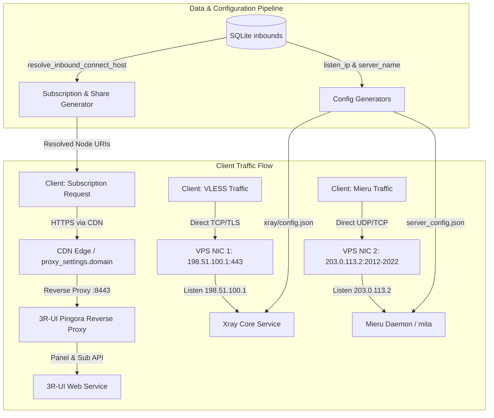

## Goal Capsule

- Objective: 允许运维人员为不同的入站协议（VLESS、Mieru、Hysteria 2）分别指定监听的多网卡 IP 地址，并在启用全局 CDN 反向代理的架构下，使客户端订阅与节点直连流量各司其职、互不干扰。
- Means: 在入站模型中引入 `listen_ip` 与 `server_name`（节点连接地址），重构端口冲突检测，并将节点连接地址与全局 CDN 域名解耦 (KTD1, KTD2)。
- Authority Hierarchy: 用户确认的业务需求 > 产品契约 (Product Contract) > 技术决策 (KTD) > 实现单元 (Implementation Units)。
- Execution Profile: code
- Stop Conditions: 所有入站协议均支持指定网卡 IP，Mieru 和 Xray 正确生成绑定配置，支持多 IP 端口复用，CDN 反代与直连节点链接解耦，所有单元测试与 Clippy 检查通过。

---

## Product Contract

### Summary
本方案为 3R-UI 入站协议增加多网卡 IP（`listen_ip`）绑定支持。在双网卡或多 IP VPS 场景下，用户可将网卡 1 的 IP 专用于 VLESS/REALITY，网卡 2 的 IP 专用于 Mieru 端口段，且不同网卡 IP 间允许监听相同端口。同时彻底解耦全局反代域名（CDN 场景）与节点直连地址：订阅接口继续走 CDN 反代域名保障分发与抗探测，而各个入站节点配置自动采用对应网卡的实际公网 IP 或独立直连域名，避免流量打入 CDN 导致连接失败。

### Problem Frame
随着多网卡 VPS（如配备多公网 IP 或双网卡策略路由的主机）的普及，运维人员经常需要将流量严格隔离：例如网卡 1 运行标准 HTTPS 端口 443（VLESS-REALITY），网卡 2 运行 UDP/抗封锁协议（Mieru 端口范围）。
然而当前 3R-UI 面临以下限制：
1. **硬编码监听所有网卡**：Xray 与 Mieru 服务端配置中均固定监听 `0.0.0.0`，无法绑定到指定网卡。
2. **数据库端口唯一约束**：数据表 `inbounds` 在初始建表时对 `listen_port` 施加了全局 `UNIQUE` 约束，导致即便不同网卡想各自监听 443 端口也会触发数据库报错。
3. **全局 CDN 反代覆盖节点地址**：一旦系统开启反向代理域名（如配合 Cloudflare CDN 加速面板与订阅），系统会无差别地将所有节点的连接地址（`host`）覆盖为该反代域名。由于 CDN 无法转发 REALITY 伪装流量或 Mieru 的自定义协议，客户端节点直接瘫痪。

### Key Decisions
- **KD1. 入站监听 IP 默认为 `0.0.0.0`**：保留与旧版本的完全兼容性；空字符串自动归一化为 `0.0.0.0`。Governs R1, R2.
- **KD2. 解耦订阅分发与节点连接地址**：全局反代域名仅服务于面板访问与订阅获取（`sub_url`），节点连接地址（`host`）由入站自身配置或其绑定的具体 IP 决定。Governs R5, R6.
- **KD3. 端口冲突基于（IP + 端口）联合判定**：解除全局单一端口限制，不同具体 IP 之间允许相同端口共存，但 `0.0.0.0` 与具体 IP 的重叠仍严格判定为冲突。Governs R3, R4.
- **KD4. Mieru 全局单一 IP 约束处理**：受限于 Mieru (`mita`) 原生架构，当前仅支持单一 `listenIPAddress`。若存在多个 Mieru 入站，要求绑定同一 IP 或统一监听全部接口，冲突时在表单提交阶段予以阻断并提示。Governs R2.

### Requirements

#### 入站网卡 IP 绑定能力
- R1. 入站数据模型必须包含 `listen_ip` 字段，默认值为 `0.0.0.0`，支持合法的 IPv4 及 IPv6 地址输入。
- R2. Xray 生成器（VLESS、Hysteria 2）与 Mieru 生成器必须将生成的监听地址动态替换为入站指定的 `listen_ip`（若为非空且非 `0.0.0.0` 时生效）。

#### 端口冲突精准判定
- R3. 系统必须支持两个处于活跃状态但绑定不同具体 IP 的入站使用相同端口（例如 `1.1.1.1:443` 与 `2.2.2.2:443` 可同时激活）。
- R4. 若入站 A 监听 `0.0.0.0`，入站 B 监听具体 IP，当两者的端口（或 Mieru 端口段）产生交集时，系统必须阻止创建或启用并给出冲突提示。

#### CDN 反代与节点连接地址兼容
- R5. 客户端订阅 URL（`sub_url`）及面板代理路由必须完整保留全局反代域名（含 CDN 场景支持）。
- R6. 节点分享 URI 生成逻辑（VLESS、Mieru、Hysteria 2）中，连接地址解析优先级为：`inbound.server_name`（直连域名/IP） > `inbound.listen_ip`（当不为 0.0.0.0 时） > 全局回退地址（`req_host` / 反代域名）。

#### 网卡发现与前端交互
- R7. 系统需提供本机可用网卡与 IP 地址的枚举探测能力，并在入站表单中提供快捷选择提示（如 `0.0.0.0 (所有网卡)`、`eth0: 1.1.1.1` 等）。
- R8. 入站列表页面表格中的监听端口列需扩展为显示监听地址（如 `1.1.1.1:443` 或 `0.0.0.0:443`）。

### Scope Boundaries
- **In-Scope**:
  - SQLite 迁移：重构 `inbounds` 表以移除 `listen_port` 全局唯一约束，添加 `listen_ip`。
  - Xray & Mieru 配置文件动态渲染。
  - 端口与协议冲突检测算法更新。
  - 分享链接与订阅节点的 Host 解析规则重构。
  - 网卡枚举接口与 Web 前端表单/列表更新。
- **Deferred to Follow-Up Work**:
  - 为 Pingora 反向代理增加针对不同网卡 IP 的独立监听绑定选择（当前 Pingora 专注于 Web 端口与 TLS 证书终结）。
  - Linux 操作系统内核层策略路由（`ip rule` / `ip route`）自动化脚本下发（由 VPS 网络环境或系统管理员配置）。

### Acceptance Examples
- AE1. VPS 拥有 `198.51.100.1` (eth0) 与 `203.0.113.2` (eth1)。创建 Inbound 1 (VLESS, IP `198.51.100.1`, 端口 443) 和 Inbound 2 (Hy2, IP `203.0.113.2`, 端口 443)，两者均能成功保存并激活，Xray 配置中分别出现两个监听在不同 IP 的 443 入站。
- AE2. 已存在 Inbound 1 监听 `198.51.100.1:443`。尝试创建 Inbound 3 监听 `0.0.0.0:443`，表单提交被拦截，提示“端口 443 已被 198.51.100.1 占用”。
- AE3. 系统配置了反代域名 `panel.cdn-domain.com` 并开启 CDN。用户导出节点订阅，订阅链接为 `https://panel.cdn-domain.com/sub/token`；订阅内容中 Inbound 1 的节点连接地址为 `198.51.100.1`，Inbound 2 的节点连接地址为 `203.0.113.2`，客户端可成功直连两张网卡。

---

## Planning Contract

### Key Technical Decisions
- KTD1. **SQLite 模式重构移除字段级唯一约束**：
  *(session-settled: user-directed — chosen over keeping single-port limit: 允许多网卡 VPS 在不同网卡 IP 上复用标准端口如 443)*
  在 `migrations/0011_inbound_multi_ip.sql` 中，通过创建临时表 `inbounds_new`、数据迁移、表重命名的方式彻底移除 `0001_initial.sql` 中 `listen_port INTEGER NOT NULL UNIQUE` 的物理约束，新增 `listen_ip TEXT NOT NULL DEFAULT '0.0.0.0'`，并在业务层与索引层建立适配多 IP 的联合校验规则。
- KTD2. **节点连接 Host 分层解析机制**：
  *(session-settled: user-directed — chosen over forced global proxy domain override: 保证订阅获取走 CDN 防探测的同时，节点流量直连 VPS 真实网卡)*
  实现通用的 `resolve_inbound_connect_host(inbound: &Inbound, fallback_host: &str) -> String`。优先采用入站显式设置的 `server_name`（直连域名/DDNS），次优采用绑定了特定网卡的 `listen_ip`，仅在监听全网卡且未指定域名时回退至 `fallback_host`。
- KTD3. **利用 `libc::getifaddrs` 实现零额外依赖的本机网卡嗅探**：
  在 `src/net/mod.rs` 中利用已有的 `libc` 依赖实现安全封装的 `get_local_interfaces()`，过滤掉回环接口（127.0.0.1/::1）和无 IP 接口，向前端输出网络接口名称与 IPv4/IPv6 地址映射列表。
- KTD4. **Mieru 多入站 IP 归一与冲突检测**：
  Mieru 守护进程配置文件只具备全局顶层 `listenIPAddress`。在配置生成器中提取所有活动 Mieru 入站的 `listen_ip`；若存在多个冲突的具体 IP，保存时阻断；在生成时若全为 `0.0.0.0` 则忽略或设置为空字符串，若指定具体 IP 则填入。

### High-Level Technical Design



### Assumptions
- VPS 宿主机双网卡已由云厂商或操作系统底层配置好相应的策略路由（保证来自网卡 1 的入站流量通过网卡 1 网关返回，来自网卡 2 的流量通过网卡 2 网关返回）。
- 用户填写的 `listen_ip` 是该服务器真实绑定的本地网络接口 IP（或 `0.0.0.0`），操作系统允许绑定到该地址。

---

## Implementation Units

### U1. Database Migration for Multi-NIC IP Binding
- **Goal**: 升级数据库结构，添加 `listen_ip` 字段并移除 `listen_port` 的全局单字段 `UNIQUE` 物理约束。
- **Requirements**: R1, R3, R4
- **Dependencies**: None
- **Files**:
  - `migrations/0011_inbound_multi_ip.sql`
  - `src/db/models.rs`
- **Approach**:
  1. 编写迁移脚本 `0011_inbound_multi_ip.sql`：关闭外键检查，创建 `inbounds_new` 表，将原有 `inbounds` 数据全量复制（`listen_ip` 默认赋值 `'0.0.0.0'`），删除旧表并将新表重命名为 `inbounds`，恢复外键检查。
  2. 移除旧的 `idx_inbounds_port_active` 索引。
  3. 在 `src/db/models.rs` 的 `Inbound` 结构体中增加 `pub listen_ip: String` 字段。
  4. 调整 `models.rs` 中涉及 `Inbound` 构造和查询的辅助方法与单元测试。
- **Patterns to follow**: `migrations/0007_mieru_inbound.sql`, `src/db/models.rs`
- **Test scenarios**:
  - 执行 `sqlx::migrate!()` 迁移成功，原有测试用例正常通过。
  - 允许在同一数据库中写入两条 `listen_port = 443` 但 `listen_ip` 不同的记录（例如 `1.1.1.1:443` 与 `2.2.2.2:443`），不抛出 SQLite UNIQUE 异常。
- **Verification**: `cargo test test_db` 或全局单元测试通过，验证迁移幂等性与数据完整性。

### U2. Host Network Interface Discovery Utility
- **Goal**: 提供本机可用网络接口与 IP 的探测工具函数，并暴露管理端查询 API。
- **Requirements**: R7
- **Dependencies**: None
- **Files**:
  - `src/net/mod.rs`
  - `src/lib.rs`
  - `src/web/inbound.rs`
- **Approach**:
  1. 新增 `src/net/mod.rs` 模块，引入 `NetworkInterfaceInfo { name: String, ip: String, is_ipv6: bool }`。
  2. 在 Unix 平台利用 `libc::getifaddrs` 遍历接口地址链表，过滤掉 `IFF_LOOPBACK`、无地址接口或链路本地地址（`fe80::`），返回格式化列表。
  3. 在 `src/web/inbound.rs` 中暴露路由 `GET /admin/api/network-interfaces`，返回 JSON 格式的网卡信息列表供前端异步加载或直接渲染到模板上下文。
- **Patterns to follow**: `src/crypto/mod.rs`, `src/web/system.rs`
- **Test scenarios**:
  - Unix 环境下调用 `get_local_interfaces()` 返回非空列表（至少包含本机非回环网卡或安全降级）。
  - 回环接口 `127.0.0.1` 和 `::1` 被有效过滤。
- **Verification**: 编写针对接口解析的单元测试并通过编译。

### U3. Core Protocol Configuration Generators (Xray & Mieru)
- **Goal**: 更新 Xray 和 Mieru 服务端配置生成逻辑，使其支持入站绑定的 `listen_ip`。
- **Requirements**: R2
- **Dependencies**: U1
- **Files**:
  - `src/xray/config.rs`
  - `src/mieru/config.rs`
- **Approach**:
  1. 在 `src/xray/config.rs` 中更新 `active_inbounds` SQL 查询包含 `listen_ip` 字段。
  2. 在 `render_vless_inbound` 与 `render_hysteria2_inbound` 中，将硬编码的 `"listen": "0.0.0.0"` 替换为 `if inbound.listen_ip.trim().is_empty() { "0.0.0.0" } else { inbound.listen_ip.trim() }`。
  3. 在 `src/mieru/config.rs` 的 `MieruServerConfig` 结构体中添加 `#[serde(skip_serializing_if = "String::is_empty")] pub listen_ip_address: String`。
  4. 在 `generate_config` 中，从所有活跃 Mieru 入站中提取非 `0.0.0.0` 的具体 IP 赋给 `listen_ip_address`。
- **Patterns to follow**: `src/xray/config.rs:295-325`, `src/mieru/config.rs:50-100`
- **Test scenarios**:
  - 当 VLESS 入站指定 `listen_ip = "198.51.100.1"` 时，生成的 Xray JSON 中对应 inbound 的 `"listen"` 为 `"198.51.100.1"`。
  - 当 VLESS 入站 `listen_ip = "0.0.0.0"` 时，生成的 Xray JSON 中对应 inbound 的 `"listen"` 为 `"0.0.0.0"`。
  - 当 Mieru 入站指定 `listen_ip = "203.0.113.2"` 时，生成的 Mieru 配置包含 `"listenIPAddress": "203.0.113.2"`。
  - 当 Mieru 入站未指定具体 IP 时，生成的 Mieru 配置不包含 `listenIPAddress` 或为空字符串。
- **Verification**: `cargo test xray::config` 与 `cargo test mieru::config` 单元测试通过。

### U4. Multi-NIC Port Conflict & Protocol Validation
- **Goal**: 重构入站保存与状态切换时的冲突判定逻辑，支持跨 IP 端口复用并拦截真实冲突。
- **Requirements**: R3, R4, KD4
- **Dependencies**: U1
- **Files**:
  - `src/web/inbound.rs`
- **Approach**:
  1. 废除原有的简单 `SELECT COUNT(*) FROM inbounds WHERE listen_port = ?` 判重。
  2. 加载当前所有 `status = 'active'` 且 `id != current_id` 的入站列表。
  3. 编写 IP 端口重叠判定函数 `is_port_conflict(candidate, existing) -> bool`：
     - 若端口或端口段有重叠，且满足 `candidate.listen_ip == "0.0.0.0" || existing.listen_ip == "0.0.0.0" || candidate.listen_ip == existing.listen_ip`，则判定冲突。
     - 若端口相同但属于不同且非 `0.0.0.0` 的具体 IP，判定不冲突。
  4. Mieru 协议特别校验：若当前为 Mieru 入站，且已有活跃 Mieru 入站指定了不同具体 IP，予以拦截并给出友好错误提示。
  5. 在 `save_inbound`（新增/修改）和 `toggle_inbound_status` 两个入口统一接入该校验。
- **Patterns to follow**: `src/web/inbound.rs:500-520`
- **Test scenarios**:
  - 存在 `1.1.1.1:443` 时，添加 `2.2.2.2:443` 成功。
  - 存在 `1.1.1.1:443` 时，添加 `1.1.1.1:443` 失败提示端口冲突。
  - 存在 `1.1.1.1:443` 时，添加 `0.0.0.0:443` 失败提示全局端口冲突。
  - 存在 `0.0.0.0:443` 时，添加 `2.2.2.2:443` 失败提示冲突。
  - 添加两个指定不同具体 IP 的 Mieru 入站时，提示 Mieru 仅支持统一监听 IP。
- **Verification**: 编写专用单元测试覆盖冲突判定矩阵。

### U5. Per-Inbound Connection Host Resolution & CDN Reverse Proxy Decoupling
- **Goal**: 将节点连接地址与全局 CDN 反代域名解耦，确保节点直连 IP/独立直连域名正确下发。
- **Requirements**: R5, R6, KD2
- **Dependencies**: U1
- **Files**:
  - `src/web/sub.rs`
  - `src/web/clients.rs`
  - `src/share/vless.rs`
  - `src/share/mieru.rs`
  - `src/share/hy2.rs`
- **Approach**:
  1. 在 `src/web/inbound.rs` 或 `src/share/mod.rs` 中实现 `resolve_inbound_host(inbound: &Inbound, global_host: &str) -> String`：
     - 若 `inbound.server_name` 存在且非空，返回 `inbound.server_name`。
     - 否则，若 `inbound.listen_ip` 存在且非 `0.0.0.0`、非 `::`，返回 `inbound.listen_ip`。
     - 否则返回 `global_host`（当开启反代时为反代域名，未开启时为当前请求的 Host）。
  2. 在 `src/web/sub.rs` 的节点生成循环中，针对每个入站分别计算其专属的 `host`，再传入 `build_uri`。
  3. 在 `src/web/clients.rs` 的单节点分享与节点卡片展示中同步采用该解析逻辑。
  4. 保持 `sub_url`（订阅链接本身）依然走全局反代域名与 HTTPS 端口。
- **Patterns to follow**: `src/web/sub.rs:80-125`, `src/web/clients.rs:480-530`
- **Test scenarios**:
  - 全局开启反代域名 `cdn.domain.com`，Inbound 1 指定 `listen_ip = "198.51.100.1"`，生成的 VLESS 链接 Host 为 `198.51.100.1` 而不是 `cdn.domain.com`。
  - Inbound 2 指定 `server_name = "direct.domain.com"`，生成的节点链接 Host 为 `direct.domain.com`。
  - Inbound 3 监听 `0.0.0.0` 且未填 `server_name`，生成的节点链接 Host 回退为 `cdn.domain.com`。
  - 订阅链接始终保持为 `https://cdn.domain.com/sub/<token>`。
- **Verification**: 编写针对 `resolve_inbound_host` 及 `sub.rs` 订阅生成的测试用例。

### U6. Web UI & Templates Enhancement
- **Goal**: 在管理端 Web 界面中提供监听 IP 和节点连接域名的配置表单与列表展示。
- **Requirements**: R7, R8
- **Dependencies**: U1, U2, U4, U5
- **Files**:
  - `templates/inbound_form.html`
  - `templates/inbound_list.html`
  - `src/web/inbound.rs`
- **Approach**:
  1. 在 `src/web/inbound.rs` 的 `InboundForm` 中新增 `pub listen_ip: String` 和 `pub server_name: String`。
  2. 在 `templates/inbound_form.html` 的表单中添加：
     - “监听 IP / 网卡”输入项（支持 datalist 下拉提示探测到的网卡列表，默认 `0.0.0.0`）。
     - “节点连接地址 / 域名”输入项（提示用户在 CDN 场景下可填入该网卡专用的直连域名或保持留空自动使用网卡 IP）。
  3. 在 `templates/inbound_list.html` 中更新监听端口展示为：若 `listen_ip != "0.0.0.0"`，显示 `IP:端口`；否则显示 `端口`。
- **Patterns to follow**: `templates/inbound_form.html`, `templates/inbound_list.html`
- **Test scenarios**:
  - 表单正确渲染已存在的 `listen_ip` 与 `server_name`。
  - 提交包含自定义 IP 的表单能成功保存并正确入库。
  - 列表页面能够区分显示全网卡监听与特定 IP 监听。
- **Verification**: 编译模板并在浏览器/测试用例中验证 HTML 渲染输出。

---

## Verification Contract

### Test Commands
- Rust 代码格式检查：
  ```bash
  cargo fmt --check
  ```
- Clippy 静态代码检查：
  ```bash
  cargo clippy --all-targets -- -D warnings
  ```
- 完整单元测试与集成测试：
  ```bash
  cargo test
  ```

### Acceptance Test Scenarios
1. **多网卡同端口共存**：创建 `198.51.100.1:443` 与 `203.0.113.2:443` 两条入站，全部激活，验证数据保存无误，`xray/config.json` 包含两个独立的入站配置且监听各自 IP。
2. **端口通配重叠拦截**：在已存在 `198.51.100.1:443` 情况下，尝试新增 `0.0.0.0:443`，界面正确显示错误信息拦截提交。
3. **Mieru 单 IP 限制校验**：在已激活 IP A 的 Mieru 入站后，激活指定 IP B 的 Mieru 入站被阻断并提示错误。
4. **CDN 反代兼容性验证**：在配置了全局反代域名并开启 CDN 的环境下，订阅请求返回的各节点连接地址准确指向其绑定的对应网卡 IP（或独立直连域名），而非全局 CDN 域名。

---

## Definition of Done

- [x] 数据库迁移 `0011_inbound_multi_ip.sql` 正常执行，成功移除物理唯一键限制并添加 `listen_ip`。
- [x] Xray 与 Mieru 配置文件能够按入站指定的 `listen_ip` 准确渲染。
- [x] 端口冲突与 Mieru 架构约束校验完善，精准识别重叠冲突并允许合法多 IP 共存。
- [x] 节点分享与订阅生成彻底解耦 CDN 反代域名，支持直连 IP 与独立域名分发。
- [x] 前端表单与列表完整展示监听 IP 与连接域名设置。
- [x] `cargo fmt --check`、`cargo clippy --all-targets -- -D warnings` 与 `cargo test` 全部 0 warning 0 error 通过。
- [x] 任何临时实验性代码均已清理。
