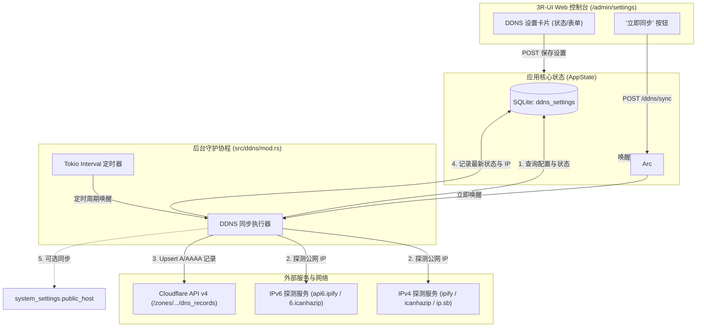
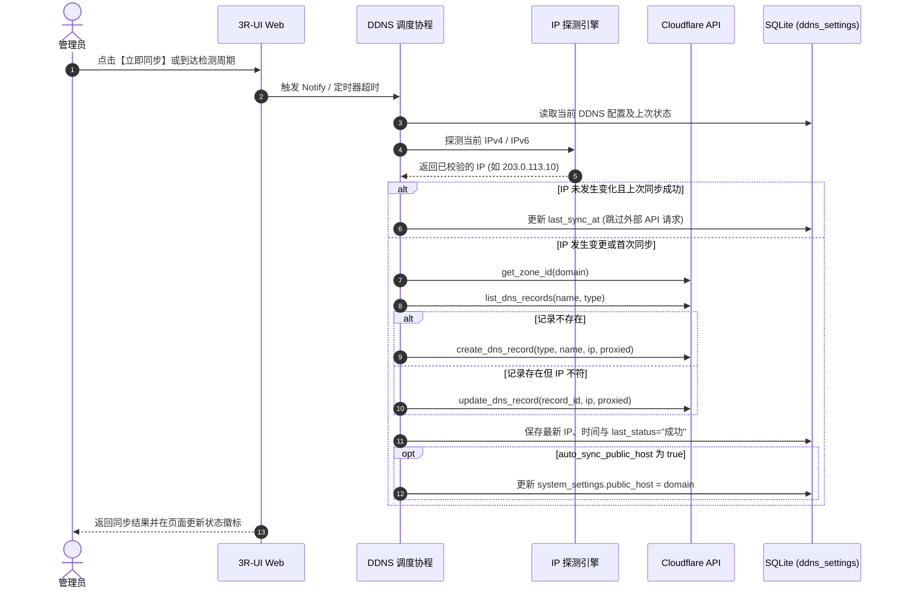

## Goal Capsule

- Objective: 让部署在动态公网 IP 或 NAT 架构 VPS 上的 3R-UI 面板具备内建的轻量级 DDNS 守护进程，可主动周期性探测本机公网 IP（IPv4 / IPv6）并自动更新 Cloudflare DNS 映射记录，避免公网 IP 变动导致节点与面板失联。
- Means: 在面板内集成 DDNS 运行时子系统（包括 IPv4/IPv6 探测、Cloudflare DNS A/AAAA 记录自动比对与 Upsert、后台异步轮询与手动同步触发机制），并支持将最新域名自动回填至节点连接 Host (KTD1, KTD2, KTD3)。
- Authority Hierarchy: 用户确认的业务需求 > 产品契约 (Product Contract) > 技术决策 (Planning Contract) > 实现单元 (Implementation Units)。
- Execution Profile: code
- Stop Conditions: 完成 SQLite 迁移、Cloudflare DNS API 扩展、双栈 IP 探测引擎、后台异步轮询协程、Web 控制台配置卡片及“立即同步”触发功能；所有单元测试、集成测试、`cargo fmt` 与 `cargo clippy --all-targets -- -D warnings` 零告警通过。

---

## Product Contract

### Summary
本方案为 3R-UI 面板引入类似 ddns-go 的轻量化 Cloudflare DDNS 自动更新服务。针对 NAT VPS 及拨号动态公网 IP 环境，面板以后台守护协程形式运行，按配置的周期（如每 5 分钟）主动向主流公网 IP 反射服务探测当前 IPv4 和 IPv6 地址。当检测到公网 IP 发生变更或首次启动时，自动调用 Cloudflare API 检索并更新（或创建）指定域名的 A / AAAA 记录，默认采用 DNS Only（关闭 CDN 代理）以保障节点直连协议畅通。同时提供可选的“自动同步节点 Host”开关，将解析域名自动写入面板系统设置，使客户端订阅与节点分享链接无缝跟随最新动态解析。管理员可在“系统设置”页面配置 Token、目标域名、检测周期，并可随时点击“立即同步”触发强制探测与更新。

### Problem Frame
在 NAT VPS、家庭宽带拨号服务器或部分低成本云主机上部署 3R-UI 时，宿主机的出口公网 IP 具有动态易变的特征：
1. **IP 漂移导致节点失联**：上游运营商网络断开重拨、NAT 网关轮换或主机重启后，VPS 的外网公网 IP 会发生改变，原 Cloudflare 域名解析失效，导致所有节点连接中断，依赖人工手动查询 VPS IP 并登录 Cloudflare 网页修改。
2. **额外第三方软件维护成本**：虽然可以通过额外安装 `ddns-go` 等外部二进制程序，但这增加了部署负担、内存占用和端口管理复杂度，且无法与 3R-UI 本身的配置（如节点 Host、反代证书凭据）互通。
3. **节点连接 Host 联动缺失**：即便外部工具更新了 Cloudflare 域名，3R-UI 生成的客户端订阅与分享链接若未同步更新为该域名，仍然可能在使用旧 IP 或错误地址。

### Key Decisions
- KD1. **凭证灵活继承与隔离**：支持配置独立的 DDNS Cloudflare API Token；若用户未输入且反向代理配置中已存在 Cloudflare API Token，支持留空时一键继承反代 Token，避免管理员重复输入。Governs R3, R4.
- KD2. **DNS Only 默认安全策略**：Cloudflare DNS 记录默认设置为 `proxied = false`（DNS Only，灰色云朵），防止 VLESS Reality、Hysteria 2、Mieru 等非标准 HTTP 流量被 Cloudflare CDN 代理拦截阻断；同时保留可选勾选框以支持特殊反代场景。Governs R5.
- KD3. **双栈独立探测与幂等更新**：IPv4 (A 记录) 与 IPv6 (AAAA 记录) 提供独立开关与域名列表；仅当探测到的 IP 与上一次记录或 Cloudflare 线上记录不一致时才发起 API 写入，避免频繁请求触发 Cloudflare 速率限制。Governs R1, R2, R6.
- KD4. **节点公网 Host 自动联动**：提供 `auto_sync_public_host` 可选功能。开启后，当 DDNS 同步成功时，将主域名自动保存到 `system_settings.public_host` 中，节点分享与订阅自动同步。Governs R7.

### Requirements

#### 双栈 IP 探测引擎
- R1. 系统必须支持主动向可靠公网反射接口探测本机当前 IPv4 地址（如 `https://api4.ipify.org`、`https://4.icanhazip.com`、`https://api-ipv4.ip.sb/ip`），并具有超时保护（单次探测 <= 3 秒）与多源故障回退机制。
- R2. 系统必须支持主动向可靠公网反射接口探测本机当前 IPv6 地址（如 `https://api6.ipify.org`、`https://6.icanhazip.com`、`https://api-ipv6.ip.sb/ip`），在纯 IPv4 环境下若无 IPv6 出口需安全降级并记录状态，禁止阻塞主线程。

#### Cloudflare DNS 同步管理
- R3. 系统必须支持使用 Cloudflare Bearer API Token 进行鉴权，支持根据完整域名（如 `vps.node.example.com`）逐级递归探测所属的 Zone ID。
- R4. 系统必须能精确查询指定 Zone 下指定域名与记录类型（A 或 AAAA）的已有 DNS 记录：若存在且 IP/Proxy 属性一致则跳过；若存在且 IP 变更则调用更新接口（PUT/PATCH）；若不存在则自动调用创建接口（POST）。
- R5. DNS 记录创建与更新必须遵循用户的代理设置（默认为 DNS Only / `proxied = false`，TTL 默认 1 表示自动）。

#### 后台守护任务与生命周期
- R6. 系统必须在面板主服务启动时常驻运行 DDNS 异步调度协程。当配置启用时，按照设定的间隔（1~1440 分钟，默认 5 分钟）定期自动执行探测与同步；当配置禁用时进入挂起休眠状态。
- R7. 系统必须提供即时唤醒通道（Notify / Channel），当管理员在控制台保存新配置或点击“立即同步”时，后台任务立即被唤醒并无延迟执行一轮探测同步。
- R8. 若开启 `auto_sync_public_host`，在域名成功更新到 Cloudflare 后，系统应自动将首选 IPv4 域名（或 IP）更新至 `system_settings.public_host`，实现节点订阅无感跟随。

#### Web 界面与运维可视化
- R9. 系统设置页面 (`/admin/settings`) 必须增加“动态域名解析 (Cloudflare DDNS)”配置卡片，提供：启用开关、CF Token（密码掩码显示）、IPv4/IPv6 独立开关与域名输入框、检测周期输入框、CF CDN 代理开关、自动同步节点 Host 开关。
- R10. 配置卡片必须实时回显运行状态：上次探测到的 IPv4 与 IPv6、上次同步时间戳、最新同步执行结果状态（成功、IP 未变更、或具体错误信息）。
- R11. 提供前端“立即同步”按钮，点击后向 `/admin/settings/ddns/sync` 发送异步请求并实时回显执行反馈。

### Scope Boundaries
- **In-Scope**:
  - SQLite 数据库迁移 `0013_ddns_settings.sql` 与 `DdnsSettings` 数据模型。
  - `src/proxy/cloudflare.rs` 的 DNS 记录查询、创建、修改及 Upsert 能力扩展。
  - `src/net/mod.rs`（或专用子模块）的双栈 IP 探测逻辑。
  - `src/ddns/mod.rs` 异步后台任务调度器与即时唤醒控制机制。
  - `/admin/settings` 前端卡片、表单提交路由与手动触发 API。
  - 与 `system_settings.public_host` 的联动同步。
- **Out-of-Scope**:
  - 非 Cloudflare 的第三方 DNS 提供商（如阿里云 DNS、腾讯云 DNSPod、DuckDNS 等）。
  - UPnP / NAT-PMP 自动路由器端口映射（NAT VPS 端口由服务商固定分配，DDNS 仅管理 IP 映射）。
  - 复杂 Webhook 告警推送（后续通过全局通知模块统一考虑）。

---

## Planning Contract

### Key Technical Decisions
- KTD1. **单例数据表存储与敏感凭证掩码 (session-settled: user-directed — 采用单例表延续 3R-UI 现有配置范式)**
  在数据库中创建 `ddns_settings` 单例表 (`id = 1`)，字段包含配置项与最新执行状态快照（`last_ipv4`, `last_ipv6`, `last_sync_at`, `last_status`）。Web 界面展示时，Token 仅回显掩码（如 `sk-***abcd`），提交保存时若包含掩码或为空则保持原 Token 不变；若留空且反代配置中已存在 Token，可提示继承反代 Token。
- KTD2. **扩展既有 CloudflareClient 避免代码重复**
  3R-UI 在 `src/proxy/cloudflare.rs` 中已存在成熟的 `CloudflareClient`，包含递归寻找 Zone ID、DoH 校验及 reqwest 封装。直接在其上扩展 `list_dns_records`、`create_dns_record`、`update_dns_record` 以及高级的 `upsert_dns_record` 方法，保持 HTTP 客户端配置与错误处理的一致性。
- KTD3. **异步事件驱动的定时器循环 (Tokio Interval + Notify)**
  在 `src/ddns/mod.rs` 中实现 `DdnsRunner`。使用 `tokio::select!` 同时监听两路事件：`tokio::time::interval`（定期执行）与 `Arc<tokio::sync::Notify>`（手动触发或配置更新即刻唤醒）。这保证了既不需要频繁起停线程，又能在用户点击“立即同步”或修改域名后 0 秒响应。
- KTD4. **安全轻量的 IP 探测器设计**
  探测使用轻量 `reqwest::Client` 并严格限制连接与读取超时（单端 2.5 秒，总流程超时控制），多备选节点轮换探测。解析返回值时必须通过 `std::net::Ipv4Addr::from_str` 和 `Ipv6Addr::from_str` 严格校验，防止网络运营商拦截或 HTTP 错误页返回伪 IP 导致 DNS 污染。
- KTD5. **与节点连接地址的单向防抖联动**
  当且仅当 DNS 同步成功且 `auto_sync_public_host = true` 时，触发 `crate::net::update_system_settings`。更新的目标优先采用配置的第一条 IPv4 域名；如果用户未配置 IPv4 域名，则回退为检测到的公网 IPv4 地址。

### High-Level Technical Design





### Assumptions
- A1: VPS 所在网络环境允许通过 HTTPS 请求标准公网反射源（如 `ipify` 或 `icanhazip`）。若个别反射源在局部网络受阻，探测引擎内置了多节点轮询。
- A2: 管理员使用的 Cloudflare API Token 具备对应 Zone 的 `DNS:Edit` 权限。若 Token 权限不足，系统将在 `last_status` 详尽捕获 Cloudflare 报错信息并呈现于面板，不会引起崩溃。
- A3: 大多数 NAT VPS 节点主要依赖 IPv4 端口映射进行流量转发，因此默认启用 IPv4 并将检测周期设为 5 分钟，既可快速响应变动，又完全处于 Cloudflare API 频率限制安全线内。

---

## Implementation Units

### U1. Database Migration & DDNS Settings Model
- **Goal**: 创建 DDNS 配置与状态持久化表结构，并提供线程安全的数据读写与敏感凭证脱敏处理。
- **Requirements**: R3, R6, R9, R10.
- **Dependencies**: None.
- **Files**:
  - `migrations/0013_ddns_settings.sql`
  - `src/db/models.rs`
  - `tests/ddns_db_test.rs`
- **Approach**:
  1. 新增迁移脚本 `migrations/0013_ddns_settings.sql`，创建 `ddns_settings` 单例表 (`id = 1`)，字段包括：`enabled`, `cf_api_token`, `ipv4_enabled`, `ipv4_domains`, `ipv6_enabled`, `ipv6_domains`, `check_interval_mins`, `cf_proxied`, `auto_sync_public_host`, `last_ipv4`, `last_ipv6`, `last_sync_at`, `last_status`, `updated_at`。
  2. 在 `src/db/models.rs` 中新增 `DdnsSettings` 结构体，派生 `FromRow`, `Serialize`, `Deserialize`, `Clone`, `Debug`。
  3. 为 `DdnsSettings` 实现辅助方法：`masked_token(&self) -> String`、`parse_ipv4_domains(&self) -> Vec<String>`、`parse_ipv6_domains(&self) -> Vec<String>`。
  4. 实现 `get_ddns_settings(&pool)` 与 `update_ddns_settings(&pool, ...)` 数据库操作方法，支持 Token 掩码保留。
- **Patterns to follow**: `src/db/models.rs` 中关于 `ProxySettings` 和 `SystemSettings` 的掩码模式与单例读写。
- **Test scenarios**:
  - *Happy path*: 运行迁移后，首次读取自动插入默认行（`enabled = false`, `check_interval_mins = 5`, `cf_proxied = false`）。
  - *Update with masking*: 更新配置时传入带有 `sk-***` 的掩码 Token，系统保留数据库中原有的明文 Token；传入新明文 Token 时正确替换。
  - *Domain parsing*: 针对包含空格、逗号与换行符的域名列表字符串，能够稳定切分为规整的 FQDN 列表，且自动忽略空字符串与末尾点号。
- **Verification**: `cargo test --test ddns_db_test` 全部通过。

---

### U2. Cloudflare DNS API Client Extension
- **Goal**: 扩展 `CloudflareClient`，增加针对 A/AAAA 记录的检索、新增、修改及智能幂等 Upsert 功能。
- **Requirements**: R3, R4, R5.
- **Dependencies**: U1.
- **Files**:
  - `src/proxy/cloudflare.rs`
  - `src/proxy/mod.rs`
- **Approach**:
  1. 在 `src/proxy/cloudflare.rs` 中新增结构体 `CfDnsRecord`、`ListDnsRecordsResponse`、`CreateDnsRecordBody`、`UpdateDnsRecordBody`。
  2. 实现 `list_dns_records(&self, zone_id: &str, record_type: &str, name: &str) -> AppResult<Vec<CfDnsRecord>>`。
  3. 实现 `create_dns_record(&self, zone_id: &str, record_type: &str, name: &str, content: &str, proxied: bool, ttl: u32) -> AppResult<String>`。
  4. 实现 `update_dns_record(&self, zone_id: &str, record_id: &str, record_type: &str, name: &str, content: &str, proxied: bool, ttl: u32) -> AppResult<()>`。
  5. 封装高级方法 `upsert_dns_record(&self, domain: &str, record_type: &str, ip: &str, proxied: bool) -> AppResult<DnsSyncOutcome>`，自动解析 Zone ID、比对已有记录，仅在必要时执行写入。
- **Patterns to follow**: `src/proxy/cloudflare.rs` 中的 `get_zone_id` 与 `create_txt_record`。
- **Test scenarios**:
  - *Happy path (Create)*: 使用 Wiremock 模拟 Cloudflare API，查询无记录时成功发送 POST 请求创建 A 记录，返回新建成功状态。
  - *Happy path (Update)*: 模拟已存在指向旧 IP 的 A 记录，验证方法正确发送 PUT 请求并更新为新 IP。
  - *Idempotent skip*: 模拟线上 A 记录的 IP 与当前探测 IP 完全一致，验证跳过 PUT/POST 请求并返回 `Unchanged`。
  - *Error handling*: 模拟 Cloudflare 返回 403 Forbidden 或 10000 认证错误，正确映射为 `AppError::Proxy` 并保留详细错误描述。
- **Verification**: 运行 `cargo test src/proxy/cloudflare.rs` 中的所有 mock 测试用例。

---

### U3. Dual-Stack Public IP Discovery Engine
- **Goal**: 提供针对 IPv4 与 IPv6 的高可用、低延迟外网公网 IP 探测服务，具备严格的 IP 格式校验与故障回退。
- **Requirements**: R1, R2.
- **Dependencies**: None.
- **Files**:
  - `src/net/mod.rs`
  - `src/net/ip_detect.rs` (可选新建或直接内联至 `src/net/mod.rs`)
- **Approach**:
  1. 优化现有的 IP 探测逻辑，拆分为明确的双栈接口：`detect_public_ipv4() -> Option<String>` 与 `detect_public_ipv6() -> Option<String>`。
  2. IPv4 探测源列表：`https://api4.ipify.org`、`https://4.icanhazip.com`、`https://api-ipv4.ip.sb/ip`。
  3. IPv6 探测源列表：`https://api6.ipify.org`、`https://6.icanhazip.com`、`https://api-ipv6.ip.sb/ip`。
  4. 使用短超时（单个源 2.5 秒，总超时 6 秒），并行或按次序探测并验证 `Ipv4Addr` / `Ipv6Addr` 解析有效性，过滤掉无效字符串或局域网回环地址。
  5. 在测试环境 (`CARGO_TARGET_TMPDIR` 存在时) 提供稳定的假数据隔离，保证测试断网也可快速通过。
- **Patterns to follow**: `src/net/mod.rs` 中的 `detect_public_ip` 现有实现。
- **Test scenarios**:
  - *Happy path*: 正常响应时准确提取 IP 并剔除首尾空白符。
  - *Malformed body handling*: 当外部服务返回 HTML 报错页或非 IP 文本时，校验器识别失败并安全尝试下一个探测源。
  - *Timeout resilience*: 当第一个探测源挂起或超时，平滑切换到第二个探测源成功返回结果。
- **Verification**: `cargo test src/net/mod.rs` 测试通过。

---

### U4. DDNS Background Runner & Synchronization Service
- **Goal**: 编写常驻后台异步同步服务，实现基于时间周期的定时轮询与基于 Channel / Notify 的事件即时唤醒，执行完整的 DDNS 业务流。
- **Requirements**: R6, R7, R8.
- **Dependencies**: U1, U2, U3.
- **Files**:
  - `src/ddns/mod.rs`
  - `src/ddns/runner.rs`
  - `src/lib.rs`
  - `src/web/mod.rs`
- **Approach**:
  1. 新建 `src/ddns/mod.rs` 与 `src/ddns/runner.rs`，定义 `DdnsNotifier(Arc<tokio::sync::Notify>)`。
  2. 实现主运行循环 `run_ddns_loop(pool: SqlitePool, notifier: Arc<tokio::sync::Notify>, shutdown_rx: watch::Receiver<bool>)`。
  3. 核心同步周期逻辑：
     - 从数据库拉取 `ddns_settings`，若未启用则挂起等待通知；
     - 根据 `ipv4_enabled` 和 `ipv6_enabled` 分别调用探测引擎；
     - 获取有效 CF Token（优先使用配置 Token，留空时回退反代 Token）；
     - 遍历所有配置的域名，调用 `upsert_dns_record`；
     - 记录本次结果（若全部成功记录成功；若有报错则记录具体失败原因），更新 `last_ipv4`、`last_ipv6`、`last_sync_at` 与 `last_status`；
     - 若 `auto_sync_public_host` 开启且有域名同步成功，自动更新 `system_settings.public_host`。
  4. 在 `src/lib.rs` 中的 `start_services` 中注入 `ddns_notifier` 并 `tokio::spawn` 启动守护协程；将 `ddns_notifier` 挂入 `AppState`。
- **Patterns to follow**: `src/proxy/cert.rs` 中的 `run_renewal_loop` 以及 `src/xray/stats.rs`。
- **Test scenarios**:
  - *Disabled state*: `enabled = 0` 时，协程保持挂起，不发起任何外网或 Cloudflare 请求。
  - *Wakeup on notify*: 发送 `notifier.notify_one()` 后协程立即被激活执行一轮检测。
  - *Auto sync public host*: 当设置 `auto_sync_public_host = true` 且成功同步域名 `vps.example.com` 时，`system_settings.public_host` 被自动更新为 `vps.example.com`。
- **Verification**: 编写集成测试模拟调度协程的启动与单轮执行。

---

### U5. Web Administration Settings & Manual Sync Trigger
- **Goal**: 在管理端提供 DDNS 表单提交保存接口以及“立即同步”触发 API，保证 CSRF 安全性与数据校验。
- **Requirements**: R9, R11.
- **Dependencies**: U4.
- **Files**:
  - `src/web/settings.rs`
  - `src/web/mod.rs`
- **Approach**:
  1. 在 `src/web/settings.rs` 中定义 `DdnsSettingsForm`，包含所有表单字段及 CSRF Token。
  2. 实现 `POST /admin/settings/ddns`：验证 CSRF，校验检测周期范围（1~1440），写入数据库，并调用 `app_state.ddns_notifier.notify_one()` 即时唤醒后台任务。
  3. 实现 `POST /admin/settings/ddns/sync`：供前端“立即同步”按钮调用，触发立即同步并在后台或短时间内执行后返回 JSON 响应（包含最新状态或触发状态）。
  4. 在 `SettingsTemplate` 结构体中增加 `ddns: DdnsSettings` 及 `ddns_inherited_token_hint: Option<String>`。
- **Patterns to follow**: `src/web/settings.rs` 中的 `save_security_settings` 与 `save_system_settings`。
- **Test scenarios**:
  - *CSRF protection*: 缺失或错误的 CSRF Token 提交返回 403 Forbidden。
  - *Valid submission*: 正确提交表单后，数据库字段更新且成功重定向回 `/admin/settings`。
  - *Sync endpoint*: `POST /admin/settings/ddns/sync` 正确返回 JSON `{ "status": "ok", "message": "已触发同步" }`。
- **Verification**: `cargo test src/web/settings.rs` 测试通过。

---

### U6. Settings Web UI Card & Interactive Status Display
- **Goal**: 在设置页面渲染直观的 DDNS 配置表单、实时状态卡片与交互按钮。
- **Requirements**: R9, R10, R11.
- **Dependencies**: U5.
- **Files**:
  - `templates/settings.html`
- **Approach**:
  1. 在 `templates/settings.html` 的“节点连接地址”与“安全防护”卡片同级新增专属卡片：“动态域名解析 (Cloudflare DDNS)”。
  2. 呈现运行状态指示器：
     - 上次探测 IPv4 / IPv6 地址（带有 monospace 样式）；
     - 上次同步时间与当前执行状态标签（成功绿色、失败红色、运行中黄色）；
     - “立即同步”操作按钮，点击后发送 Ajax 请求并在按钮上显示加载状态。
  3. 渲染配置表单：
     - 启用 DDNS 复选框；
     - Cloudflare API Token 输入框（带有“继承自反向代理”提示）；
     - IPv4 / IPv6 独立开关与多行文本输入框；
     - 检测周期输入框（附“推荐 5 分钟”提示）；
     - Cloudflare CDN 代理复选框（提示“节点协议建议保持关闭”）；
     - 自动同步节点 Host 复选框。
  4. 编写对应的 JavaScript 交互函数 `triggerDdnsSync()`，同步完成后自动刷新状态区域或页面。
- **Patterns to follow**: `templates/settings.html` 中的 `detectPublicIp()` 与 Fail2ban 状态卡片。
- **Test scenarios**:
  - *Visual structure*: 模板能够成功渲染所有 DDNS 字段而无 Askama 编译错误。
  - *Masked token*: 若数据库已存有 Token，输入框显示掩码值。
  - *Status badge*: 当 `last_status` 包含 "Success" 时显示绿色成功徽标，包含错误时显示告警信息。
- **Verification**: `cargo test` 验证 Askama 模板编译无误，并在浏览器中核对样式排版。

---

## Verification Contract

### 质量检查命令
- Rust 代码格式检查：
  ```bash
  cargo fmt --check
  ```
- Clippy 静态代码检查：
  ```bash
  cargo clippy --all-targets -- -D warnings
  ```
- 完整单元测试与集成测试验证：
  ```bash
  cargo test
  ```

### Acceptance Test Scenarios
1. **纯 IPv4 场景下的自动探测与解析建档**：
   在空 DNS 记录环境下配置 DDNS，指定域名 `vps4.example.com`，触发同步。系统自动识别 Zone ID，在 Cloudflare 创建一条 A 记录指向当前公网 IPv4，`proxied` 为 `false`，状态更新为“成功”。
2. **IP 变动下的无缝更新与 Host 联动**：
   手动变更模拟公网 IP，触发同步。系统识别到 IP 变动，调用 Cloudflare 更新接口更新记录，同时 `system_settings.public_host` 自动更新为 `vps4.example.com`，订阅链接中的服务器地址自动更新为该域名。
3. **未发生变动的幂等跳过**：
   在 IP 未变动时连续触发同步，系统仅执行本地对比或检测到线上一致，跳过 Cloudflare 写入操作，避免 API 滥用。
4. **异常鉴权与安全容错**：
   输入错误的 Cloudflare API Token 触发同步，系统在 Web 界面友好回显 Cloudflare 鉴权失败报错，后台守护任务保持稳定运行，不发生 Panic 或进程异常退出。

---

## Definition of Done

- [x] 数据库迁移脚本 `migrations/0013_ddns_settings.sql` 正常运行，提供完整单例配置与状态字段。
- [x] `CloudflareClient` 具备完整的 A/AAAA 记录查询、创建、更新与 Upsert 幂等控制能力。
- [x] 双栈公网 IP 探测引擎健壮可靠，具有短超时保护与多源容灾回退。
- [x] DDNS 后台调度协程常驻运行，支持基于周期的自动轮询与基于 Notify 的即时唤醒。
- [x] Web 控制台提供直观的配置表单、脱敏保护、状态回显与“立即同步”按钮。
- [x] 成功与 `system_settings.public_host` 实现可选自动联动。
- [x] `cargo fmt --check`、`cargo clippy --all-targets -- -D warnings` 与 `cargo test` 全部零告警通过。
- [x] 无任何临时或废弃实验代码残留。
