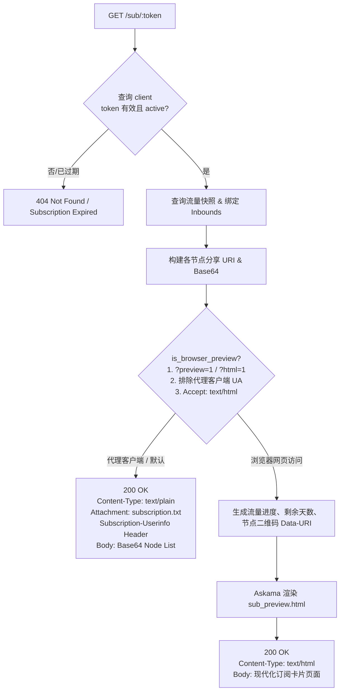

## Goal Capsule

- **Objective:** 当用户或管理员在浏览器中访问订阅链接时，展示现代化、美观且响应式的网页预览页面（包含用户信息、到期状态、流量用量进度条、快捷复制及节点列表），彻底消除默认触发 `subscription.txt` 下载的糟糕体验；同时确保代理客户端（Clash、Sing-box、v2rayN、Shadowrocket 等）拉取订阅时继续稳定获得 Base64 纯文本和 `Subscription-Userinfo` 标头。
- **Means:** 在 `src/web/sub.rs` 的订阅处理逻辑中引入智能内容协商，结合请求头 `Accept`、User-Agent 特征与 URL 查询参数，将浏览器访问路由至 Askama 服务端模板 `templates/sub_preview.html` 渲染；代理客户端请求则保持原有的 Base64 格式不变 (KTD1, KTD2)。
- **Authority Hierarchy:**
  1. Product Contract: 核心产品与安全边界（R1-R6）具有最高效力。
  2. Planning Contract: 架构决策（KTD1-KTD4）规范具体实现方式。
  3. Implementation Units: 执行单元（U1-U4）负责原子化落地与验证。
- **Stop Conditions:**
  - 若代理客户端因内容协商误判收到 HTML 页面导致订阅解析失败，必须立刻终止并纠正判定逻辑。
  - 若因缺少权限或脱敏处理导致节点私钥等服务端机密暴露，必须立刻终止。

---

## Product Contract

### Summary
在 3R-UI 中为现有聚合订阅地址增加浏览器网页预览功能。访问同一订阅 URL 时，浏览器将渲染类似 3x-ui 风格的优雅预览页面，直观呈现用户状态、配额进度与分节点详情；代理客户端自动更新机制保持 100% 兼容。

### Problem Frame
目前 3R-UI 的订阅接口 `/sub/:token` 在响应中固定添加了 `Content-Disposition: attachment; filename*=UTF-8''subscription.txt`，并且响应类型为 `text/plain`。当管理员在后台点击订阅地址或用户在浏览器中粘贴订阅链接时，浏览器会直接将其当做文件下载到本地，用户只能看到一串 Base64 密文，既不美观，也无法直观查看剩余流量和到期时间。3x-ui 等主流面板均支持在浏览器访问订阅地址时展现精美的仪表盘卡片，这一体验提升呼声很高。

### Key Decisions
- **KD1: 单一订阅 URL 双模响应 (Governs R1, R2)**
  (session-settled: user-directed — chosen over separate sub-preview route: 维持唯一的订阅链接，无需向用户分发两个不同的链接，贴合用户直觉与 3x-ui 习惯)
- **KD2: 公开预览页面的最小权限与数据脱敏 (Governs R4)**
  (session-settled: user-approved — chosen over exposing full node configuration: 订阅页面无需登录即可凭 token 查看，因此只呈现节点对外连接所需的脱敏信息与分享链接，与原 Base64 导出的内容保持严格同等安全边界)

### Requirements

#### 客户端判定与内容协商
- **R1. 浏览器请求识别与页面渲染**
  当请求符合以下任一条件时，判定为网页预览请求并返回 HTML 页面：
  1. 请求头 `Accept` 显式优先包含 `text/html`。
  2. 请求 URL 携带 `?preview=1` 或 `?html=1` 查询参数。
- **R2. 代理客户端防误判与格式保持**
  当请求符合以下条件时，强制返回标准 Base64 纯文本订阅：
  1. `User-Agent` 包含典型代理客户端特征标识（如 `clash`, `sing-box`, `v2ray`, `shadowrocket`, `surge`, `quantumult`, `loon`, `stash`, `surfboard`, `curl` 等，忽略大小写）。
  2. `Accept` 头未指定 `text/html`（如 `*/*` 或 `text/plain`）。
  代理客户端响应必须严格保留 `Subscription-Userinfo` 与 `profile-update-interval` 标头。

#### 预览页面内容与视觉交互
- **R3. 用户状态与流量用量可视化**
  预览页面顶部展示用户卡片：
  1. 用户名称与账户状态徽章（正常启用 / 已过期 / 已禁用）。
  2. 到期时间与倒计时剩余天数（如“剩余 28 天”或“永不到期”）。
  3. 流量用量：已用上传、已用下载、总已用、总配额、剩余可用流量，搭配渐变进度条展示用量百分比。
- **R4. 节点列表与快捷操作**
  预览页面提供节点卡片与便捷交互：
  1. 页面顶部提供“复制订阅链接”按钮与“复制全部节点”按钮。
  2. 列出用户关联的所有可用节点，标明协议徽章（VLESS、Hysteria 2、Mieru）、端口、域名/SNI。
  3. 每个节点卡片提供单独的“复制链接”按钮与“二维码”弹窗/折叠展示。
  4. 二维码采用纯前端或 Base64 Data-URI 方式加载，支持手机端即开即扫。
- **R5. 统一的视觉设计与暗黑模式适配**
  页面遵循 3R-UI 既有的调色盘与字体规范，复用 `templates/theme_head.html`，自动支持系统级浅色/深色模式及手动切换，完美适配移动端与桌面端屏幕。

#### 管理后台入口优化
- **R6. 客户端详情页补充预览入口**
  在管理后台 `templates/clients_detail.html` 的“聚合订阅”卡片中，在“复制订阅地址”和“二维码”按钮旁新增“在新标签页预览”外链按钮，方便管理员随时核验效果。

### Success Criteria
1. 在主流浏览器（Chrome / Safari / Firefox / Edge / 移动端浏览器）中直接访问订阅地址，返回 HTTP 200 及 `text/html`，页面无报错、渲染完整。
2. 在主流代理客户端（Clash, Sing-box, v2rayN, Shadowrocket）中添加/更新订阅，行为与当前版本完全一致，成功拉取节点并读取流量信息。
3. 自动化测试套件完整覆盖浏览器预览模式、代理客户端模式、强制参数模式及异常过期分支。

### Scope Boundaries
- **In Scope:**
  - `src/web/sub.rs` 的请求参数/头解析、数据组装与响应分流。
  - 新增 Askama 模板 `templates/sub_preview.html`。
  - `templates/clients_detail.html` 详情页按钮增加。
  - `tests/sub_test.rs` 集成测试用例补充。
- **Out of Scope:**
  - 订阅 Token 的生成与认证规则变更（保持既有数据表与模型不变）。
  - 引入 React/Vue 等重型前端构建框架（保持服务端 Askama 渲染与轻量原生 JS）。
  - 为不同客户端动态生成 Clash YAML 或 Sing-box JSON 配置文件（保持统一 Base64 节点列表）。
- **#### Deferred to Follow-Up Work:**
  - 支持一键调起外部 App 导入（如 `clash://install-config?url=...` 或 `sing-box://import-remote-profile?url=...` 等自定义 URL Scheme）。

### Acceptance Examples
- **AE1 (标准浏览器访问):** 
  使用 Chrome 访问 `https://panel.example.com:8443/sub/tok123`，响应头为 `Content-Type: text/html; charset=utf-8`，无 `Content-Disposition: attachment`，页面渲染用户详情仪表盘。
- **AE2 (代理客户端自动拉取):**
  客户端发送 `GET /sub/tok123`，带请求头 `User-Agent: ClashforWindows/0.20.39`，响应头为 `Content-Type: text/plain; charset=utf-8`，响应体为 Base64 编码的节点列表，包含 `subscription-userinfo`。
- **AE3 (显式查询参数触发预览):**
  发送 `GET /sub/tok123?preview=1`（即使无特异性 Accept），响应直接返回 HTML 预览页面。
- **AE4 (过期/禁用用户防护):**
  若用户已过期或状态不是 active，访问预览页面不会泄露节点信息，返回统一的 404 / 过期提示。

---

## Planning Contract

### Key Technical Decisions

- **KTD1. 智能内容协商分流器设计**
  (session-settled: user-directed — chosen over separate sub-preview route: 维持统一的订阅路径，依据请求特征路由)
  在 `handle_subscription` 中，先提取 `HeaderMap` 与 `Query` 参数。实现一个纯函数判定器：
  ```rust
  fn is_browser_preview(headers: &HeaderMap, query: &HashMap<String, String>) -> bool
  ```
  判定优先级：
  1. 若 Query 包含 `preview` (如 `?preview=1`) 或 `html` (如 `?html=1`)，返回 `true`。
  2. 若 `User-Agent` 匹配代理客户端黑名单（`clash`, `sing-box`, `v2ray`, `shadowrocket`, `surge`, `quantumult`, `loon`, `stash`, `surfboard`, `curl` 等），返回 `false`。
  3. 若 `Accept` 头包含 `text/html`，返回 `true`。
  4. 其余默认返回 `false`（走标准客户端订阅流程）。

- **KTD2. 采用 Askama 编译期模板渲染 `sub_preview.html`**
  (session-settled: user-approved — chosen over client-side SPA or raw string interpolation: 与现有 3R-UI 模板技术栈保持 100% 一致，编译期类型检查，零额外运行时开销)
  定义视图结构体 `SubPreviewTemplate`，传入渲染所需的数据模型：
  - `client`: 用户名、UUID、状态、格式化到期日、剩余天数。
  - `traffic`: 格式化上传、格式化下载、格式化总用量、格式化配额总量、格式化剩余流量、用量百分比数值（用于进度条宽度）。
  - `sub_url`: 订阅完整地址。
  - `sub_qr_data_uri`: 订阅地址对应的 Base64 PNG Data-URI，用于免鉴权图片展示。
  - `nodes`: 节点卡片列表（包含协议标签、节点名、端口、URI、节点专属二维码 Data-URI）。
  - `base_path`: 页面静态资源前缀。

- **KTD3. 服务端内联生成 QR Code Data-URI**
  (chosen over dedicated public QR endpoint: 无需暴露额外的公网免鉴权二维码 API，避免爬虫滥用风险；页面完全自包含，无二次图片请求白屏)
  复用 `crate::share::qr::render_png`，将生成的 PNG 二进制通过 `base64::engine::general_purpose::STANDARD.encode` 转换为 `data:image/png;base64,...`，直接注入模板中渲染为 `` 标签。

- **KTD4. 充分复用既有系统格式化与网络定位工具**
  (chosen over duplicated formatting logic: 保持全站单位转换与显示口径一致)
  - 流量大小格式化复用 `crate::web::system::format_bytes_human`。
  - 日期格式化复用 `crate::web::logs::timestamp_to_iso`。
  - 节点入站域名/IP 判定复用 `crate::share::resolve_inbound_host`。

### High-Level Technical Design



---

## Implementation Units

### U1. 订阅分流判定与预览数据模型设计
- **Goal:** 在 `src/web/sub.rs` 中实现请求头与参数分析器，并构建用于渲染预览页面的数据结构体。
- **Requirements:** R1, R2, R3, R4
- **Dependencies:** 无
- **Files:**
  - `src/web/sub.rs`
- **Approach:**
  1. 定义 `SubPreviewQuery` 结构体用于提取 Axum Query 参数（`preview`, `html`）。
  2. 提取 `headers: axum::http::HeaderMap` 并实现 `is_browser_preview(&HeaderMap, &HashMap<String, String>) -> bool` 判定逻辑。
  3. 定义 `SubPreviewNode` 包含协议标签、协议大写、节点名、端口、URI、二维码 Data-URI。
  4. 计算用户流量统计指标：已用总字节数、配额百分比（clamp 到 0..=100）、剩余字节数、到期剩余天数文本。
  5. 生成订阅链接的二维码 Data-URI 及各节点的二维码 Data-URI。
  6. 依据判定结果，分流返回纯文本响应或 HTML 响应。
- **Patterns to follow:**
  - `src/web/clients.rs` 中 `ClientNodeCard` 与 `ClientView` 的构建方式。
  - `crate::share::qr::render_png` 生成 PNG 字节。
- **Test scenarios:**
  - Happy path: `is_browser_preview` 在 `Accept: text/html` 且 UA 为 Mozilla 时返回 `true`。
  - Happy path: `is_browser_preview` 在查询参数包含 `preview=1` 时返回 `true`。
  - Edge case: UA 为 `ClashforWindows/0.20` 且 Accept 为 `*/*` 时返回 `false`。
  - Edge case: UA 为 `v2rayN/6.23` 即使 Accept 携带 `text/html` 也防御性返回 `false`。
  - Edge case: 无配额限制用户（`quota_bytes = 0`）进度条与剩余流量显示“无限制”。
- **Verification:**
  - 单元测试验证判定器与数据组装逻辑无 panic，数值计算准确。

### U2. 现代化订阅预览模板 `sub_preview.html` 实现
- **Goal:** 新增 `templates/sub_preview.html` 模板，打造媲美 3x-ui 的高质感订阅信息与节点面板。
- **Requirements:** R3, R4, R5
- **Dependencies:** U1
- **Files:**
  - `templates/sub_preview.html`
- **Approach:**
  1. 引入 `` 实现全套自适应浅色与深色主题支持。
  2. 容器设计：最大宽度 780px 居中排版，顶部为应用品牌标题与快速刷新/复制区。
  3. 头部卡片（用户信息）：展示用户名、UUID、状态点亮徽章、到期时间与剩余天数。
  4. 流量卡片：展示进度条（使用渐变背景，当用量超 90% 变警示橙红），下方排列 3 列数据栅格（已用上传、已用下载、剩余可用 / 总额度）。
  5. 快捷聚合操作：大尺寸“复制订阅地址”主按钮，配“二维码”切换浮层，并提供“复制全部节点”操作。
  6. 分节点展示区：循环渲染各节点卡片，左侧显示醒目的协议 Badge（如 `VLESS-REALITY`, `Hysteria 2`, `Mieru`）与端口号，右侧提供单节点复制与二维码展开按钮。
  7. 轻量原生 JavaScript：仅包含原生剪贴板复制提示（Toast）与二维码弹窗显示/隐藏控制，零外部 CDN 依赖。
- **Patterns to follow:**
  - `templates/clients_detail.html` 的 CSS 变量与设计语法。
  - `templates/dashboard.html` 的仪表盘质感与栅格样式。
- **Test scenarios:**
  - Happy path: 模板能成功渲染包含多个不同协议节点的完整数据模型，无语法错误。
  - Happy path: 点击各复制按钮触发原生 `navigator.clipboard.writeText` 并提示成功。
  - Edge case: 用户名为空时安全回退显示“订阅详情”。
  - Edge case: 移动端窄屏（375px 视口）栅格与按钮自动换行，无水平溢出。
- **Verification:**
  - 模板通过 Askama 宏编译，页面结构合法无畸形 HTML 标签。

### U3. 后台客户端详情页预览快捷入口集成
- **Goal:** 在后台“用户详情与分享”页面中提供一键在浏览器打开订阅预览的入口。
- **Requirements:** R6
- **Dependencies:** U1
- **Files:**
  - `templates/clients_detail.html`
- **Approach:**
  1. 在“聚合订阅 (Subscription)”卡片的操作按钮栏（`actions`）中，在“复制订阅地址”和“二维码”按钮旁边，添加一个 `<a class="btn btn-secondary" href="{{ sub_url }}" target="_blank" rel="noopener">网页预览</a>` 按钮。
  2. 为按钮增加图标或醒目标记，方便管理员一键跳转验证订阅展示效果。
- **Patterns to follow:**
  - `templates/clients_detail.html` 中既有的按钮样式规范。
- **Test scenarios:**
  - Happy path: 渲染客户端详情页时，网页预览按钮的 `href` 正确绑定 `sub_url`，带有 `target="_blank"`。
- **Verification:**
  - 后台页面加载正常，点击按钮可在新标签页直接打开订阅预览。

### U4. 订阅双模集成测试与质量验证
- **Goal:** 扩充 `tests/sub_test.rs`，全面覆盖浏览器预览与代理客户端更新两个通道的契约一致性。
- **Requirements:** R1, R2, R3, R4, R5, R6
- **Dependencies:** U1, U2, U3
- **Files:**
  - `tests/sub_test.rs`
- **Approach:**
  1. 补充测试用例 `sub_endpoint_serves_html_preview_to_browsers`:
     - 构造带有 `Accept: text/html,application/xhtml+xml` 及常见桌面浏览器 `User-Agent` 的请求。
     - 验证响应状态码为 200 OK，`Content-Type` 为 `text/html; charset=utf-8`。
     - 验证响应头**不包含** `Content-Disposition: attachment`。
     - 验证响应体 HTML 包含用户名、节点列表、进度条、节点链接与 Base64 二维码。
  2. 补充测试用例 `sub_endpoint_serves_html_preview_with_query_param`:
     - 请求携带 `?preview=1`，验证即便无特殊头也返回 HTML 预览。
  3. 补充测试用例 `sub_endpoint_preserves_base64_for_proxy_clients`:
     - 模拟 Clash (`User-Agent: Clash.Meta`) 和 sing-box 请求。
     - 验证即使客户端附带奇怪的 Accept 标头，依然稳定返回 Base64 纯文本和 `Subscription-Userinfo`。
  4. 验证既有订阅测试用例 100% 保持通过。
- **Patterns to follow:**
  - `tests/sub_test.rs` 既有的 `Harness` 与测试数据准备模式。
- **Test scenarios:**
  - Covers R1: 浏览器标准请求返回 HTML 预览。
  - Covers R2: 代理客户端请求返回 Base64 订阅。
  - Covers R3 & R4: 页面文本包含流量用量与节点信息。
- **Verification:**
  - `cargo test --test sub_test` 全部通过。
  - `cargo clippy --all-targets -- -D warnings` 0 warnings。
  - `cargo fmt --check` 格式合规。

---

## Verification Contract

执行以下命令验证实现的正确性与代码质量：

1. **自动化集成与单元测试：**
   ```bash
   cargo test --test sub_test
   ```
   验证所有订阅相关用例（Base64 下载模式、HTML 预览模式、防误判模式、过期拦截）均绿灯通过。

2. **全局测试套件回归：**
   ```bash
   cargo test
   ```
   确保新特性的引入没有破坏系统的其他既有功能。

3. **Rust 代码格式化检查：**
   ```bash
   cargo fmt --check
   ```

4. **Clippy 静态分析检查：**
   ```bash
   cargo clippy --all-targets -- -D warnings
   ```
   确保 0 warning、0 error。

---

## Definition of Done

- [ ] **功能实现：**
  - [ ] 浏览器直接访问 `/sub/:token` 正常展现 HTML 订阅预览页面，不再弹出 `subscription.txt` 下载对话框。
  - [ ] 订阅页面展示完整的账户状态、到期时间、流量使用百分比进度条与可用节点卡片。
  - [ ] 预览页面自包含一键复制与扫码能力，样式完全自适应浅色/深色主题与手机屏幕。
  - [ ] 代理客户端（Clash, Sing-box 等）继续获得原样 Base64 纯文本并保留 `Subscription-Userinfo` 标头。
  - [ ] 管理后台“用户详情与分享”界面提供直达“网页预览”的快捷按钮。
- [ ] **代码与测试质量：**
  - [ ] `tests/sub_test.rs` 包含覆盖 HTML 预览、查询参数强制预览、代理客户端 UA 保护的分支测试。
  - [ ] 本地执行 `cargo fmt --check`、`cargo clippy --all-targets -- -D warnings`、`cargo test` 全部通过。
  - [ ] 清理所有调试日志与临时试探代码，不留多余 diff。
