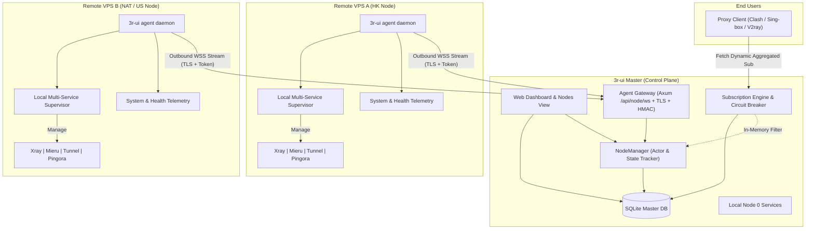

## Goal Capsule

- **Objective:** Establish a centralized multi-VPS proxy node control plane and lightweight sub-agent architecture in 3r-ui, allowing operators to deploy, group, monitor, securely configure, and auto-aggregate subscriptions across distributed VPS nodes from a single dashboard.
- **Means:** Introduce a modular `node` subsystem with an Axum WebSocket/TLS agent gateway, SQLite schema migration for nodes and groups, a headless `3r-ui agent` subcommand running a multi-service supervisor (Xray, Mieru, Cloudflare Tunnel, Pingora, Fail2ban), in-memory heartbeat tracking with dynamic subscription circuit breaking, and a dedicated Web UI dashboard.
- **Product Authority:** 3r-ui Multi-Node Distributed Architecture. Surrounding areas like general server DevOps (Web SSH, OS package management, arbitrary shell execution) and multi-hop mesh relays are explicitly out of active scope.
- **Authority Hierarchy:** User confirmed requirements > Product Contract > Planning Contract > Implementation Units.
- **Execution Profile:** code
- **Stop Conditions:** Successful execution of all unit & integration tests, zero warnings on `cargo clippy --all-targets -- -D warnings`, and clean `cargo fmt --check`.
- **Open Blockers:** None.

## Product Contract

### Summary
3r-ui adds a distributed Master-Agent capability that turns the standalone panel into a unified multi-node control center. Operators deploy lightweight sub-agents onto remote VPS nodes via a single-line command; sub-agents establish secure, reverse long-lived connections back to the Master, allowing centralized node grouping, config distribution, real-time health monitoring, dynamic subscription circuit breaking, and strict zero-trust credential isolation. Sub-agents run the full suite of 3r-ui proxy services (Xray, Mieru, Cloudflare Tunnels, Pingora, Fail2ban) controlled and monitored directly from the Master dashboard.

### Problem Frame
Currently, running 3r-ui across multiple VPS instances requires operators to log in to separate web panels, manually synchronize inbounds and users, and provide multiple fragmented subscription links to end clients. Furthermore, managing distributed nodes across public networks introduces substantial security risks—such as credential theft across machines, exposure of internal RPC ports to public scanners, and lack of automatic failover when a remote VPS experiences routing degradation or IP blocking. Operators also lack unified visibility into remote VPS system metrics (CPU, RAM, disk) and individual service health.

### Key Decisions
- **Multi-Node Proxy Node Control Model:** Focus the system strictly on proxy node orchestration, configuration synchronization, unified subscription aggregation, and proxy telemetry (session-settled: user-directed — chosen over general DevOps monitoring and AI-driven automation: maximizes domain focus and operational stability). Governs R1, R2, R7, R14.
- **Node Grouping & Fine-Grained Routing:** Enable tagging and grouping of nodes by geographical region or network tier (e.g., HK, JP, US, Premium), with user/inbound binding and node-level rate limits (session-settled: user-directed — chosen over global flat node pool: allows granular access control and geo-targeted routing). Governs R3, R4.
- **Reverse Long-Lived Secure Connection via One-Liner Script:** Remote sub-agents initiate outbound persistent connections (TLS-encrypted WebSocket) to the Master using one-time provisioning tokens (session-settled: user-directed — chosen over Master-initiated SSH push and direct public IP inbound: supports NAT/firewalled VPS out-of-the-box without exposing agent inbound ports). Governs R5, R6, R10.
- **Master Dual-Role with Default Local Node 0:** Retain an embedded local proxy node inside the Master instance while providing a toggle to run as a dedicated, proxy-less controller (session-settled: user-directed — chosen over strict panel-node decoupling: preserves seamless single-VPS out-of-the-box experience while allowing disablement for dedicated controllers). Governs R8.
- **Dynamic Heartbeat Sensing & Subscription Circuit Breaker:** Track continuous heartbeats between Master and sub-agents, automatically pruning offline nodes from generated subscriptions to prevent client connection blackholes (session-settled: user-directed — chosen over static warning alerts: ensures high client availability without manual admin intervention). Governs R7, R9.
- **Zero-Trust Node Security & Minimal Privilege Isolation:** Enforce per-node credential isolation, mutual TLS/HMAC token verification, non-root agent execution with restricted Linux capabilities, and a strict whitelist of system RPC actions with zero arbitrary shell execution (session-settled: user-directed — chosen over shared credentials and arbitrary remote execution: prevents a single compromised node from pivoting into the Master or sibling nodes). Governs R10, R11, R12, R13.
- **Full Service Suite & Telemetry on Remote Agents:** Enable Master to configure and monitor all proxy subsystems (Xray, Mieru, Cloudflare Tunnels, Pingora, Fail2ban) across all nodes, with real-time CPU, RAM, disk, and service status telemetry (session-settled: user-directed — chosen over Xray-only sub-agents: provides uniform functionality across all VPS nodes). Governs R14, R15.

### Visualizations



### Actors
- A1. Panel Administrator: Configures node groups, provisions new VPS nodes, manages service toggles, inspects health and telemetry.
- A2. End-User Subscriber: Requests unified or group-specific subscription links containing only active, healthy nodes.
- A3. Master Controller: Manages node lifecycle, broadcasts configuration deltas, verifies heartbeats, runs circuit breaker algorithms, and isolates node secrets.
- A4. Remote VPS Sub-Agent: Runs as a lightweight systemd daemon on remote VPS nodes, maintains reverse persistent connection to Master, manages local proxy processes, and reports telemetry.

### Requirements

#### Node & Group Management
- R1. The system shall maintain an inventory of all managed VPS nodes, capturing their hostname, public/outbound IP, connection status, latency, CPU/memory usage, and active proxy version.
- R2. The system shall display a unified node dashboard showing aggregated throughput, per-node real-time bandwidth, and live connection states.
- R3. The system shall allow administrators to organize nodes into logical groups with custom labels and tags (such as geographic regions or routing tiers).
- R4. The system shall support binding specific inbounds and client users to designated nodes or node groups, preventing unassigned users from authenticating against restricted nodes.

#### Onboarding & Communication Channel
- R5. The system shall generate a single-line installation command containing an ephemeral one-time provisioning token that automatically installs, configures, and launches the sub-agent service on a target VPS.
- R6. The sub-agent shall establish and maintain an outbound, persistent, TLS-encrypted connection (WebSocket stream) to the Master controller, automatically reconnecting with exponential backoff and jitter upon network interruption.

#### Subscription Aggregation & Health Circuit Breaking
- R7. The system shall generate unified subscription links that dynamically aggregate inbounds across all eligible nodes or filtered by specific node groups.
- R8. The Master instance shall provide a built-in "Local Node 0" enabled by default for single-VPS setups, with an administrative toggle to disable local proxying when operating as a dedicated control plane.
- R9. The system shall perform continuous heartbeat probing between Master and sub-agents, automatically evicting offline or unhealthy nodes from active client subscriptions within 30 seconds of missed heartbeats, and re-admitting them upon recovery.

#### System Security & Hardening
- R10. The system shall enforce cryptographic authentication on all Agent-Master communications using per-node unique secret keys and TLS transport encryption.
- R11. The Master shall distribute only node-specific configuration data and certificates to each sub-agent, strictly isolating database credentials, administrative passwords, and keys of other nodes.
- R12. The sub-agent shall restrict incoming Master commands to a strictly validated whitelist of pre-compiled actions (such as Xray config update, process reload, certificate rotation, and stats collection), prohibiting any arbitrary shell or script execution.
- R13. The sub-agent installation script and systemd service definition shall run the daemon under a dedicated unprivileged system account, utilizing Linux ambient capabilities (`CAP_NET_BIND_SERVICE`) only when binding privileged network ports is required.

#### Sub-Agent Multi-Service Suite & Telemetry
- R14. The sub-agent shall support hosting the panel's full service suite (Xray-core, Mieru, Cloudflare Tunnels, Pingora reverse proxy, and Fail2ban security rules), controllable via configuration payloads from the Master.
- R15. The sub-agent shall collect and report comprehensive node telemetry at configurable intervals (CPU %, memory usage, disk usage, network I/O, process PID/uptime, and service operational status) back to the Master.

### Key Flows
- F1. One-Click Node Provisioning & Reverse Registration (Covers R5, R6, R10, R13)
- F2. Inbound & Multi-Service Configuration Delta Push (Covers R4, R11, R12, R14)
- F3. Node Failure & Automatic Subscription Circuit Breaking (Covers R7, R9)
- F4. Real-time Node Telemetry & Service Status Streaming (Covers R1, R2, R15)

### Acceptance Examples
- AE1. NAT VPS Node Registration (Covers R5, R6, R10)
- AE2. Grouped Node Subscription Generation (Covers R3, R4, R7)
- AE3. Node Failure & Circuit Breaker Eviction (Covers R9)
- AE4. Zero-Trust Node Isolation & Unauthorized RPC Rejection (Covers R11, R12)
- AE5. Remote Multi-Service Activation & Telemetry Reporting (Covers R14, R15)

### Success Criteria
- SC1. Remote node deployment from pasting the one-liner script to `Online` status in Master dashboard completes in under 10 seconds on a standard VPS.
- SC2. Node failure detection and subscription circuit breaking takes effect in less than 30 seconds after network termination.
- SC3. Sub-agent daemon resident memory usage remains under 25MB (excluding the separate Xray-core process).
- SC4. Complete cryptographic isolation: zero leakage of Master credentials, admin passwords, or sibling node private keys to sub-agent nodes.
- SC5. Real-time telemetry reporting accurately reflects remote CPU, memory, disk, and service operational state without impacting proxy data plane performance.

### Scope Boundaries
- **Deferred for later (v2+):**
  - Multi-hop relay chaining and mesh networking between sub-agent nodes.
  - Embedded Web SSH terminal and remote file explorer in the Master UI.
  - Docker container lifecycle management on sub-nodes.
- **Outside this product's identity:**
  - Generic Linux server administration (e.g., APT/YUM package updates, cron management).
  - Autonomous AI-driven prompt execution or unpredictable self-directed agent behavior on host servers.

### Dependencies / Assumptions
- Remote VPS nodes run Linux (x86_64 or aarch64) with systemd.
- Remote VPS nodes have outbound internet access capable of reaching the Master's domain/IP on its configured secure gateway port.
- Master instance has a valid domain name and TLS certificate (or automatic Let's Encrypt support) for termination of reverse agent connections.

---

## Planning Contract

### Product Contract Preservation
Product Contract preserved and enriched in place with full multi-service suite and telemetry capabilities (R14, R15, AE5, SC5). No requirements or settled decisions weakened.

### Assumptions
- Master Web Server is accessible over HTTPS/WSS (either via direct TLS, Pingora, Cloudflare Tunnel, or an external reverse proxy).
- Agent connects to Master via WebSocket over TLS (`wss://<master_domain>/api/node/ws`).
- SQLite is maintained as single source of truth on Master; Agent holds zero SQLite databases.
- Single unified binary `3r-ui` handles both master mode (`3r-ui`) and agent mode (`3r-ui agent --server <URL> --token <TOKEN>`).

### Key Technical Decisions
- **KTD1. Unified Binary Architecture with Subcommand Dispatch:** Implement `3r-ui agent` as a lightweight subcommand within the existing crate. When running in agent mode, HTTP router, Askama templates, and SQLite pools are bypassed, minimizing resident memory footprint. Governs R6, R13.
- **KTD2. Axum WebSocket Bi-Directional RPC Protocol:** Utilize `axum::extract::ws` on the Master and `tokio-tungstenite` (with `rustls-tls-webpki-roots`) on the sub-agent. Agents maintain a persistent WebSocket stream to the Master. Heartbeats (ping/pong) run every 10 seconds; missed heartbeats for 30s trigger offline state. Protect `/api/node/ws` handshake against brute-force attacks with IP-based connection rate limiting. Governs R6, R9, R10.
- **KTD3. Cryptographic Token & Session Key Authentication with Clock-Skew Compensation:** Master issues 15-minute one-time provisioning tokens (`provision_<random32>`). Upon first connect, Master generates a persistent 256-bit Node Secret Key (`sec_<random32>`) and registers the node in SQLite. Subsequent connections authenticate via HMAC-SHA256 signature over a timestamped challenge; Master's handshake response includes the authoritative server timestamp so sub-agents can compensate for local NTP clock skew. Governs R5, R10.
- **KTD4. In-Memory Circuit Breaker with Atomic Node Registry:** Master maintains an `Arc<NodeManager>` containing thread-safe in-memory maps of online node connections, last seen timestamps, and telemetry snapshots. Subscription handlers query this in-memory cache directly without hitting SQLite on every request. Governs R7, R9.
- **KTD5. Headless Multi-Service Supervisor on Agent:** The Agent instantiates a specialized `AgentSupervisor` managing local sub-processes (`XraySupervisor`, `MieruSupervisor`, `CloudflaredSupervisor`). It receives pre-rendered configuration payloads from Master and reloads services on demand. Governs R12, R14.
- **KTD6. Zero-Allocation System Telemetry Collector:** Sub-agent reads `/proc/stat`, `/proc/meminfo`, and uses `libc::statvfs` on Linux (with fallback mocks for test environments) to report CPU%, memory, and disk usage without heavy external crates. Governs R15.

### High-Level Technical Design

#### Master-Agent Connection & Handshake Flow
```
Agent VPS                                              Master Server
   |                                                        |
   | --- 1. GET /api/node/ws?token=provision_xyz (WSS) ---> |
   |                                                        | [Validate Provision Token]
   |                                                        | [Generate Node Secret]
   | <--- 2. HandshakeAck { node_id, secret_key } --------- | [Save Node to SQLite]
   |                                                        |
   | ================== Connection Established ============ |
   |                                                        |
   | <--- 3. ConfigSync { xrays, mieru, tunnels } --------- | [Push Config Delta]
   | [Apply configs & reload local supervisors]             |
   | --- 4. ConfigAck { status: Ok } ---------------------> |
   |                                                        |
   | --- 5. Heartbeat & Telemetry (every 10s) ------------> |
   |      { cpu, ram, disk, services_health }               | [Update In-Memory Cache]
   | <--- 6. HeartbeatPong -------------------------------- |
   |                                                        |
```

#### Node Inbound & Subscription Routing Matrix
```
+-------------------------------------------------------------+
|                      Node Groups                            |
|  Group 1: "Hong Kong" [Node 1, Node 2]                     |
|  Group 2: "US Direct" [Node 3]                             |
+-------------------------------------------------------------+
                               |
                               v
+-------------------------------------------------------------+
|                     Inbound Allocations                     |
|  Inbound A (VLESS Reality): Bound to Group 1                |
|  Inbound B (Hysteria 2): Bound to Group 1 & 2               |
+-------------------------------------------------------------+
                               |
                               v
+-------------------------------------------------------------+
|               Dynamic Subscription Generation               |
|  Client 1 (Assigned to Group 1):                            |
|    - Evaluates Node 1: Online -> Generates Inbound A & B    |
|    - Evaluates Node 2: Offline -> Filtered by Circuit Breaker|
|    => Returns clean payload with Node 1 endpoints only      |
+-------------------------------------------------------------+
```

### Output Structure

```
src/
├── lib.rs                   # Expose node module & initialize NodeManager
├── main.rs                  # CLI parser: default run vs "agent" subcommand
├── node/                    # NEW: Distributed multi-node module
│   ├── mod.rs               # Public exports, NodeError, NodeResult
│   ├── protocol.rs          # Protocol frames: Handshake, ConfigSync, Telemetry, RPC
│   ├── manager.rs           # Master-side NodeManager actor, session tracking, circuit breaker
│   ├── server.rs            # Axum WebSocket gateway (/api/node/ws) & admin REST routes
│   ├── agent.rs             # Sub-agent client daemon runtime & reconnect loop
│   ├── supervisor.rs        # Agent-side headless multi-service supervisor (Xray, Mieru, Tunnel)
│   └── telemetry.rs         # Lightweight system resource collector (CPU, RAM, Disk)
├── db/
│   └── node.rs              # NEW: SQLite queries for nodes, groups, provisioning tokens
├── share/
│   └── mod.rs               # Updated: Node-aware subscription filtering & circuit breaker check
├── web/
│   ├── mod.rs               # Register /nodes and /api/nodes routes
│   └── nodes.rs             # NEW: Web controllers for node dashboard, groups, script generator
templates/
├── base.html                # Add "Nodes" (节点管理) to navbar
└── nodes.html               # NEW: Node management dashboard, metrics & add-node modal
migrations/
└── 0015_nodes_and_groups.sql # NEW: Nodes, node_groups, provisioning_tokens schema
```

---

## Implementation Units

### U1. Database Schema & Node Model Layer
- **Goal:** Add SQLite migrations and data access routines for nodes, node groups, and one-time provisioning tokens.
- **Requirements:** R1, R3, R5, R8.
- **Dependencies:** None.
- **Files:**
  - `migrations/0015_nodes_and_groups.sql`
  - `src/db/node.rs`
  - `src/db/mod.rs`
- **Approach:**
  1. Create tables: `node_groups`, `nodes`, `node_provisioning_tokens`, and `client_node_groups`.
  2. Implement database functions: `create_group`, `list_groups`, `create_node`, `get_node_by_id`, `get_node_by_secret`, `list_nodes`, `update_node_status`, `update_node_telemetry`, `create_provisioning_token`, `consume_provisioning_token`.
  3. Ensure `0015_nodes_and_groups.sql` seeds `Node 0 (Master Local Node)` with `is_local = 1` and `name = 'Master Local'`.
- **Patterns to follow:** `migrations/0014_tunnel_settings.sql`, `src/db/inbound.rs`.
- **Test scenarios:**
  - Unit test migration execution and verify foreign key constraints.
  - Verify `create_provisioning_token` creates an unconsumed token that can only be consumed once.
  - Verify `list_nodes` returns Node 0 by default.

### U2. Master-Agent RPC Protocol & Security Envelope
- **Goal:** Define structured protocol envelopes for WebSocket streaming, mutual authentication, config distribution, and telemetry.
- **Requirements:** R6, R10, R11, R12.
- **Dependencies:** U1.
- **Files:**
  - `src/node/protocol.rs`
  - `src/node/mod.rs`
- **Approach:**
  1. Define `ClientMessage` enum: `Handshake { token }`, `Authenticate { node_id, timestamp, hmac_signature }`, `Heartbeat { telemetry }`, `ConfigApplied { success, error }`, `ServiceStatusReport { statuses }`.
  2. Define `ServerMessage` enum: `HandshakeAck { node_id, secret_key, server_time }`, `AuthAck { success }`, `HeartbeatAck`, `SyncServicesConfig { xrays, mieru, tunnel, pingora }`, `RestartService { service_name }`.
  3. Implement HMAC-SHA256 signature verification over `timestamp` with a 60-second window calibrated against `server_time` to prevent NTP desync failures.
  4. Enforce strict enumeration of allowed RPC actions; reject any undefined or arbitrary command.
- **Patterns to follow:** `src/crypto/mod.rs`, `serde_json`.
- **Test scenarios:**
  - Serialization/deserialization of all `ClientMessage` and `ServerMessage` frames.
  - Valid HMAC signature accepted; expired timestamp (> 60s) or invalid signature rejected.
  - Clock skew compensation correctly validates signatures when agent local time drifts by 30 seconds.

### U3. Master NodeManager & Circuit Breaker Actor
- **Goal:** Implement the Master-side runtime manager that holds connected agent sessions, monitors heartbeats, updates node health in memory, and evicts dead nodes.
- **Requirements:** R1, R2, R7, R9, R11.
- **Dependencies:** U1, U2.
- **Files:**
  - `src/node/manager.rs`
  - `src/node/server.rs`
  - `src/lib.rs`
- **Approach:**
  1. Implement `NodeManager` struct with `Arc<RwLock<HashMap<i64, ConnectedSession>>>`.
  2. Protect `/api/node/ws` with connection rate-limiting (e.g. max 10 failed handshake attempts per minute per source IP).
  3. Track `last_heartbeat` per node with `std::time::Instant`.
  4. Run a background watchdog loop every 5 seconds: if `now - last_heartbeat > 30s`, flag node as `Offline` and notify circuit breaker.
  5. Expose query methods: `get_healthy_node_ids()`, `get_node_telemetry(node_id)`, `broadcast_config_update(node_id)`.
  6. Integrate `NodeManager` into `start_services` in `src/lib.rs`.
- **Patterns to follow:** `src/xray/supervisor.rs`, `tokio::sync::mpsc`.
- **Test scenarios:**
  - Node registers and sends heartbeats; status remains `Online`.
  - Simulate missing heartbeats for 31 seconds; status changes to `Offline` and `is_healthy` returns false.
  - Reconnecting agent sends heartbeat; status immediately recovers to `Online`.
  - Rate-limiting blocks excessive unauthenticated connection attempts from single IP.

### U4. Sub-Agent Headless Daemon Runtime
- **Goal:** Implement the `3r-ui agent` subcommand that runs on remote VPS nodes, establishes reverse WebSocket TLS connections, and auto-reconnects.
- **Requirements:** R5, R6, R10, R13.
- **Dependencies:** U2.
- **Files:**
  - `src/node/agent.rs`
  - `src/main.rs`
  - `Cargo.toml`
- **Approach:**
  1. Add CLI parser in `src/main.rs` for `agent` subcommand: `--server <URL>`, `--token <TOKEN>`, `--secret <SECRET>`, `--data-dir <PATH>`.
  2. Add `tokio-tungstenite = { version = "0.24", default-features = false, features = ["rustls-tls-webpki-roots", "connect"] }` for client WebSocket connection.
  3. Handle automatic initial provisioning: if `--token` is provided, send `Handshake`, receive and persist `node_id` & `secret_key` to local `agent.json` (with 0600 file permissions).
  4. Implement reconnect loop with exponential backoff (1s, 2s, 4s, ... max 30s) + jitter.
  5. Send periodic `Heartbeat` frame every 10 seconds.
- **Patterns to follow:** `src/main.rs`, `tokio::time::sleep`.
- **Test scenarios:**
  - Sub-agent connects with valid provisioning token, saves credentials, and maintains heartbeat.
  - Server disconnects; agent reconnects automatically with exponential backoff.

### U5. Multi-Service Configuration Sync & Telemetry Collector
- **Goal:** Enable remote sub-agents to manage local services (Xray, Mieru, Tunnel, Pingora) and report comprehensive telemetry (CPU, RAM, disk, service status).
- **Requirements:** R12, R14, R15.
- **Dependencies:** U2, U4.
- **Files:**
  - `src/node/supervisor.rs`
  - `src/node/telemetry.rs`
- **Approach:**
  1. Implement `AgentSupervisor` on the agent side, holding child supervisors for Xray, Mieru, and Cloudflared.
  2. When receiving `SyncServicesConfig` from Master, write sanitized config files to local agent data directory and trigger service reload.
  3. Implement `collect_telemetry()` in `src/node/telemetry.rs`: parse `/proc/stat` for CPU usage, `/proc/meminfo` for memory, and `statvfs` for disk space; query PID and health of each sub-service.
  4. Attach telemetry payload to regular heartbeat frames.
- **Patterns to follow:** `src/xray/supervisor.rs`, `src/mieru/supervisor.rs`, `src/tunnel/supervisor.rs`.
- **Test scenarios:**
  - Receive config sync payload for Xray; local Xray supervisor reloads successfully.
  - Telemetry collector returns non-zero total memory and valid CPU percentage between 0 and 100.
  - Telemetry accurately reports service status (Running vs Stopped).

### U6. Dynamic Subscription Aggregator with Circuit Breaker
- **Goal:** Update the subscription generation engine to aggregate inbounds across all active nodes and dynamically filter out offline/unhealthy nodes.
- **Requirements:** R4, R7, R8, R9.
- **Dependencies:** U1, U3.
- **Files:**
  - `src/share/mod.rs`
  - `src/web/sub.rs`
- **Approach:**
  1. In `src/web/sub.rs`, query active inbounds joined with their target nodes or node groups.
  2. Query `NodeManager::get_healthy_node_ids()` to obtain the set of currently live nodes.
  3. If a node is marked offline by the circuit breaker, omit its inbounds from the generated subscription URLs (Clash/Sing-box/V2ray).
  4. Support query param `?group=<tag>` to generate group-specific subscriptions.
- **Patterns to follow:** `src/web/sub.rs`, `src/share/vless.rs`.
- **Test scenarios:**
  - Two nodes online: subscription payload contains endpoints for both Node 1 and Node 2.
  - Node 2 fails heartbeat and gets evicted: immediate subsequent subscription request returns endpoints for Node 1 only.
  - Node 2 recovers: subsequent subscription request includes Node 2 again.

### U7. Web Management UI & REST API for Nodes
- **Goal:** Build the web interface and REST API for viewing node status, creating groups, generating install commands, and toggling services.
- **Requirements:** R1, R2, R3, R5, R14, R15.
- **Dependencies:** U1, U3, U5.
- **Files:**
  - `src/web/nodes.rs`
  - `src/web/mod.rs`
  - `templates/nodes.html`
  - `templates/base.html`
- **Approach:**
  1. Add web routes:
     - `GET /nodes` -> renders `templates/nodes.html`.
     - `GET /api/nodes` -> JSON list of nodes with real-time status and telemetry.
     - `POST /api/nodes/token` -> generates one-time install token and returns one-liner shell command.
     - `POST /api/nodes/{id}/services` -> toggle services per node.
     - `DELETE /api/nodes/{id}` -> deletes a node.
     - `POST /api/node-groups` -> create/update node groups.
  2. In `templates/nodes.html`, display node table with status badge (Online/Offline/Degraded), latency, CPU/RAM progress bars, and active services.
  3. Add modal "Add Node" with one-click copyable bash command:
     `curl -fsSL https://<master>/api/node/install.sh | sh -s -- --server https://<master> --token <TOKEN>`
  4. Add navigation link "Nodes" (节点管理) into `templates/base.html`.
- **Patterns to follow:** `src/web/settings.rs`, `templates/settings.html`.
- **Test scenarios:**
  - Admin logs in, accesses `/nodes`, verifies HTTP 200 and presence of Node 0.
  - Generate provisioning token via API; verify token expiry and correct bash install command formatting.
  - Non-authenticated requests to `/api/nodes` rejected with 401 Unauthorized.

---

## Verification Contract

### Automated Verification
- Unit & Integration Tests:
  - `cargo test --test node_test`: Comprehensive test suite verifying handshake, HMAC auth, heartbeat timeout, and circuit breaker eviction.
  - `cargo test --test sub_test`: Verifies dynamic subscription filtering across healthy and evicted nodes.
  - `cargo test`: Ensure all existing tests in `tests/` pass with zero regressions.
- Code Quality & Linter:
  - `cargo fmt --check`: 0 formatting issues.
  - `cargo clippy --all-targets -- -D warnings`: 0 warnings, 0 errors.

### Manual Verification Steps
1. Start Master server: `cargo run`.
2. Open Web dashboard (`http://127.0.0.1:2053`), navigate to "节点管理" (Nodes). Verify `Master Local Node 0` is listed and online.
3. Click "添加节点", copy the one-line install command with the generated token.
4. Run sub-agent in a second terminal:
   `cargo run -- agent --server http://127.0.0.1:2053 --token <TOKEN> --data-dir /tmp/3r-agent-test`
5. Observe Master Web dashboard: new node transitions to `Online`, displaying real-time CPU and RAM telemetry.
6. Open subscription link in browser: verify both Master and Remote Node inbounds are present.
7. Terminate the sub-agent process (`Ctrl-C`). Wait 30 seconds: verify node status switches to `Offline` with red badge on dashboard, and subsequent subscription fetch excludes the remote node endpoints.
8. Restart sub-agent: verify status switches back to `Online` within 10 seconds and subscription restores node endpoints.

---

## Definition of Done

- [ ] All database tables (`nodes`, `node_groups`, `node_provisioning_tokens`, `client_node_groups`) migrated and functional.
- [ ] Subcommand `3r-ui agent` functional and able to connect via reverse WebSocket stream with HMAC authentication.
- [ ] In-memory `NodeManager` tracking heartbeats, managing active channels, and evicting dead nodes after 30s.
- [ ] Sub-agent multi-service supervisor controlling local Xray, Mieru, Tunnel, and Pingora services.
- [ ] Real-time telemetry (CPU, RAM, disk, service status) streaming from agent to master.
- [ ] Dynamic subscription generator successfully filtering out offline nodes.
- [ ] Web UI "节点管理" operational with node table, health indicators, and one-click install script generator.
- [ ] `cargo fmt --check` passes cleanly.
- [ ] `cargo clippy --all-targets -- -D warnings` passes with 0 warnings.
- [ ] All `cargo test` cases pass.
